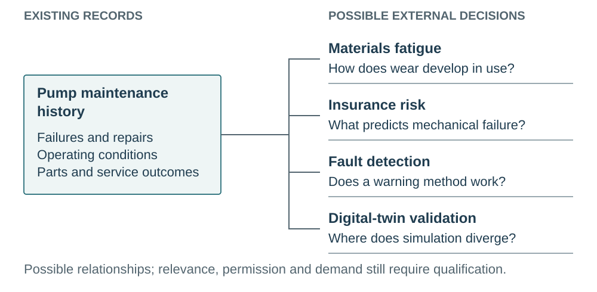

# When Questions Become Markets

AI, Evidence Discovery, and the Financing of New Observations

Brad Pierce

October 18, 2026

[https://doi.org/10.5281/zenodo.23464042](<https://doi.org/10.5281/zenodo.23464042>)

## Abstract

Questions become economically useful through work that makes them answerable, keeps observation capability available and turns findings into usable knowledge. Existing empirical studies show why this work belongs in the service and why its resource use needs to be counted. Howells reports fewer experimental trials, reduced factory wastage and a more informed purchaser in CERAM's work for IKEA. McCarthy and colleagues show farmers interpreting returned drone imagery with extension support. Aggeri and colleagues' platform cases place instruments inside continuing organizational arrangements. These findings inform present choices about what to purchase, maintain and return to participants. This report brings them together with information economics, data-market research, patents and financing precedents to examine an evidence economy and its possible extension through AI. Cheaper discovery could locate evidence that avoids collection, reveal a method that makes another action possible to assess, connect compatible buyers or retain useful work for later inquiries. Qualification, rights, access and continuing support determine the full cost of putting the additional connection to use. The proposed integrated AI service has no deployed-system evaluation or established commercial viability; its added benefit over capable procurement remains unmeasured. Specialists, embedded services, networks, cooperatives and public purchasers can organize different parts of this work. Their choices determine which questions receive resources, which capabilities endure and who controls the next inquiry.

Keywords: evidence services, AI-assisted evidence discovery, observation capability, technical intermediation, engineering procurement, data markets, collective purchasing, observation finance, institutional memory

## EXECUTIVE SUMMARY

The economic unit in this report is a supported ability to answer a consequential question. A data file, an instrument or a promising connection becomes useful through formulation, qualified investigation and interpretation. Existing studies reveal what that work accomplishes and whose resources it uses. They support practical choices in procurement, laboratories and observation networks now. The further possibility is that cheaper AI-assisted discovery makes more such relationships affordable to find and organize.

Howells \[[165](<#reference-165>)\] reports a tangible manufacturing outcome. IKEA brought a problem of high pottery fracture and breakage to CERAM, which connected computational modeling and process and kiln simulation to work with supplier factories. The account reports fewer experimental trials and reduced factory wastage, while IKEA became a more informed purchaser for later commissioning. The customer acquired help improving supplier production and its own ability to ask and assess. Buying that capability is a different choice from purchasing a finished dataset or paying only for an introduction. The report is an exploratory account of practice, without a controlled estimate of savings.

McCarthy and colleagues' \[[138](<#reference-138>)\] work with farmers in Malawi reveals another part of the service. Drone images were returned to farmers, annotated and discussed with extension support. The observations became material for interpreting the land and considering responses, alongside questions about sharing and privacy. The study concerns local understanding and perceived usefulness, rather than a controlled production or financial gain. Its implication for an evidence economy is substantial: returning intelligible information and supporting local interpretation can be part of what makes an observation worth producing.

Usable capability also needs an organization around it. Aggeri, Le Masson, Branciard, Paradeise and Peerbaye's \[[104](<#reference-104>)\] six life-science platform cases show heterogeneous arrangements and performance, with equipment obsolescence among the pressures. An instrument, a currently supported method and a service another party can use are different resources. Buying another machine, keeping a specialist available and opening an existing capability to another inquiry can therefore be different investment choices.

An evidence service includes useful work beyond producing and delivering an observation. Howells's purchaser learning \[[165](<#reference-165>)\], McCarthy and colleagues' returned interpretation \[[138](<#reference-138>)\] and Aggeri and colleagues' supported platforms \[[104](<#reference-104>)\] show valuable work at different points in the relationship. A contract or investment that pays only for the measurement can leave that work unsupported. A purchaser can include formulation and interpretation in its scope; a facility can compare retaining support with adding equipment; a network can return information in a form its contributors can use. These are implications of the synthesis for existing organizations. They remain useful when an AI extension is uneconomical or an incumbent provides the best route.

Engineering procurement already develops questions, finds unfamiliar specialists, commissions feasibility and organizes shared purchasing. These capabilities, and the expertise, permissions and working relationships behind them, are the foundation for the proposed service. A wider discovery arrangement is valuable when it reveals a useful relationship that the best existing route would miss or reach only at greater full cost. It must earn the extra screening, expert attention, qualification and integration it creates. An established specialist may already offer the most economical route; it can also adopt useful discovery tools. A new independent marketplace is one possible organizational outcome.

The hypothetical pump transaction shows what such a connection could change. A manufacturer initially asks whether premature seal wear requires a redesign. A service firm's maintenance records and installed-unit access suggest an investigation linking exterior measurements to an independent assessment of wear. If that relation can be qualified, the manufacturer can compare redesign with a different operating envelope. An equipment operator and a warning developer have different decisions that might use a common measurement core. A laboratory's paid feasibility work determines whether the inquiry is scientifically and operationally possible; separate purchasing commitments and spendable funds determine whether it proceeds. Section 6.1.2 follows both competent procurement and wider discovery through the same transaction. It assumes the suggested connections and demonstrates their consequences without showing an observed advantage for either discovery route.

Four relationships explain how discovery could earn its cost. A qualified historical source or an established method can supply a sufficient answer while avoiding a more expensive collection program. Encountering an unfamiliar capability can make a different action assessable, changing the question worth investigating. An enterprise's maintenance history, failed experiments, development records or instrument observations can therefore matter to organizations its owner has never encountered. The economic gain depends on what those records or capabilities establish for a particular decision.

Connections among buyers can change production economics as well. Compatible needs may share setup and collection while retaining separate outputs, making an acquisition worthwhile after adaptation and coordination are paid for. Work left from one inquiry can also reduce the next: an excluded route need not be rediscovered, a permitted specialist can be reached again, or a qualified method can be adapted within its valid scope. Section 2.3.2 develops these four mechanisms beside the mature procurement practices that already pursue them. Wider reach matters when the additional relationship improves a feasible choice or saves more work than it creates.

Howells's wider study \[[165](<#reference-165>)\] used interviews and documents from 22 organizations and eight subsidiaries. It describes an established productive role for formulation and technical intermediation, with no controlled estimate of its magnitude. McCarthy and colleagues \[[138](<#reference-138>)\] study local understanding and perceived usefulness; Aggeri and colleagues \[[104](<#reference-104>)\] examine historical platforms. Their methods answer different questions. The synthesis uses the reported processes and outcomes to explain how an evidence service works, while reserving quantitative claims about net benefit, transfer and an added AI effect for evidence that can establish them.

The service bought is decision-relevant evidence: a qualified answer, a bounded external evaluation, an historical observation or a newly commissioned experiment. The seller can retain protected underlying material. Acceptance must assess provenance and the authority of the method for the named claim, including a result that contradicts the buyer's preferred hypothesis. A valid adverse answer can fulfill the purchase and prevent another unnecessary test. The service's value lies in helping a decision owner obtain a sufficient answer, including knowing when further investigation is no longer worth buying.

A purchaser can first buy help discovering what observation would answer its concern. Paid formulation and feasibility compare actions and methods, test access and calibration, and produce an authorized specification or a defensible reason to stop. A defined right to commission a later stage can preserve a useful test slot or follow-on scope while that investigation proceeds. The evidence option in Section 2.4 sets out that arrangement; reserving the opportunity guarantees neither a measurement nor a useful result. The observability map in Section 2.5 records who could observe what, under which conditions and permissions, so an unfamiliar lead can be investigated.

The work that continues after an introduction can itself be worth purchasing. Buyers may need renewed specification, comparison among sources, expert interpretation, trusted acceptance, coordination or readiness for the next inquiry. The people, methods and access needed between orders can be supported through internal operations, a portfolio of related purchases, membership or a sponsor. Another possibility is an explicit readiness purchaser who pays to keep the service available between orders. A funded buyer can pay for source finding. An organization with an unformed concern can buy formulation, while a supplier or collective body can support exploration before an individual order exists. These arrangements make different parties responsible for failed leads and ongoing help. Project value, maintained capability and a viable service organization require separate accounts.

People can supply that continuing effort through more than commercial employment. Jansky, Hendl and Nocanda's \[[139](<#reference-139>)\] 28 interviews about patient-led innovation describe agency and peer assistance alongside unpaid work and uneven access. A community can create useful technical capability while participants carry time, learning and support burdens. That contribution belongs in the resource account. A low cash charge can coexist with substantial work, and broad availability of a technical design can coexist with unequal ability to use it.

Discovering demand can change investment through three different paths. An operator with supplied capital can select a better observation program. Compatible customers can support a shared acquisition. A further buyer, lender, investor or public risk bearer can enable a provider that otherwise cannot proceed. The last path requires an actual decision to supply resources: a valuable question, a feasible protocol, an accepted pilot, a signed order and cash available before delivery are different achievements. Funding terms then distribute equipment, scheduling authority, customers and learning. More useful observations can coexist with greater concentration of control or less independent supplier participation.

The purpose of a funding commitment also changes what counts as an achievement. Gavi's \[[129](<#reference-129>)\] mixed-methods evaluation summary reports accelerated pneumococcal-vaccine uptake and expanded supply, while finding no evidence of accelerated new-product R&D. Early shortages, forecasts and price competition complicated the programme. Supporting wider delivery of an available capability can be valuable without establishing faster invention. For an engineering ecosystem, that distinction helps separate purchases of access, maintained readiness, added capacity and new methods. The vaccine findings inform that distinction within their evaluated setting; they provide no engineering return multiplier.

Three forms of retained work can improve later inquiry, and they travel different distances. Search knowledge records useful routes and exclusions. Service relationships preserve a way to reach people, sites and authorized outputs. Qualified methods retain technical procedures whose scope still applies. A useful contact can survive when a method fails to transfer; a method can apply when a new customer's access still needs authorization. The benefit is the work actually saved after permissions, adaptation and refresh. A buyer, supplier, incumbent, cooperative or intermediary may retain it. Repeated transactions alone establish neither accumulation nor a continuing intermediary role.

Different frictions give different institutions a reason to organize these services. A specialist can use tacit operating knowledge; an embedded engineering service can work through existing context and authorization; a neutral evaluator can help parties that distrust one another's claims. Cooperatives can organize fragmented suppliers or shared buyers, while federated arrangements can connect services without one owner controlling all records. Public purchasing can support readiness or questions whose benefits exceed private willingness to pay. Each arrangement must sustain its continuing job and assigns customer access, qualification and learning differently. Hybrid forms are plausible. Purchasable demand can support collective purposes, but the parties can also disagree about whose question deserves a scarce observation window.

The way buyers use the relationship can also matter to capability development. 付翔 and 李勃's \[[167](<#reference-167>)\] 170 valid questionnaires, mainly from medium and large agricultural-machinery manufacturers, associate direct involvement and incentives positively with reported supplier innovation contributions, and competitive pressure negatively. These are associations, rather than causal intervention effects. They give a reason to examine support, incentives and bargaining alongside discovery. A service that finds more suppliers still needs to organize productive work with them; how it does so can affect what capability the relationship leaves behind.

Existing work histories give this argument a further consequence for productive firms. Reported purchases of failed companies' repositories and workplace records reveal interest in requirements, discussions, revisions, tests, failures and decisions. Their salvage value does not establish dependable collateral or the proceeds a lender could realize from a living firm. The more useful opportunity may be to discover authorized uses and recurring customers while the organization can still curate its records, retain interpretive context and provide continuing services. Observation capability includes supported people, methods, access, instruments and stored files.

The precedents establish parts of this account. Satellite tasking and paid field collection supply examples of commissioned observations. Frontier's distinct prepurchase and offtake arrangements \[[67](<#reference-67>), [68](<#reference-68>)\] illustrate different commitments to future delivery. The data-related loans and structured financings reported by the Ministry of Commerce \[[53](<#reference-53>)\], 新华财经 \[[54](<#reference-54>), [55](<#reference-55>)\] and 青岛融资担保集团 \[[56](<#reference-56>)\] expose the importance of repayment and external credit support. Data-market research, information economics, multilingual technical scholarship and patents explain other components. These are credits and bounded precedents for the proposed synthesis; they do not establish a deployed integrated evidence-finance system.

These findings inform choices an engineering organization can make today. A purchasing team can commission help turning a concern into an answerable question and retain what it learns about assessing later suppliers, as Howells's CERAM/IKEA account \[[165](<#reference-165>)\] illustrates. A facility can budget for operators, calibration and available access alongside instruments, using the platform literature to examine what capability it can actually offer. A grower network can arrange returned information and supported interpretation as part of acquisition, following the practical work made visible by McCarthy and colleagues \[[138](<#reference-138>)\]. A funder can distinguish wider use and supply of an available capability from invention, as the vaccine evaluation \[[129](<#reference-129>)\] requires. These are reasoned applications of different empirical findings, not measured effects of introducing the proposed AI system.

The conditional discovery extension builds on that economy. Avoided collection, a newly assessable action, compatible acquisition and retained useful work offer four routes to additional value. Competent contemporary procurement may already supply the best route, and an added service can consume more qualification effort than it saves. The integrated architecture has no deployed-system evaluation or established commercial viability; the research programme tests those specific added benefits and outcomes. The broader economic argument concerns how resources support the work that makes questions answerable. Its consequences include better-informed purchasers, usable facilities, locally meaningful observations and the allocation of power over future inquiry.

Takeaways for decisions today

<table class="comparison" data-source-table="18022" style="width:calc(100% - 1pt)"><colgroup><col style="width:40.598290598290596%"/><col style="width:29.700854700854702%"/><col style="width:29.700854700854702%"/></colgroup><thead><tr><th scope="col">
Grounding in the paper
</th><th scope="col">
Use in present decisions
</th><th scope="col">
Broader importance
</th></tr></thead><tbody><tr><td>
Howells's CERAM/IKEA account reports fewer trials, reduced wastage and improved purchasing competence after specialist modeling and factory work; it supplies no controlled savings estimate [<a href="#reference-165">165</a>].
</td><td>
Include help developing an answerable question and assessing the resulting work in the purchase.
</td><td>
An investigation can leave the purchaser better able to commission the next inquiry.
</td></tr><tr><td>
Aggeri and colleagues' six life-science platform cases place instruments within differing continuing organizational arrangements [<a href="#reference-104">104</a>].
</td><td>
Assess people, supported methods, maintenance and access alongside equipment when judging what capability is actually available.
</td><td>
Installed equipment and an enduring ability to answer questions are different achievements.
</td></tr><tr><td>
McCarthy and colleagues describe farmers in Malawi annotating and discussing returned drone imagery with extension support; the findings concern understanding and perceived usefulness [<a href="#reference-138">138</a>].
</td><td>
Include intelligible returned information and supported interpretation in the service and its resource account.
</td><td>
People supplying observations can also gain knowledge they can use in their own setting.
</td></tr><tr><td>
Whittard and colleagues distinguish private returns from wider benefits in an Ethiopian soil-health case [<a href="#reference-31">31</a>]. Jansky, Hendl and Nocanda document peer support, unpaid work and uneven access in patient-led innovation [<a href="#reference-139">139</a>].
</td><td>
Count participants' effort and the cost of keeping a capability available alongside receipts and private returns.
</td><td>
Private returns, participants' benefits and public purposes can justify different choices about the same activity. The resources it consumes still count.
</td></tr><tr><td>
The paper's synthesis connects existing evidence services to possible AI-assisted relationships among questions, sources, methods and buyers. Added benefit over capable procurement remains unmeasured.
</td><td>
Use the distinctions to scope services, account for full resource costs and compare available ways to obtain a sufficient answer.
</td><td>
Cheaper discovery could change which questions become investigable and who controls the next inquiry; the institutional outcome remains open.
</td></tr></tbody></table>

## 1 The hidden economy of questions and evidence

A peculiar kind of wealth is scattered throughout the economy. It's in the histories of machines, the records of experiments that failed, the maintenance logs of fleets, the measurements taken in factories, and the operational files kept for reasons that had nothing to do with selling information. Much of it has never been treated as a product. Often, its owners have no idea who else might find it valuable.

A buyer's problem can already set such a relationship in motion. Howells \[[165](<#reference-165>)\] describes IKEA bringing a problem of high pottery fracture and breakage to CERAM. The investigation involved modeling, process and kiln simulation, and work with supplier factories. In the reported account, fewer experimental trials and reduced wastage followed. IKEA also became a more informed purchaser. The relationship brought together a question, specialist methods and knowledge of production conditions. It supplied both an investigation and a stronger ability to commission later work. Those outputs matter economically even when no new standalone market or AI service is involved.

Other settings reveal further parts of that productive system. Life-science platform cases show equipment embedded in organizations with different support and governance arrangements; returned drone imagery in Malawi was interpreted with the farmers whose land it described \[[104](<#reference-104>), [138](<#reference-138>)\]. The evidence economy includes the people, recurring work and local purposes through which observations become useful. Those relationships provide a grounded starting point for considering how cheaper discovery could extend their reach.

The usual description of the AI economy starts with what intelligence will do to work: cheaper analysis, faster design, more automation, and a growing supply of plausible answers. Another transformation may be taking shape on the other side of the question. AI could make it possible to discover what the world already knows, where that knowledge is trapped, and who would pay to put it to use.

The largest opportunity might not be a better way to sell data. It could be the discovery of entirely new economic relationships among organizations that never knew they had something useful to exchange.

That gap is already a subject of serious research. In 2020, Raul Castro Fernandez, Pranav Subramaniam, and Michael J. Franklin proposed data-market platforms that help owners discover who needs their information and buyers discover what information is available. The central obstacle wasn't simply storage. It was the absence of shared knowledge about demand and supply, alongside weak incentives to prepare data for someone else \[[14](<#reference-14>)\]. This report builds on that foundation to ask what changes when AI makes discovery and interpretation cheaper, when the product is a decision-relevant evaluation, and when a buyer can commission observations that don't yet exist.

Economics already has names for several pieces of this problem. Transaction-cost economics explains why finding, negotiating, and governing an exchange can cost more than the exchange is worth \[[1](<#reference-1>)\]. Information economics studies what can be sold when the product is knowledge and its buyer can't inspect it like a pump or a car \[[2](<#reference-2>)\]. The possibility here is that AI changes several of those costs together. Finding a useful counterpart, interpreting unfamiliar records, and designing an acceptable transaction may all become less expensive. Exchanges that once weren't worth anyone's attention could become practical.

### 1.1 An economy organized around answerable questions

An evidence economy supports the work that makes a consequential uncertainty answerable and an answer useful. The empirical studies show what work belongs in that account. Howells's CERAM/IKEA episode includes reduced trials and wastage and purchaser learning; Aggeri and colleagues' cases place equipment within continuing organizational arrangements; McCarthy and colleagues' Malawi process includes returned information and local interpretation \[[104](<#reference-104>), [138](<#reference-138>), [165](<#reference-165>)\]. A service can improve a customer's ability to investigate, maintain access to a method or give participants a useful understanding of their own setting. Paying only for a file or counting only installations can miss those contributions and the work needed to sustain them.

An evidence economy links consequential uncertainty to the people and organizations able to investigate it. AI can assist by translating a concern into another field's vocabulary, finding an unfamiliar observer, comparing candidate methods or relating purchasers' needs. The economic possibility follows from a changed choice. An adequate historical source can avoid an expensive experiment. An unfamiliar method can make another action assessable. Compatible buyers can support one acquisition whose separate production would cost more. Useful work can remain for subsequent inquiries. A connection becomes productive when those consequences justify the work of qualifying and organizing it. Section 2.3.2 develops the four routes; the cases show how scientific, contractual and resource requirements determine which possibility survives.

Engineering procurement already organizes this kind of inquiry. A capable team can challenge the initial question, follow referrals to an unfamiliar laboratory, commission research, share an acquisition and use contemporary AI tools. Its tacit context, trusted responsibility and working access can make this the economical route. The hypothesis concerns the useful reach of that work: whether an added discovery service makes a consequential relationship affordable to find and organize, or supplies an adequate answer with fewer total resources. The incumbent can make the same connection or adopt the same tools. A demonstrated improvement in the function would still leave open which organization captures it and whether a separate intermediary can sustain a business.

The useful unit is an evidence service linked to a decision, with a documented source, authority for that specific decision, explicit permitted uses, a price and a way to determine fulfillment. Historical files are one source. Continuous instruments, laboratory experiments, service organizations, field workers and independent engineering evaluators are others. A supplier can deliver a small result from an enormous private corpus; a buyer can fund an experiment without receiving a copy of the underlying data. The transaction pays for what the qualified result can establish under the agreed conditions.

This report follows that productive work from unrecognized observations through demand discovery, semantic matching, independent evaluation, contracting, new measurements, financing and repeated learning. The central resource question is what makes an investigation possible and leaves people able to undertake the next one. It also follows the relationships backward through bankruptcy. Private repositories and work histories now have salvage value for AI training after their companies cease operating. Financing asks whether part of that previously invisible value can become productive capital sooner, while the company can improve instruments, continue measurements and meet unexpected customer needs. The empirical synthesis, proposed arrangements and evaluation designs address different parts of this account.

Data-market research, information economics, procurement studies, field investigations and patents illuminate different parts of this economy. Academic research and patents describe many of the technical ingredients \[[14](<#reference-14>), [32](<#reference-32>), [33](<#reference-33>), [69](<#reference-69>)\]. IBM's autonomous agents supply a discovery precedent, TEEDA supplies request-to-data design, and buyer-specific experimental acquisition supplies a budgeted selection method \[[32](<#reference-32>), [69](<#reference-69>), [96](<#reference-96>)\]. Local studies explain how people formulate, support and use the resulting services. These contributions belong together because a useful answer depends on their interaction.

The existing literature helps an organization identify who develops the question, who keeps observation capability available, which uses are authorized and why people continue to participate. Those responsibilities shape what it can investigate and what remains available for its next inquiry. The proposed extension links wider discovery to paid feasibility work, acceptance of evidence for a specified claim, funds available to spend and the ability to keep making observations. Its incremental benefit over competent contemporary procurement remains unmeasured. The architecture and tests below examine particular future arrangements within that broader empirical and conceptual account.

Consider a measurement campaign that no single customer can justify. Discovering other buyers changes the possible scale of demand. Establishing that their required timing, observation conditions, permitted uses and acceptance rules fit a common core makes shared production meaningful. Their commitments can then make that program worthwhile to each participant after separate adaptation and coordination. Obtaining spendable funds before delivery remains another problem, potentially requiring the operator's own resources or a further willing risk bearer. Discovery has changed the organization of a feasible inquiry even though it has not removed every constraint. The physical transaction in Section 6.1.2 follows those consequences through scientific qualification, customer commitments and the operator's investment decision.

A useful relationship can leave several kinds of work available for the next question. Search knowledge can record which paths to try or exclude. A service relationship can preserve a route into a site or evaluation environment. A qualified technical method can save setup within its supported scope. Each needs different permissions and refresh; none makes the new claim authoritative by itself. Continuing specification, source comparison, interpretation or coordination can remain worth buying after the introduction. Staff, methods and access can be supported through internal work, related customers or an explicit readiness purchaser. These productive arrangements help explain which institutions can sustain the service and retain its learning.

The claims have different dependencies. The base claim concerns additional economically useful evidence relationships. New collection is one possible consequence when existing evidence is insufficient. Investment is a further possibility when resources and retained benefits justify capability. Cumulative technical capital requires useful methods and learning to survive at tolerable upkeep cost. An earlier achievement can be worthwhile without establishing a later one. This is a hierarchy of claims, not a compulsory operational sequence: a sponsor can fund exploration before a purchase, and a new capability can change the question.

Figure 1 maps these distinct claims and their separate conditions for additional evidence relationships. The empirical account also informs choices about the work organizations already purchase and support, including cases where no additional discovery service is needed.

Figure 1. An economically useful evidence relationship can end with an answer, confirmation or a justified decision not to collect. New observations, actual investment, additional usable capacity and retained learning are further claims with separate conditions. These are not compulsory stages; exploration can be funded before an order.

Three kinds of statements recur. A documented transaction tells us what parties actually bought, paid, issued, or delivered. A patent or paper can disclose a technical design, mathematical model, embodiment, simulation, or experiment without establishing that a commercial organization deployed the whole system. A proposed architecture describes an executable direction for future engineering and market design. The distinction lets us think expansively and state evidence precisely.

Tomašev, Franklin, Kasirzadeh, Natarajan, Karthikesalingam, Krier and Osindero \[[99](<#reference-99>)\] develop a related vision of agentic economies for scientific discovery, bringing research agents, scarce resources and institutional coordination into the same discussion. Their proposal helps make the larger opportunity intelligible: scientific work depends on generating ideas and on organizing access to people, instruments, information and funding. The evidence services examined here draw on that intellectual landscape and on the more established traditions developed below. A useful guide should connect these traditions while keeping the difference between an architectural proposal and an observed institutional result clear.

Two discovery routes feed the same process. An owner can identify possible outside uses of existing records or unexercised capabilities; a buyer can begin with an expensive unanswered question. Neither route immediately establishes an order. Paid feasibility work may be needed to specify what would count as sufficient evidence, which observation could provide it, and whether a permitted supplier can deliver affordably. After independent acceptance and payment, authorized feedback can improve later routing. Only credible commitments and an actual funding decision turn this learning into investment in new observation capacity.

These relationships can alter the industrial role of familiar participants. An equipment specialist may hold a measurement capability a larger customer needs; a farmer cooperative may organize regional observations; a laboratory may evaluate claims across several industries. A provider can retain useful routing knowledge without owning an exclusive dataset. Where accepted delivery history, permitted rights and credible receipts support underwriting, a willing financier can help sustain or expand the service. Participants can remain separate, with different control over observations, qualification, customers and funding. A productive connection supplies a reason to coordinate them, while leaving their institutional arrangement open.

The deepest issue is who captures the value. Discovery and matchmaking can confer market power, and a platform may control pricing information accumulated from suppliers' work. Neutral intermediaries, federated networks, data trusts, direct owner-operated services, and cooperative purchasing arrangements distribute bargaining power differently. A successful market must preserve truthfulness, lawful rights, adequate supplier returns, and local capacity to create evidence, not just maximize completed trades.

The practical thesis does not require data prices to rise universally. Cheap computation can erode the value of some records and simulations can substitute for some measurements. Where independent observation still changes a consequential decision, value can concentrate in access, provenance, qualified methods and reliable delivery. Buyers and funders can expand those capabilities through paid demand; the AI system assists with discovery and coordination.

### 1.2 The value you don't know you own

Imagine a company that has serviced industrial pumps for thirty years. It has records of failures, unusual vibrations, repairs, operating conditions, replacement parts, and service outcomes. Those records exist because the company needed to keep pumps running. Their immediate value is internal.

A materials researcher might need exactly those observations to understand how fatigue develops outside the laboratory. An insurer might want better evidence about mechanical failure rates. A robotics company might use them to evaluate fault-detection software. A manufacturer of digital twins might discover where simulated degradation diverges from physical experience. None of these organizations necessarily knows the service company exists as a potential source of evidence.

The owner has no reason to recognize these customers either. Its personnel think in terms of pumps and repairs. Its potential buyers think in terms of risks, material behavior, or model validity. The economic relationship lies between their existing vocabularies, budgets, and business models.

Figure 2. Maintenance records can connect otherwise separated decisions. These illustrative relationships require qualification of relevance, permissions and demand; they are not completed purchases or grants of access.

AI could help interpret both sides at once: the questions someone wants answered and the observations someone else possesses. It could make a connection affordable to investigate beyond a catalog's categories or a sales department's established customer relationships. An engineer, research intermediary or supplier network can also find that connection. The useful difference is the inquiry it makes possible or the full work it saves, as Section 2.3 develops.

清水たくみ、早矢仕晃章 and colleagues \[[15](<#reference-15>)\] studied that connection directly, analyzing relationships among datasets on a trading platform. They found that common variables such as time and place help connect records from different domains and that data networks can be locally dense yet only weakly connected across industries. A dataset that bridges two otherwise separated clusters may be useful for reasons its owner can't see from within either cluster. A 2023 experiment by 早矢仕晃章 and colleagues \[[16](<#reference-16>)\] went a level deeper: they studied how seeing a catalog description or actual data affects a prospective user's evaluation of an unfamiliar source. For a practical marketplace, the challenge isn't just retrieving records. It's supplying enough trustworthy context to let a buyer judge their relevance without requiring every potential buyer to become an expert in every supplier's field.

Recognizing the value of unfamiliar information is itself an organizational capability. Cohen and Levinthal \[[3](<#reference-3>)\] called the ability to recognize, assimilate, and apply external knowledge absorptive capacity. Shane \[[4](<#reference-4>)\] found that entrepreneurs exposed to the same invention discovered different opportunities because they brought different prior knowledge. AI could expand the effective range of knowledge available to a company trying to understand both its own assets and other people's problems. It wouldn't eliminate the need for domain experts: a plausible match still has to survive the actual measurement context, sampling conditions, units, process constraints, and decision it is supposed to improve.

### 1.3 Value lives in a decision, not in a file

A dataset isn't economically valuable simply because it's large, proprietary, or difficult to collect. It becomes commercially interesting when someone can use it to make a better decision, reduce uncertainty, avoid an expensive mistake, or accomplish something previously out of reach.

A distinction developed in When Design Exploration Gets Cheap \[[12](<#reference-12>)\] helps here: stored information isn't automatically retained productive capability. Technical capital forms when context, methods, evidence, and experience can improve future work. Thirty years of maintenance records may contain valuable observations yet remain economically inert if nobody can interpret them for an unfamiliar problem. AI might help supply that missing connection, linking an owner's records, qualified means of interpretation, and a buyer's consequential decision. The owner might participate without having to become a data-products company.

This changes how we'd search for opportunities. Instead of beginning with a warehouse and asking what price its contents might fetch, we could begin with a decision whose uncertainty is costly. What would it be worth to know whether a factory process will remain stable? To identify a rare failure mechanism before a fleet is deployed? To distinguish a genuinely superior material from a convincing laboratory artifact?

Only then do we search for the evidence. The buyer may need a few high-quality observations, not a billion rows. One unusually authoritative measurement might be worth more than an enormous pile of conveniently available data. A negative experimental result may be priceless if it prevents years of pursuing an impossible path.

There's a complementary route in the other direction. An AI working for a data owner could examine the provenance and meaning of its records, infer classes of external questions they might resolve, identify potential buyers, and estimate the value of small pilot transactions. The owner would no longer have to imagine every application before anyone could discover it.

The owner may not even know which types of information are in demand. In a 2024 survey of 73 staff members in Saudi Arabia's Ministry of Education, مشاعل بنت محمد الغرير and مها بنت صالح العمود \[[24](<#reference-24>)\] identified knowledge of market demand, specialist skills, clear policies, and protection requirements among the conditions affecting data commercialization. Work by Can Azkan and colleagues \[[19](<#reference-19>)\] likewise treats incentives, organizational readiness, valuation, and licensing as practical parts of data sharing. These are business capabilities, not properties of a file format. An AI may help discover demand, but it can't turn incomplete records or unclear rights into valuable capital by declaration.

Research by 蔡思航 and 翁翕 \[[5](<#reference-5>)\] on data as a factor of production develops a closely related perspective. They emphasize that data is often a byproduct of other activity and that combining data with complementary resources can create increasing returns. The pump records illustrate the byproduct problem: their first purpose was keeping equipment working, yet their next use may arise elsewhere. 张明、路先锋、吴雨桐 \[[6](<#reference-6>)\] examine data's nonrivalry, uncertain and changing value, and spillovers, alongside the institutions for assigning rights, setting prices, and arranging exchanges. The same records may have little commercial value in isolation, considerable value in combination, and different legitimate uses under different rights. In engineering terms, context and permission are part of the asset, not metadata to discard during export.

### 1.4 How a buyer compares evidence

Data value has several distinct measures. Recreation cost estimates what collecting comparable data would cost. Book value follows a specific accounting convention. A distressed auction records bids from the buyers present under time pressure. Replacement value depends on substitutes. Decision value measures how buying evidence changes the expected consequences of a specific choice. Public value includes spillovers and benefits outside the buyer's ledger. These numbers need not agree.

For a technical buyer, take a set of available actions D, uncertain states S, and utility U(d,s). The gross value of information E is the expected advantage of choosing the best action after seeing E, compared with choosing without E. Subtract the cost of obtaining, interpreting, validating, integrating and waiting for E to obtain its net value. An engineering team doesn't need a formal probability model for every purchase, but it must know which decision the requested evidence will affect and which alternatives it is comparing. Wider discovery can change the comparison in different ways. It can find another sufficient source for the existing question. Or it can reveal an action absent from the initial formulation. In that case, the decision owner must reconsider what question is worth investigating. Neither a cheaper search nor a more interesting question establishes that the resulting inquiry is worth its full cost.

This explains why a few authoritative observations can be worth more than a vast dataset and why a negative experimental result can be enormously valuable. A test that convincingly invalidates an expensive development direction is successful evidence production. A service paid only when it generates a favored answer will create incentives to select, manipulate, or conceal results. The transaction must reward protocol-conformant observation, not the desirability of the conclusion.

The buyer should compare at least five options: make no further measurement; use existing internal evidence; purchase a cheap estimate or simulation; ask an independent party to evaluate the question using its protected data; or commission a new observation. Every option has costs, time, rights requirements and authority for the target decision. Pierce’s \[[12](<#reference-12>)\] account of evaluator economics supplies a disciplined approach to selecting the least costly sufficient source and recognizing when another test no longer justifies its cost.

The comparison starts with the best feasible course a capable buyer could arrange through procurement. That includes the buyer's existing relationships, internal evidence, specialist advice and ability to commission a feasibility study. Compare resources and expected consequences from the same initial concern. Where required, count the work of formulating the question, using models, consulting experts, pursuing unsuccessful leads, obtaining permissions, qualifying methods and suppliers, integrating results, physically collecting observations, waiting and providing continuing support. Keep the buyer's spending account separate from the joint resource account, which counts resources used across the transaction. A service fee is an expense to the purchaser and a receipt to the provider; count the labor and other inputs it pays for once in the joint account. Work still consumes resources when it comes from an existing budget or has no separate invoice. Public benefits beyond the buyer's decision need their own stated assessment and a party willing to support the work.

Patents already address buyer-relative evaluation. A Huawei patent application by 古西姆兰·辛格 and colleagues \[[37](<#reference-37>)\] describes a privacy-aware way to test candidate seller datasets for a buyer's machine-learning task before acquisition. Goel and Cushman's patent application \[[40](<#reference-40>)\], assigned to Collibra, addresses matching missing customer attributes with outside sources. Patent applications by 刘登涛 and colleagues \[[39](<#reference-39>)\], Zhang and colleagues \[[46](<#reference-46>)\], and 姚建国 and colleagues \[[47](<#reference-47>)\] describe private probing, demand-related price adjustments and accounting for the marginal contributions of providers. These are intellectual resources for building an interface between commercial demand and evidence quality, not evidence that any single product is a mature global market.

Evaluation itself changes bargaining power. A public benchmark can leak the buyer's strategic target or tell the buyer enough to avoid purchasing. A seller can overfit a sample to the buyer's test. A neutral evaluator can accidentally reveal details about a confidential process. Zheng, Tian and Li \[[71](<#reference-71>)\] model the consequences of giving buyers more opportunity to evaluate data: reducing uncertainty may facilitate transactions and still reduce the surplus retained by certain high-quality sellers. An evaluation protocol is a commercial institution as much as a technical tool.

Nonrivalry gives historical data special economics. The same authentic observation can inform different users without being consumed. But an observation opportunity can be rival: instruments, test vehicles, production runs, human expertise and calendar windows are finite. A market licensing completed information has a different supply curve from a market scheduling new measurements. Work by Jones and Tonetti and by 张明 and colleagues helps explain the value of combining nonrival records with rival instruments, organization-specific access, and scarce expertise \[[6](<#reference-6>), [11](<#reference-11>)\].

The seller's choice includes selling a copy, licensing a purpose-limited use, releasing a bounded evaluation, granting time-limited exclusivity, and selling a continuing observation subscription. Each has a distinct effect on future pricing and on the owner's retained economic options. A practical evidence market needs a portfolio of contracts and pricing instruments, not a universal price per row.

## 2 Discovering what can be observed

### 2.1 A market in questions

Today's data markets tend to be organized around identifiable datasets, providers, subscriptions, and licenses. A more ambitious future market might be organized around questions.

The product sold might differ from one transaction to the next. Bergemann and Bonatti \[[2](<#reference-2>)\] distinguish selling an information structure in advance from selling a particular realization of information afterward. For a technical buyer, that is approximately the difference between purchasing access to a testing capability and purchasing a defined test result. An evidence marketplace might offer one-off outcomes, recurring measurement services, evaluated predictions, or permission to conduct specified analyses. The distinction affects prices, incentives, and the capital required to keep supplying useful results.

A buyer could describe an expensive uncertainty: “We need to know whether this model predicts failure in these operating conditions.” Market-making software could search for relevant evidence across organizations, negotiate a permitted evaluation, and arrange for a result that helps the buyer decide. In some cases the transaction would involve the data. In others, it would involve an answer, a confidence interval, a verdict, a benchmark result, a feed, or an observation commissioned for the purpose.

The seller would not always be an information company. It might be a mine operator, a logistics firm, a laboratory, a hospital, a repair contractor, a retailer, or the operator of a machine with an unusual view of the world.

Pierce’s \[[12](<#reference-12>)\] account of evaluator economics asks which evidence is worth obtaining next, how much authority it has for the particular question, when stronger evidence justifies its added cost, and when to stop. An AI-mediated evidence market could extend that reasoning across organizational boundaries. A buyer might compare an inexpensive prediction, a laboratory result, a decade of field failures, and a newly commissioned measurement. These aren't simply points on a universal ladder of truth. They answer different questions, rest on different assumptions, and have different costs and consequences.

The market's unit of value could be a justified improvement in a particular decision, not an undifferentiated quantity of data. Discovering a source would be only the beginning. A useful intermediary would also need to establish that the source could answer the right question with sufficient authority, and decide when buying additional evidence no longer made economic sense.

That market would require more than semantic search. The parties would need to agree on what question is actually being asked, which evidence is relevant, how trustworthy it is, who has the right to use it, which results can be released, and what counts as fulfillment of the agreement. But the economic significance of these obstacles is itself part of the hypothesis. If AI substantially reduces the cost of handling them, transactions too small or obscure to justify today might become routine.

Market design research is a useful guide to what would have to work. Roth \[[7](<#reference-7>)\] emphasizes attracting enough participants, preventing the burden of too many possible matches from overwhelming them, and making participation sufficiently safe and simple. An AI search engine can't rescue a market whose best evidence suppliers won't join or whose contract negotiations cost more than the answers. In a review originally published in 2021, 熊巧琴 and 汤珂 \[[8](<#reference-8>)\] examine how rights, differing buyers, product differentiation, trading arrangements, and pricing interact in markets for data. The implication for our proposed market is practical: a universal price per record is unlikely to describe the value of evidence that answers different questions for different buyers.

Cheaper candidate generation can make specialist attention the limiting resource. In the proposed service, AI can contribute by finding a rare useful route, rejecting impossible routes cheaply, or making a promising route easier to qualify. More plausible leads can instead consume the time needed to evaluate the best ones. Broad search is attractive where overlooked relationships matter and inexpensive exclusions are available. Where access and contextual validation dominate, a narrower specialist route may remain economical. Retrieval quality and the economics of the full inquiry are different achievements.

The technical groundwork for certain protected transactions already exists. My separate documentary report, External Analysis of Protected Data, surveys established approaches for controlled computation and release of bounded results across organizational boundaries \[[13](<#reference-13>)\]. That report describes current practice. The conjecture here concerns the new economic relationships that widespread, low-cost discovery and coordination could make possible.

The market also has to cover the cost of its continuing work. The datos.gob.es guide on data-space business models distinguishes arrangements for sharing costs, joint innovation that no participant can achieve alone, and joint action to prevent a dominant intermediary \[[22](<#reference-22>)\]. Plattform Industrie 4.0's industrial-data study distinguishes data platforms, pools, and decentralized spaces, and warns that smaller companies face substantial entry barriers even when the foundations for sharing exist \[[20](<#reference-20>)\]. Fraunhofer's Next Generation Dataspaces research is exploring LLM-based and semantic methods to connect data spaces isolated within sectors \[[21](<#reference-21>)\]. Those are real research and institutional responses, not evidence that cross-sector market-making has been solved. They reinforce a useful design principle: start from a decision and a paying participant, then determine which coordination mechanism is justified.

Lu et al. \[[96](<#reference-96>)\] directly connect data-market acquisition to experimental design. Their federated method chooses seller data to improve a buyer’s particular test-query predictions under a budget, rather than assigning one universal value to a dataset. This is a computational acquisition method for available data. Paying to establish whether a new physical observation is possible, and financing the instruments that produce it, remain distinct design problems.

Questions and sources can develop together. Eric von Hippel and Sandro Kaulartz \[[97](<#reference-97>)\] used machine-learning search to find early need–solution pairs in web material about kiteboarding: users had already connected a problem with a possible way to address it, before it became an established product category. Kathrin Reinsberger, Vegard Kolbjørnsrud and Barbara Mehner \[[98](<#reference-98>)\], studying four exploratory projects involving 18 searchers, describe deliberate practices for discovering and developing such pairs. These studies make the search process richer than matching a fixed query to a fixed catalog. A buyer can learn what to ask through encountering an unfamiliar capability, and a supplier can learn what its capability is useful for through working on a buyer’s concern.

For an evidence service, the practical implication is to preserve the question’s development. Record which new method, observation or proposed action caused it to change, and whether the revised question still has an accountable decision owner. The kiteboarding case and exploratory projects illuminate discovery and learning; they do not establish that a new physical quantity can be measured or that anyone will finance the instrument. Those are subsequent empirical and contractual questions. Keeping the stages distinct lets us give discovery research its full credit without asking it to demonstrate an entire future market.

### 2.2 What the owner can measure

A conventional inventory answers where information resides. An economically useful inventory answers what it is evidence of, which decisions it can help settle, what additional work could qualify it, and which transactions are permitted. A storage administrator's classification of a log as pump maintenance says little about its utility to a materials scientist. A machine identifier without configuration history can invalidate a longitudinal failure analysis; a rare sample without a sampling frame can be less useful than a broad imperfect population.

A practical source profile needs to describe the observed physical process and original collection purpose. It should record units, instrument configuration, calibration, sampling frame, time window, missingness, intervention history, known confounders, transformation history and provenance. It should also record rights, permitted outputs, previous evaluations and the ability to repeat the observation. The profile needs a description of what the owner can legitimately authorize. Possessing a copy of a customer record is not the same thing as possessing the right to sublicense its contents.

Add a second inventory: measurements that an organization can make but has never made. A factory can alter a test sequence; a service firm can mount new sensors; a farm cooperative can standardize field observations; a satellite operator can task a different region; an EDA provider can arrange an approved benchmark with source code remaining inside its owner's boundary. A capability profile describes measurable variables, operating conditions, achievable fidelity, incremental cost, lead time, equipment availability, and likelihood of successful performance.

This second inventory is a bridge from selling static archives to making evidence. An active sourcing team can investigate an unfamiliar operator and discover that its machine or field setting can test a hypothesis. Such work may cross sector boundaries and technical vocabularies, drawing on catalogs, specialist advice and relationships. The proposed AI interface could help extend the affordable reach of that work by connecting a buyer's scientific or engineering question with additional physical capabilities. To pass the economic test, the AI-assisted route must find useful additional relationships or save sufficient resources compared with competent procurement. The comparison must count search, qualification and use. Section 2.3 develops both the established practice and the conditional increment.

Data Jackets research from 大澤幸生, 早矢仕晃章, 清水たくみ and colleagues describes metadata as a way to match data needs and available resources across domains without indiscriminate disclosure. Work on cross-domain data-network bridges and user-context-sensitive data selection provides important foundations \[[15](<#reference-15>), [16](<#reference-16>)\]. A data source connecting otherwise separate industrial domains has value that may be invisible to participants within either domain. The same is true of an operator's ability to perform an observation neither domain realizes is feasible.

A source profile is not a quality certificate. A rational market advances through inexpensive descriptive matching, provenance and permission screening, limited relevance tests, more demanding evaluation, and a real purchase or commissioned observation only when the buyer's decision justifies it. Exhaustively cleaning every unused archive in advance would squander money. Qualifying a source against a live question gives the process a stopping rule.

Small enterprises often lack the organizational skills to perform these steps. Work by Can Azkan and colleagues on sharing incentives, the datos.gob.es data-space guide, and the study by مشاعل بنت محمد الغرير and مها بنت صالح العمود identify governance, commercial demand knowledge, specialist skills, and participation costs as practical barriers \[[19](<#reference-19>), [22](<#reference-22>), [24](<#reference-24>)\]. Good intermediation therefore includes help with descriptions, provenance, contracts, and measurement protocols. It should enable an equipment contractor to sell a qualified result without transforming that contractor into a full-service AI vendor.

Research-facility studies show why an inventory must describe an operating service. In a university equipment-use analysis drawing on 393 expert-network responses, 伊藤裕子 \[[105](<#reference-105>)\] identified difficulties obtaining information about facilities, arranging their use and finding specialist support. 이찬구 and colleagues \[[108](<#reference-108>)\] likewise distinguish equipment that can in principle be shared from arrangements ready to provide a shared service, with maintenance, staffing and fee questions still to resolve. A catalog entry can make an instrument visible while leaving an outside customer unable to obtain a timely, interpretable measurement. For a small supplier, intermediation may therefore be most useful when it makes these ordinary operating arrangements possible.

Discovery also inherits structural bias. If the platform searches only English descriptions and cloud-native schemas, it misses local laboratories, smaller manufacturers, farmer organizations, and research institutions with different metadata conventions. A multilingual evidence market needs original-language retrieval, recorded translation uncertainty, local representation and deliberate measures against treating absent metadata as absent productive capacity.

### 2.3 From an unanswered question to an observation that can be ordered

A consequential uncertainty is not yet a procurement specification. A manufacturer may know that an unexplained failure is expensive without knowing whether it needs an old service record, a different instrument, a controlled laboratory experiment or a longer period of field observation. Asking a language model to find “fatigue data” can return relevant words while leaving the decisive engineering question unanswered. Before the market can buy an observation, somebody may have to discover what observation would count.

#### 2.3.1 Competent procurement already develops the question

Competent engineering procurement can begin at precisely this point. The responsible team can investigate a failure, compare explanations, consult an unfamiliar specialist, commission contract research and revise the proposed measurement as it learns. Supplier development can improve a provider's ability to deliver the needed work; qualification establishes what can be relied upon under the relevant conditions. Contracts can assign permitted uses, acceptance, payment and responsibility for an unsuccessful attempt. Purchasing groups and public or member bodies can organize an inquiry whose benefits extend beyond one buyer. These are productive capabilities of established procurement, engineering and research organizations. A fixed product catalog is only one instrument they may use. Their expertise and relationships belong in the starting comparison, together with the authority and resources needed to investigate.

Jeremy Howells's \[[165](<#reference-165>)\] account of CERAM's work for IKEA begins with pottery that fractured and broke too often. The customer brought the problem to a ceramics specialist. CERAM connected computational modeling and process and kiln simulation with work in the supplier factories. Howells reports accurate prediction of thermal and mechanical performance, fewer experimental trials before production and reduced factory wastage; he also describes IKEA becoming a more informed purchaser for later commissioning. The wider study used interviews and documents from 22 organizations and eight subsidiaries. These are exploratory accounts of reported practice, without a controlled estimate of project benefit or cost.

The sequence matters economically. A concern about breakage did not arrive as a complete specification for a dataset. The investigation had to connect the customer's problem to methods and production conditions that could make it answerable. Helping the customer understand what to ask and how to assess a supplier was part of the productive service. The relationship could leave a more capable purchaser after the immediate investigation. That possibility is relevant to an organization choosing between buying a result, buying interpretation and maintaining an ability to investigate a changing class of problems.

Howells \[[165](<#reference-165>)\] also describes LGC advising clients on analytical needs and measurement improvements, and Oakland mapping external research capabilities against a client's own gaps. Those examples give question formulation and intermediation an established organizational history. The proposed AI extension concerns how widely and affordably such connections can be found and prepared. An AI service would still need the specialist work that gives a connection scientific and operational meaning; finding a description of CERAM would not reproduce CERAM's work. Existing procurement may already supply the best route, or may itself use discovery tools to extend its reach.

Jeffrey Dyer and Kentaro Nobeoka's \[[166](<#reference-166>)\] Toyota study shows how much a mature supplier relationship can contain. Interviews, supplier surveys and archival records describe consulting teams, supplier associations and learning groups that support joint problem solving and knowledge transfer. Suppliers receiving assistance showed faster improvement in the reported project records. Transferring practical production knowledge nevertheless required substantial time and close involvement, supported by Toyota's resources and participation rules. This field study makes a strong incumbent advantage intelligible: an introduction to a supplier cannot reproduce an established route for learning and acting together. It does not estimate the advantage of a discovery service.

How a purchaser develops the relationship also matters. 付翔 and 李勃 \[[167](<#reference-167>)\] analyzed 170 valid questionnaires, mainly from medium and large agricultural-machinery manufacturers. Direct involvement and incentives were positively associated with reported supplier innovation contributions, while competitive pressure was negatively associated; combinations of practices differed as well. Direct involvement included site assistance, training, equipment and joint problem solving. These are reported associations in the studied relationships, rather than a causal estimate of an intervention or a finding representative of every supplier.

This gives substance to the work after counterpart discovery. A buyer can help a supplier become able to contribute, reward a longer relationship or place it under competitive pressure. Those choices use purchasing power differently and may have different implications for the capability the buyer hopes to obtain. For an evidence service, the practical implication is to include qualification, support and the terms of continued participation in the production account. A larger list of possible suppliers can increase choice while leaving that work undone. The associations direct attention to the relationship; they do not establish which package a new domain should adopt.

Shared purchasing has equally substantial antecedents. Jean Nollet and Martin Beaulieu \[[168](<#reference-168>)\], drawing on 73 in-depth interviews, mostly in healthcare procurement and including Quebec purchasing groups, examine purchasing groups as part of a procurement strategy. Their account includes access to specialist purchasing personnel and exchanges among members, alongside price and administrative benefits. It also describes effort to maintain cohesion, differing member needs, confidentiality and the autonomy given up through common arrangements. The mechanism is richer than adding several expressions of interest. An existing group may already supply expertise, decision processes and commitments that a new service would have to build.

The original price study discussed by Nollet and Beaulieu illustrates why the actual alternative matters. In an exploratory pilot using purchase data from 18 hospitals in one metropolitan area, the U.S. General Accounting Office \[[169](<#reference-169>)\] found that group contracts for pacemakers and safety needles did not consistently yield the lowest prices. Results differed across products and hospital circumstances. This was a local comparison of prices, without an estimate of the full resources used by each route. It supports checking what pooling changes in the particular purchase; it cannot settle whether pooling or discovery is generally beneficial.

A fair conventional route therefore permits question formation, unfamiliar suppliers, paid feasibility, staged commitments and cooperative purchasing, using contemporary routine digital and AI tools. It also retains the existing team's tacit context, trusted contacts and working permissions. Those advantages can make an additional service unnecessary. The proposed discovery arrangement must earn its role through a useful connection or avoided work after its own costs are included. Established capability does not by itself establish that every worthwhile connection is affordable to find, and a broader search does not establish that another inquiry is worth undertaking.

#### 2.3.2 Four ways discovery can change the economics of inquiry

Making another connection affordable can change what a responsible purchaser is able to investigate. A discovery service might translate a concern into another field's vocabulary, identify an unfamiliar observer, or prepare weak-lead exclusions before asking engineers for detailed attention. The resulting value comes from what that preparation changes: a source can avoid collection, a method can change the actionable question, purchasers can share an acquisition, or retained work can reduce a later inquiry. The proposed gain is either a better feasible choice whose value justifies the additional resources, or a sufficient answer obtained with fewer full resources than the best available route. The four mechanisms below identify the changed constraint and what can consume the gain.

Competent procurement is the strong alternative explanation. Expertise, established access, trusted responsibility, qualification and supplied capital may already account for a useful result, and incumbents can use contemporary search and AI tools. A separate service can add candidates while consuming more of the engineers' scarce time. If the existing route reaches an adequate source more economically, or if method development and collection dominate the bill, wider search can raise full cost. Conventional practitioners can make every kind of connection described here. The empirical question is how far and how often an additional service extends economically useful inquiry; a longer list by itself establishes no increment.

The routes make different comparative expectations intelligible. Wider search has more room to help when a relevant observer lies outside the buyer's reachable network and permission and qualification costs are otherwise similar. A context-heavy or design-specific problem gives an existing specialist more reason to prevail when source access is comparable. A large common measurement core favors shared acquisition if little separate adaptation is needed. A maintained method family offers more scope for reuse than a changed physical regime. These are conditional relationships, with no established frequency or effect size; screening, restrictions, tailoring and requalification can consume the apparent advantage.

An existing qualified source can avoid a new collection program. For an already formulated question, the connection may be to historical exposure or an established method sufficient for the buyer's decision. Authorized inspection of scope and provenance can establish that the required answer is already obtainable, or justify stopping an unpromising search. The economic consequence is the collection or search work no longer required.

That saving must cover the work of finding, checking and using the source. An archive unable to support the target claim, a supplier without permission or a method needing costly research supplies a different prospect. Easy discovery does not make that prospect a cheaper answer. If competent procurement finds the same sufficient source with less effort, its route remains preferable.

A discovered capability can change which action is worth investigating. A buyer considering early replacement, for example, may encounter a method capable of informing a narrower operating change. The new relationship changes the assessable alternatives, so formulation can create a more useful decision problem instead of merely finding another supplier for the original specification.

The decision owner must confirm that the alternative action is feasible and distinguishing it is worth the investigation. The same work can show that no affordable observation would alter the sensible choice, making a justified stop the useful deliverable. Its value comes from consequences for actual alternatives, not the novelty of a reformulated question or the number of imagined uses.

Compatible purchasers can make shared production worthwhile. The connection is among buyers whose needs fit one acquisition core: some setup and collection can be done once, while each receives the separately authorized result it needs. Discovery can help find those buyers and establish which timing, scope, permissions and acceptance conditions overlap. Their commitments can make the program affordable to participants even though it still consumes real production resources.

Separate adaptation, coordination, delay and support can consume the avoided duplication. Pooling is established procurement practice; the proposed gain is a workable additional relationship at a worthwhile cost. Expressions of interest supply neither the necessary commitments nor spendable funds. Payments must cover the program, and a provider unable to bridge the remaining cash or risk needs an actual willing supporter.

Retained work can reduce the resources needed for a later answer. An inquiry may leave a useful exclusion, a reachable specialist, an access arrangement or a method whose qualified scope still applies. A subsequent purchaser can then begin with some search, relationship or technical work already available. The productive benefit is the work that remains applicable to its question.

Someone must maintain the record, renew permission, retain the people able to use it and check what changed. A familiar service family may support substantial reuse; another specimen, customer, operating regime or domain can require most of the work again. Savings are counted after those rechecks. They can accrue to the buyer, supplier, cooperative or incumbent that retains the work, with no continuing role for the intermediary that made the first introduction.

Each of these routes needs support before its benefits are known. The funded buyer can purchase screening or formulation; the supplier can fund service development; an existing organization can supply help through its operating budget; members or a public sponsor can support a shared purpose. Continuing readiness needs an internal use, a supported portfolio of inquiries or an explicit purchaser for readiness, as Section 4 develops. A successful project need not pay for the entire organization, but all required common work needs a source of support. Moving effort into unpaid participant time, an incumbent's staff or a sponsor's budget changes its incidence without eliminating its resource cost.

These conditions also show where mature procurement has an advantage. Existing access, tacit operating knowledge, trusted responsibility and a working qualification route can save repeated explanation and negotiation. An independent service must supply enough additional reach, comparison, neutrality or coordination to cover the cost and work of the extra relationship it creates. Where useful new connections survive that burden, the discovery function can improve purchasing inside an incumbent or through another institution. Where they do not, capable conventional procurement remains the economical choice. Continuity with existing procurement, evidence of a net benefit, who captures that benefit and whether an independent marketplace is viable remain separate questions. An incumbent's adoption can realize a useful function without establishing an AI effect. If the incumbent absorbs a real saving, that is a different outcome from finding no saving at all.

#### 2.3.3 Supporting formulation and feasibility

An inquiry can begin from three different economic positions. In the first, a responsible purchaser already has a funded decision and needs a source. Its engineers or procurement staff can spend part of an existing budget on screening and qualification. Discovery then changes the available means of answering an authorized question: it may reveal a better source, an affordable method or a useful reason to stop. The purchaser need not be persuaded that the problem matters before anyone can begin looking.

In the second, an organization recognizes a consequential concern but cannot yet specify the evidence it should buy. It can purchase a bounded investigation to formulate the question, compare possible actions and determine what observation would be informative. Alternatively, a supplier can undertake some of that work within an existing customer relationship or invest its own resources in developing a prospective service. The arrangements justify the spending in different ways. The purchaser buys useful formulation. An established service includes support in its wider price. The supplier accepts the risk that later work will repay its initial effort. The useful deliverable can be a clearer question and a defensible stopping decision even when no measurement order follows.

The third position is a possible benefit for which no individual purchaser can capture enough of the gain or authorize the necessary expenditure. A shared environmental concern, an unfamiliar capability or a question raised by observers may therefore need a sponsor, a purchasing consortium or a member organization willing to fund exploration and choose whose question to pursue. Forming that body and agreeing on its purpose can be part of making the inquiry possible. A public or collective benefit can justify the expense without creating sales revenue for the organization that first recognized it. Until an institution or purchaser accepts that responsibility, discovery has revealed a useful possibility whose inquiry remains unfunded.

The demand-first route begins with the action the customer must take. Should it redesign a component, replace equipment earlier, change an operating limit or collect more evidence? The initial action set can itself change when discovery reveals an unfamiliar measurement capability or a previously unconsidered intervention. The next step identifies competing explanations and the observations that could distinguish them at the required decision threshold. Existing records are screened for that purpose. If they are insufficient, candidate methods are assessed for sensitivity, physical access, sampling, confounding, cost and time. The buyer must approve the refined decision and inquiry before it becomes a particular measurement request under particular conditions.

A question can be new to the intermediary while long familiar to the people living with the problem. Observers can contribute measurements, interpretations, alternative actions and questions. The buyer's approval authorizes its expenditure; it does not establish that its chosen framing represents every affected interest. The cooperative example in Section 6.1.7 returns to that distinction when scarce observation time serves some questions and leaves others waiting.

The supply-first route starts elsewhere. An operator may have a rare test rig, a history of unusual field exposures, an authorized evaluation environment or an ability to add a measurement during routine maintenance. An intermediary describes the capability in technical terms, translates it into possible outside questions and seeks buyers whose decisions it could improve. Suggested uses remain conjectures until a responsible buyer confirms the question, information requirements and willingness to pay. The fact that an AI can generate a thousand plausible customers is evidence about its imagination, not a thousand units of economic demand.

The two routes should meet at the same qualification step. Demand-first search can reveal that no supplier can make an affordable measurement. Supply-first search can reveal that an unusual capability has no permitted customer willing to buy it. Both outcomes matter. A system that records only completed matches will exaggerate its success and lose the knowledge needed to avoid repeating unsuccessful searches.

The work before an order includes the prospective buyer’s attention and the intermediary’s search. Someone must judge whether a suggested use belongs to an actual decision, explain operating constraints, find the person authorized to spend and compare the proposal with existing ways of obtaining help. The supplier must likewise establish whether it can permit the inquiry and support its promised scope. Cheap candidate generation can increase these demands if it sends many plausible but poorly qualified suggestions to the same engineers. A useful discovery service earns attention by doing enough prior screening to make the next conversation worth having.

These early activities can be funded through ordinary customer development, an existing enterprise relationship, a purchased inquiry or collective sponsorship. They need not each produce a separate invoice. Their economic burden nevertheless belongs somewhere: in the purchaser’s internal effort, the provider’s cost of developing work, an agreed service price or the sponsor’s exploration budget. The proposed paid-feasibility arrangement in Figure 3 begins after participants have secured support for the inquiry. The organization providing that service must also support screening and development that produce no order; Section 4 explains how this continuing work can be sustained.

The missing middle can itself be a paid service. A feasibility investigation can deliver a comparison of candidate methods, a small calibration experiment, an account of inaccessible variables, an uncertainty and power assessment, a rights screen, a proposed sampling protocol and an estimated cost and delivery window. Its deliverable is a defensible account of whether and how the question can be answered. If no affordable method can meet the buyer's deadline, the finding can justify stopping. The investigator has not failed merely because it declines to manufacture an observation order.

Figure 3. The two discovery routes meet at paid feasibility in this proposed arrangement. Questions, methods and scope can be revised during qualification. The purchased investigation can justify stopping, a narrower inquiry or an agreed follow-on order; interest, an order and spendable cash are separate states.

This paid stage belongs to the familiar practices of feasibility studies, contract research, staged procurement and reserving capacity. In the arrangement proposed here, discovery broadens the field considered before and during that stage, while the investigator makes the proposed route specific enough to accept, revise or decline. Its possible contribution is a change in what can feasibly be investigated, as Section 2.3.2 explains. It still needs accountable engineering judgment, authorized spending and support for the work that finds no order. Ordinary procurement can perform and improve these same functions; the worked cases examine what a wider connection would have to change.

Qualification has three different starting points. An established method may already cover the required population, operating conditions and decision tolerance; the task is to verify current access and applicability. A bounded adaptation needs additional calibration or validation, with a priced limit and a decision about whether to continue. Novel measurement research begins with uncertainty about whether a useful relation can be established at all. Its first purchase may be a bounded research attempt. Finding these routes can use similar discovery tools, but their cost and authority differ. The record should identify which starting point applies and who can authorize the next stage. Otherwise inexpensive semantic matching can conceal an expensive change from buying an available test to funding new science.

Information economics and experimental design provide complementary ways to think about that investigation. Denti, Marinacci and Rustichini \[[100](<#reference-100>)\] study the cost of acquiring information; Cheng and Huan \[[101](<#reference-101>)\] develop sequential Bayesian experimental-design stopping methods. These literatures give substance to the idea that learning has an acquisition cost and that another experiment need not be worth doing. A physical feasibility investigation must also determine whether its available model and methods describe the actual decision. A computed stopping rule cannot resolve unknown access, an unmodeled failure mode or an invalid measurement assumption simply by optimizing more accurately.

Lo and colleagues’ \[[102](<#reference-102>)\] review of low-cost self-driving laboratories offers a practical exploratory strategy: a frugal twin can make experimentation with an apparatus and its control methods affordable before committing to a more expensive system. For a proposed evidence service, a cheap rig or surrogate process could help compare methods, expose integration work and support a justified decision to stop. Its usefulness depends on what transfers to the target instrument, material and operating conditions. Demonstrating the surrogate is one deliverable; qualifying the observation that a customer needs is another. The feasibility contract should name and price that bridge.

### 2.4 A proposed evidence option

An “evidence option” in this report is a proposed contract arrangement, not a claim that a standardized financial instrument or global exchange already exists. It has two separable components. A buyer pays for an investigation into how evidence could be produced. Where useful, it also purchases a time-limited right to commission a specified next stage on agreed terms. A paid investigation without a reserved follow-on right is a feasibility study. The arrangement is called an evidence option here when it adds a defined right to the next stage. That right has value only if the contract identifies the capacity, conditions and rights being reserved.

The contract names the investigator, payer, responsible technical reviewer, investigation budget and expiry. It specifies the work owed even when the answer is “not feasible”: methods considered, tests performed, exclusions, remaining uncertainty and reasons for stopping. It separates the investigation fee from a capacity-reservation fee and from the later observation price. A fee spent on engineering work is not automatically a refundable deposit. Money held in escrow is not automatically working capital available to the investigator. If any fee is credited against a later purchase, the amount and conditions are stated explicitly.

Exclusivity is a priced choice. A buyer might reserve the next available test slot for a short period without acquiring exclusive rights to the method or the instrument. Another buyer might pay for an exclusive result for a limited use or time window. The supplier may retain its pre-existing method, general calibration knowledge and ability to serve unrelated questions, subject to confidentiality and permission. A reservation should not quietly become a perpetual transfer of the supplier's future customers. Conversely, a supplier cannot sell the same exclusive capacity twice or promise a delivery window it has already committed elsewhere.

The next-stage price can be fixed where uncertainty is limited, conditional on named design choices, or quoted after feasibility with no obligation to proceed. Those alternatives are economically different. Calling an open-ended future quotation an option would give the buyer an illusory right. The exercise event, permitted substitutions, cancellation compensation, treatment of failed calibration and rights to the feasibility report should be explicit. A buyer may need to take the report to another qualified supplier; that portability can be negotiated without forcing disclosure of the investigator's proprietary implementation details.

Success is therefore not measured by the fraction of investigations that become larger orders. That reward would encourage investigators to recommend expensive continuation. A useful evaluation instead asks whether the investigation narrowed the feasible choices, exposed a decisive limitation, produced a replicable specification or correctly justified stopping. The investigator should be paid for the contracted work rather than for confirming the buyer's favored hypothesis. Repeated independent review can test whether an investigator systematically oversells feasibility or recommends its own affiliated laboratory.

### 2.5 A proposed observability map

A data catalog describes information that has been recorded. An observability map, as proposed here, describes which observations can be made under which conditions. It can include an archive, but it must distinguish existing evidence from an advertised capability, a capability independently demonstrated in one regime, and an accepted measurement for a particular contract. None of these states can substitute for the next.

A capability profile should identify the measurable variable and units, and the relevant process, population and operating domain. It should describe the method and instrument, including range, resolution, calibration and detection limits. It should state access, safety and permission constraints; sampling opportunities and available windows; incremental collection and evaluation costs; setup and delivery times; reproducibility and continuity; and the authority and uncertainty limits of any result. A measurement available only during scheduled disassembly is different from one available continuously. An instrument sensitive enough on a clean laboratory specimen may be unusable on an installed assembly. Metadata should expose those differences before a buyer purchases an expensive semantic match.

The proposed map can be represented as a graph linking questions, hypothesized mechanisms, variables, methods, instruments, operating sites, rights holders, evaluators and available time windows. Edges need reasons and qualifications: “can measure under these conditions,” “might discriminate these explanations,” “requires this permission,” or “was independently demonstrated on this date.” A link inferred from text is a search lead. A calibrated trial can strengthen it. Acceptance under one contract does not establish validity across all domains. In engineering, observability can have precise meanings within a model; the term here denotes a discovery interface for measurement capabilities and does not certify that every internal state of a physical system can be reconstructed.

Figure 4 shows the exposure-measurement route, rather than the full protocol for a wear claim. That claim also needs an independently assessed wear outcome or a surrogate independently validated for it in the stated regime.

Figure 4. This illustrative map shows an exposure-measurement route. A wear claim additionally requires an independently assessed wear outcome or a surrogate independently validated against wear in the stated regime. Paid feasibility (Figure 3) qualifies a candidate route; permission, a usable window and claim-specific evidence remain necessary.

Negative entries are useful. The map should record that a proposed sensor cannot resolve the relevant event under a specified mounting condition, that access is unavailable until after the decision deadline, or that an archive omits the required operating variable. These records need expiry and recheck conditions: a new method, changed access agreement or different decision tolerance may make an old exclusion obsolete. The legitimate output is “no qualified route was found within this search scope,” not “no such route exists anywhere.” Search termination, physical infeasibility, lack of rights and unwillingness to pay are different findings.

The proposed map draws on several distinct intellectual foundations. Data Jackets \[[15](<#reference-15>), [16](<#reference-16>)\] concerns descriptions that allow needs and data to be connected without indiscriminate disclosure. TEEDA \[[69](<#reference-69>)\] examines requests and design for unobserved events. The University of Tokyo programs \[[17](<#reference-17>), [18](<#reference-18>)\] address missing observations. Sensor-market patents describe requested collection and metadata-based matching. Those are related components with different evidence states. They do not establish that an economy-wide observability map is operating. The proposed observability map connects capability discovery with paid feasibility, claim-specific acceptance, permitted transactions and investment in repeatable measurement.

Data Jackets, TEEDA and meta-sensing research by 清水たくみ, 早矢仕晃章, 大澤幸生 and colleagues treats descriptions, user context and missing observations as design problems \[[15](<#reference-15>), [16](<#reference-16>), [69](<#reference-69>)\]. This work supplies a front end for evidence procurement: identify what would matter before pricing or financing it. It does not establish that every observation request is feasible. Japan's business-value security framework is a separate financial precedent considered in Section 4.

Can Azkan and colleagues' analysis \[[19](<#reference-19>)\] of data-sharing incentives for Fraunhofer IAO focuses on organizational incentives and economic viability, documenting capability, licensing and governance requirements. Plattform Industrie 4.0 \[[20](<#reference-20>)\] describes the different roles of data platforms, pools and decentralized data spaces, including substantial costs of entry for smaller firms. Fraunhofer ISST's Next Generation Dataspaces Initiative \[[21](<#reference-21>)\] addresses a second-order fragmentation problem: even trusted sectoral spaces become isolated from each other. AI-assisted semantic interoperability is valuable because the surprising buyers of an observation are often in another discipline. Yet the expensive part of the exchange may still be acquisition, interpretation, legal rights or independently credible validation.

### 2.6 From archives to supported observation capability

The first wave may monetize historical records. The longer-lasting value could lie in an organization's continuing ability to observe the world.

A machine builder can collect failure evidence year after year. A port operator sees real bottlenecks, delays, and weather disruptions. A scientific instrument maker may observe phenomena that few other organizations can measure. A hospital network sees outcomes beyond the carefully selected population of a clinical study. These aren't just archives. They're ongoing observation systems embedded in real activity.

An existing dataset can be copied, imitated, exhausted, or made obsolete. An ability to collect new observations under changing conditions can remain valuable. It may also support an important asymmetry: AI can cheaply manufacture hypotheses and synthetic examples, but it cannot conjure an authentic future observation out of the world. Someone must still run the machine, observe the patient, inspect the wafer, or perform the experiment.

This suggests a migration of value from owning old records to holding reliable observation rights and operating evidence-producing infrastructure. It is not a universal law. For some decisions simulations will suffice, some data will rapidly lose scarcity, and some observations will be too expensive or too biased to trust. The interesting question is where the distinction persists.

The study of six life-science technology platforms by Aggeri, Le Masson, Branciard, Paradeise and Peerbaye \[[104](<#reference-104>)\] makes the organizational part of observation capability visible. Their historical cases show heterogeneous arrangements and performance, with equipment obsolescence among the pressures. Their cases include internal research platforms and arrangements supplying standardized or more specific services. The equipment is part of a working institution with people, recurrent responsibilities and a purpose for providing access. Possessing a machine and being able to offer a useful service can consequently be different economic positions.

For an operator, this changes the investment question. Another instrument is useful only alongside the work that makes its observations interpretable and available. An outside customer may need a supported method, a specialist's time or access within a suitable window. Paying for those complements can expand usable capability without adding a machine. Conversely, an installation can remain physically present after the people or arrangements needed to use it have disappeared. An inventory of capital equipment misses this difference.

The distinction also explains why one accounting model need not fit every platform. An internal research purpose can justify core support while an outside inquiry pays its additional burden. A service portfolio can contribute toward shared upkeep. A sponsor can purchase readiness for future questions. These are economic interpretations and possible support arrangements, not estimated revenue models from the six cases. Their full terms are developed below. A laboratory considering outside work needs to identify what it can keep available, whose purposes that serves and which resources the new order actually supports.

The access barriers described in Section 2.2 also have continuing economic consequences. 伊藤裕子 \[[105](<#reference-105>)\] identifies missing information about use, unclear arrangements and a lack of specialist personnel. 이찬구 and colleagues \[[108](<#reference-108>)\] distinguish equipment classified as shareable from equipment able to provide a shared service; reported uses of fee income include maintenance and specialist operating labor. These particular institutional accounts explain why finding a machine and obtaining a currently supported service can be different achievements. They supply no universal cost estimate or finding that fees cover the whole operation.

Observation capability is maintained through a combination of instruments, qualified operators, methods, interpretation, current permissions and usable access to material or sites. A collection window can be as consequential as the machine. Losing one of these complements can remove the service without changing equipment ownership. New demand can therefore create usable capacity by paying for staff, calibration or access, rather than another instrument. Some complements can be replaced through standardized services; others depend on sustained relationships. Readiness has a carrying cost even when no customer orders a measurement.

Three support arrangements give that carrying cost different economic meanings. First, an organization may maintain capability primarily for its own operations or research. Its internal benefit justifies the core staff, calibration and access; outside inquiries can contribute by paying for additional collection, interpretation and the disruption or scarce time they consume. An external order is attractive only on terms compatible with the host activity. The whole facility need not become an independent business for this incremental use to be worthwhile.

Second, a continuing portfolio of related inquiries may support the capability. The provider expects contributions across those services to cover their shared upkeep and the work needed between orders. Different customers can ask different questions while using a stable acquisition arrangement or evaluation method. Whether the portfolio is sufficient depends on its actual contributions, including costly requalification and unsuccessful inquiries. Many worthwhile individual projects can still leave too little to retain the specialist or maintain access.

Third, a buyer, member group or public sponsor may explicitly purchase readiness for an uncertain future need. It pays to preserve a useful option: qualified personnel, maintained methods and access that can be called upon under agreed conditions. The arrangement must say what availability is being purchased, who can call on it and which additional work an actual inquiry would require. A public purpose can justify low utilization when the value lies in having the option available; the purpose and the terms still have to justify the resources committed.

The effort can also be supplied outside a formal service budget. Jansky, Hendl and Nocanda's \[[139](<#reference-139>)\] account of patient-led innovation, and Suttiratana and colleagues' \[[142](<#reference-142>)\] work on the daily experience of Loop users, make practical help and troubleshooting visible. Peer assistance can sustain a useful technical capability while participants contribute time and knowledge that do not appear as provider receipts. The empirical and institutional accounts in Section 6.1.9 develop the achievement alongside the work and access burdens.

A low cash price can therefore conceal a substantial resource requirement. Replacing a paid support function with participant effort changes who carries the work and who can participate; it need not make that work disappear. An evidence economy includes these contributions when considering what capability can endure. Commercial receipts, member effort and public support can sustain different parts of a service, with different obligations to the people whose contribution makes it usable.

Maintained readiness is one possible choice over time. If internal need ends, the inquiry portfolio thins or a sponsor withdraws, economical dormancy can preserve equipment and permitted records while allowing some operating capability to lapse. Recommissioning then carries its own delay and qualification work. Retirement can be the better choice when restoring a usable service would cost more than the expected benefit. A valid answer can be the successful end of an investigation without creating a reason to keep its entire apparatus continuously ready.

Figure 5 shows the maintained complements behind that capability.

Figure 5. Usable observation capability depends on maintained relationships among instruments, people, methods, calibration and authorized access. Later questions can reuse that capability while those complements remain available and fit for purpose. Technical reuse does not by itself establish customer renewal or intermediary margin.

游玎怡 and colleagues \[[106](<#reference-106>)\] compare authority and incentive instruments in 23 central and 65 provincial scientific-facility policies. Their study also includes interviews about implementation. The distinction matters for market formation: a requirement to share equipment and an incentive to supply a useful service address different organizational problems. Кропачев and colleagues \[[107](<#reference-107>)\] examine an appropriate utilization interval for a shared-use scientific centre; Wang and Qu \[[109](<#reference-109>)\] analyze use-time networks across 15 regional organizations over 2013–2022. These studies make utilization a question about an institution’s role and relationships, rather than a universal instruction to keep every instrument fully occupied.

Utilization, scientific performance and financial return also require different evidence. The work of Lee, Choi and Yang \[[110](<#reference-110>)\], read with its correction \[[157](<#reference-157>)\], examines expensive equipment and R&D performance; Adesiji, Wang, Kuo and Brown \[[103](<#reference-103>)\] examine how self-driving laboratories are benchmarked. Network activity, publications, optimization success and experimental throughput can each reveal something valuable without establishing a sustainable service margin. An operator considering outside evidence contracts needs the acquisition and qualification costs, specialist time, failed requests, maintenance and renewal demand alongside technical performance. Those quantities connect laboratory capability to the accounts in Section 4.

### 2.7 Producing missing observations and retaining useful work

Once a marketplace can identify who holds useful evidence, it could take a further step: locate who can produce missing evidence.

Suppose several companies developing industrial AI need measurements under operating conditions no available dataset covers. Instead of commissioning one large laboratory program, they might buy a narrowly defined set of observations from existing equipment operators. Another buyer might commission a calibration run, a standardized inspection, a safe test, or an extended monitoring interval. Organizations might discover a second line of business in allowing carefully specified evidence to be gathered during their ordinary operations.

This would blur the boundary among data licensing, measurement services, contract research, field testing, and market-making. It could change the economics of experimental science and product validation. The market would no longer ask only, “Who already has the answer?” It could ask, “Who can most credibly and economically cause the answer to exist?”

早矢仕晃章's University of Tokyo research program \[[17](<#reference-17>)\] addresses the question of missing observations, describing techniques for observing and recording previously unmeasured events. A related Data Jackets program \[[18](<#reference-18>)\] led by 大澤幸生 explores how knowledge of available and missing data can guide the design of new datasets or AI capabilities. Those programs aren't proof of a mature market for commissioned evidence. They show that identifying missing observations is already a legitimate engineering and research problem. The future-market hypothesis developed here is that customers could sometimes pay for the measurement capability and create a continuing business around it.

The transactions could eventually create new capabilities of their own. A recurring stream of paid questions might justify maintaining a calibrated instrument, collecting richer diagnostics, or adapting routine operations to produce better observations. The resulting experience could improve the methods for gathering and interpreting later evidence. Three kinds of prior work can help, and they need not travel together.

The more informed purchaser in Howells's CERAM/IKEA account illustrates one reason to examine what remains after an inquiry \[[165](<#reference-165>)\]. A buyer can acquire an improved ability to commission and judge later work, alongside the immediate result. That is a different retained benefit from a supplier's reusable procedure or a broker's routing record. The following distinctions help locate whose later work might improve and what would have to remain available. The exploratory episode supplies an instance of intermediation and purchaser learning; it does not measure transfer across customers or establish an AI-enabled accumulation rate.

#### 2.7.1 Reusable search knowledge

Search knowledge records which sources were considered, why a route failed, which observable could distinguish the explanations and when a cheaper check made further work unnecessary. A later investigator can avoid repeating an exclusion while its reasons remain current. For example, a record that direct measurement would miss a decision deadline can save another inquiry into that route for the same window. A later overhaul or changed deadline can reopen it. The retained value is a current reason for choosing or excluding a route, rather than a permanent verdict on the supplier.

#### 2.7.2 Service, access and contractual relationships

Service and contractual relationships preserve a known contact, an authorized route into a site or protected environment, an evaluator relationship and agreed ways to specify outputs, access and payment. They can shorten coordination even when a new customer still needs its own authorization. An established evaluation relationship may avoid finding a new contractor and renegotiating every working arrangement, while a different customer design still requires permission to use the environment and release its result. What carries forward is a workable relationship within its terms; neither the contact nor the old contract authorizes every later use.

#### 2.7.3 Qualified technical methods

Qualified technical methods preserve demonstrated performance under named mounting conditions, configurations, operating envelopes or evidence requirements. Reusing a method requires checking that the later inquiry remains within the supported scope. A protocol qualified for a specified pump regime may save method development on a related inquiry after its fit is checked; a changed mounting arrangement or operating regime can require new calibration and qualification. In protected design evaluation, a reusable harness can save setup while a new revision still needs its own evaluation. The saved work is method development or qualified setup, not the truth of the new result.

#### 2.7.4 When earlier work makes later service worthwhile

A provider can therefore develop a family of related evidence services around sufficiently stable methods, access and operating arrangements. The family might share an acquisition protocol while keeping each buyer’s interpretation and acceptance separate. Its economic benefit comes from identifiable work that a later inquiry can avoid or perform more reliably. A new evidence class or operating regime can preserve a useful contact and a search lead while requiring substantial technical qualification. Broader discovery expands the possibilities to investigate; it does not by itself shorten that transfer.

More worthwhile bespoke projects and better economics on later projects are distinct gains. Accumulated exclusions and relationships can help a specialist undertake additional useful inquiries while each remains demanding expert work. Within a supported service family, later inquiries may also avoid some setup, negotiation or validation costs after refresh and adaptation are paid. Either can be valuable without software-like margins. In the language of technical capital, a transaction can supply a purchased answer and leave reusable productive capacity. Where authorized learning improves later service enough to justify maintaining it, that capacity can enlarge reliable evidence supply. Fleeting demand, distorted observations or costly requalification can break the loop while leaving the original investigation worthwhile.

Later transactions can make the architecture more valuable when they supply permitted feedback that remains useful after requalification and upkeep. The system can accumulate statistics about actual demand, supplier responsiveness, method failure, observation cost, contract exceptions and acceptance outcomes. It can use those statistics to route inquiries, set prices and decide when to stop. The test of routing capital is whether earlier exchanges make the next qualified exchange less expensive or more reliable. Improvement for the same buyer and laboratory can be useful operating learning. Transfer to a new buyer, another method or an unfamiliar domain supports progressively broader claims. Those results should be reported separately. Keeping that learning current also costs money. An excluded supplier may acquire a better instrument, a familiar protocol may expire and a new permission may reopen a route. A broker rewarded only for immediate completion may neglect those rechecks. The experiment should count the cost of both refreshing qualified alternatives and using known ones. Mere accumulation of transaction logs is not enough.

Such a system would have to confront sampling, incentives, independent verification, and the possibility that sellers alter their behavior to produce marketable observations. The best evidence may come from operations that weren't designed to satisfy the buyer. The design of the market would need to respect that fact.

### 2.8 Earlier designs for discovery and commissioned observation

Patents complement scholarly models by specifying agent behaviors, sensing requests, data channels and transaction interfaces. A described embodiment is evidence of a proposed mechanism; deployment and economic performance require separate evidence. This distinction permits learning from industrial designs without assigning them commercial achievements they do not establish.

Earlier patent architectures make autonomous discovery and information trading concrete. Assunção and colleagues' IBM patent application, filed in 2013 and published in 2014, describes autonomous selling and buying agents attached to organizations. It also describes a discovery service identifying prospective customers unaware of useful data, bidding rules, and choices between buying data and generating local information \[[32](<#reference-32>)\]. The description contains example agent strategies, queue-management logic and figures. Its scenario includes municipal operations, weather, emergency response and regional services. Its account gives a concrete role to agents that identify another organization's unforeseen need.

Melvin and colleagues' sensor-market patent application \[[33](<#reference-33>)\], with priority dating to 2011, describes purchasers requesting observations that mobile devices have not yet collected. The design schedules collection under energy and resource constraints, with compensation for device participation or derived processing. Sen and colleagues' patent application \[[34](<#reference-34>)\] describes discovering real-time sensors and assembling requested space-time summaries. Watanabe and Sakamoto's patent application \[[41](<#reference-41>)\], assigned to Sloth Networks, describes requests for people counts across locations or temperature-history graphs for freezer trucks. In the design, an intermediary selects the devices and processing needed to produce the result and allocates rewards. Muschaweckh and Mai's wind-farm patent \[[42](<#reference-42>)\] proposes finding sensor data through a data marketplace, exchanging it through machine-to-machine links, and settling digitally. The proposal includes peer-to-peer data and payment flows. These proposals show how an exchange can be organized around a requested result, an ongoing sensor stream or a future observation, rather than only an existing data file.

Joshi, Gettings, Chan, Stevens, Ivers and Hovland’s patent application \[[124](<#reference-124>)\] describes subcontracting sensor data needed for environmental monitoring, including service- or alert-triggered identification of suitable sources. It is a useful engineering precedent for asking an observation network to supply what a current task requires. Zeckser, Ridenour, Tilley, Davis, Laird and Smith’s patent application \[[125](<#reference-125>)\] describes temporal feasibility analysis across candidate service sources. The analysis considers qualification, responses, capacity and timing. Together they make two coordination problems concrete: which provider can supply the needed observation, and whether it can do so in the usable window. Determining what experiment could answer an unresolved scientific question remains a further task. The patent descriptions supply architectures to learn from; purchases, delivered performance and investment require their own records.

Matching capabilities to customer needs is another mature family of proposals. A Plat'Home patent by 鈴木友康 and colleagues \[[35](<#reference-35>)\] describes conditional offers from sensor/device operators and requests from service consumers, resulting in a data-provisioning channel. Patents by 大島敬志 and colleagues \[[86](<#reference-86>)\] and Misumi and colleagues \[[87](<#reference-87>)\] extend the same engineering vocabulary. A Zhejiang Lab patent by 任冠龙 and colleagues \[[36](<#reference-36>)\] describes a richer semantic matching pipeline. It combines large language model features with knowledge graphs, graph neural networks, supplier/buyer profiles, transaction feedback, price suggestions and contract generation. The technology is recent; the market-making question it addresses is old. Modern AI may reduce the initial cost of interpreting the parties' intent and connecting unfamiliar domains. The full cost of a qualified exchange, including permissions and evaluation, remains the empirical test.

Active learning connects these markets to experimental design. Kushnir's Nokia patent application \[[43](<#reference-43>)\] describes requesting sensor reports targeted to uncertain or useful parts of a learned model. The design takes network impact into account and can also consider monetary cost and regulatory restrictions. A patent by Cella and colleagues \[[44](<#reference-44>)\] describes a self-organizing industrial IoT data marketplace with model-based pricing and data presentation trained using industry-specific measures of success. An evidence market therefore has a broader optimization problem than choosing the best listed supplier. It must decide which observation to obtain next, which source has the right conditions, whether multiple sources should be combined, and whether a further observation is worth its price. It also needs to know when not to buy information.

These designs place different constraints on a common workflow: discovery must represent buyer intent, sensing must respect physical capacity and time, and acceptance must be tied to a specified result. The proposed feasibility contract connects those stages when the buyer cannot yet name an orderable observation. Finding a description of an instrument is the start of qualification, not its completion.

## 3 Contracts for authoritative evidence

### 3.1 From request to independently accepted evidence

An evidence market is proposed here as a control plane that coordinates buyer decisions, available observations, supplier capabilities, qualified evaluators, financial commitments and rights. It should not require a central warehouse containing the world's proprietary data. Centralizing discovery is one possible commercial architecture. Centralizing custody is not a prerequisite, and in many sectors it would prevent participation.

Every transaction begins with a decision specification. It identifies the consequential choice, the target population or operating state, the scope and uncertainty of the question, the customer's time constraints, the price of obtaining a wrong answer, and what evidence would cause a different action. The customer can conceal proprietary details behind a limited description or trusted evaluator. The marketplace nevertheless needs enough structure to distinguish a factual question from an unbounded request for “useful data.”

The next object is an evidence requirement. It specifies observation variables and units; physical and temporal scope; provenance and calibration; exclusions and known confounders; sampling constraints; acceptable uncertainty and repeatability; required independence; delivery timing; and acceptance tests. The requirement has to name what would make an answer trustworthy for this buyer, rather than asserting that a seller's data is generally authoritative. Authority is contextual. A simulation can be authoritative for a well-characterized parameter regime and inadequate for a regulatory field claim. A field log can be useful for distributional realism and inadequate for causal identification.

Institutions also make obligations legible. Millo, Muniesa, Panourgias and Scott \[[154](<#reference-154>)\] examine clearinghouse mechanisms in financial markets, a useful account of how an exchange depends on arrangements behind the visible transaction. Evidence services likewise need identified counterparties, obligations, remedies and rules for accepting or contesting performance. The analogy has a boundary: a scientific result has authority under particular methods and conditions, so settling a payment or transferring a receipt cannot make its claim interchangeable with another result. The institution can settle an obligation while a scientific disagreement remains open.

Decision sufficiency concerns the evidence, available actions, consequences and uncertainty a decision maker can accept. Scientific warrant concerns the claim and its supporting reasons. Two buyers can reasonably act differently on the same warranted finding. Acceptance establishes what the supplier owed and what its evidence supports; the decision owner still combines that finding with the other constraints and consequences of action. A technically sufficient answer need not compel the contemplated business decision. An economically worthwhile inquiry can return a finding that confirms the action already preferred; its expected value is assessed before that finding is known.

A confidential evidence service can be useful without producing a public scientific advance. Its contribution to later inquiry depends on which qualified findings, methods, limitations or corrections can be reused under the permitted terms. Where qualified methods disagree, an acceptance receipt can preserve that disagreement and explain the bounded grounds for reliance. Settlement ends the specified obligation; it need not close the inquiry. Section 3.2.1 considers how later correction can change the authority of an accepted result.

### 3.2 What an evidence product has authority to establish

Evidence has authority for a claim under stated conditions. The following types are a proposed contract vocabulary, not a universal ranking from weak to strong truth. Authenticity, population relevance, causal identification, formal proof and operational performance address different questions. Paying for the wrong type can produce a flawless deliverable that fails to improve the buyer’s decision.

<table class="comparison" data-source-table="121240"><thead><tr><th scope="col">
Product type
</th><th scope="col">
What it can establish
</th><th scope="col">
What it does not establish
</th></tr></thead><tbody><tr><td>
Record authenticity
</td><td>
Origin and version of the named record
</td><td>
Truth of every assertion in the record
</td></tr><tr><td>
Observed phenomenon
</td><td>
Measurement under specified acquisition/calibration conditions
</td><td>
Representativeness beyond those conditions
</td></tr><tr><td>
Population estimate
</td><td>
Inference to a stated population with sampling/uncertainty limits
</td><td>
Causal effect or omitted populations
</td></tr><tr><td>
Causal/model inference
</td><td>
Named causal or model claim under explicit assumptions
</td><td>
Assumptions that were never tested
</td></tr><tr><td>
Formal relation
</td><td>
Specified logical property in a model and configuration scope
</td><td>
Physical behavior outside that model
</td></tr><tr><td>
Engineering performance
</td><td>
Reproduced result under named flow, workload and environment
</td><td>
Every workload or realized silicon if not measured
</td></tr><tr><td>
Operational outcome
</td><td>
Observed field behavior under stated deployment conditions
</td><td>
Universal safety or performance in other settings
</td></tr></tbody></table>

A claim-bound receipt therefore binds the question and claim to the source, method, configuration, conditions, uncertainty, evaluator and permitted output. It records why the evidence applies here and which tempting neighboring claims remain unsupported. Those conditions include how observations, design candidates or sites entered the comparison. Successful execution alone does not establish the reach of a selected result. The detailed EDA transaction in Section 6 makes these differences concrete; its elaboration result, simulation record, formal relation, routed estimate and physical measurement have separate acceptance semantics.

A supplier advertises a capability descriptor, not necessarily data. The descriptor records source class, physical access, instrument type, data quality, available time windows, processing and evaluation services, evidence previously accepted, rights, release options, and prices or cost functions. Historical datasets, opportunities for future measurement, and access to an independent evaluator should use a common discovery interface without being mistaken for interchangeable products. One supplier may answer through controlled computation, another by sampling its manufacturing history, and another by running an experiment after the purchase.

The first matching pass can use multilingual embeddings, knowledge graphs, semantic rules, industry taxonomies and task-aware retrieval. A second pass must test candidates against measurement physics, compatibility of units, causal assumptions, population differences, export and confidentiality restrictions, time windows, and rights. A semantically plausible match does not become a commercially acceptable one until these technical checks pass. The marketplace should retain why candidates were ruled out. Rejected matches can expose genuine limits of available evidence, not only limitations of the search engine.

Some incompatibilities can be checked against explicit descriptions: units, expired permissions or an unavailable slot. Others require a substantive bridge, such as whether an exterior signal supports an internal-wear claim or one population informs another. The representation makes that bridge and its assumptions visible; it does not supply their scientific justification. AI can propose and assemble candidate bridges, while qualification supplies the grounds for relying on them. More capable automated checks can perform parts of that work without removing the distinction.

Routing proceeds as a portfolio, not a single ranked list. The buyer might combine an inexpensive but weak simulator, an intermediate laboratory test and a costly long-duration field observation. Independent sources may be complementary, redundant, correlated or systematically biased. The router estimates the expected benefit of each additional check and stops once the buyer's decision standard is satisfied or the marginal expected benefit falls below cost. This is evaluator economics applied to an external evidence supply network. It also prevents the market maker from maximizing transaction volume by recommending measurements nobody needs.

At transaction time, the parties negotiate an evidence contract. Minimum terms include the question and protocol, approved data sources or observations, authorized computation and disclosure, delivery units, independent acceptance, schedule, price and performance contingencies. They also cover ownership of derived outputs, resale restrictions, exclusivity windows, retention, deletion or audit duties, and dispute procedure. When new measurement is involved, the parties also define instrument conditions, sample selection, recalibration, blinded tests, chain of custody, failure reporting and compensation for a valid null or negative result. A seller should not have to guess which outcome pleases the customer.

Inquiry can reveal that the original question or acceptance standard was misconceived. A change should distinguish the original obligation, authorized work already performed and the terms of the revised inquiry; a narrower answer does not retroactively fulfill a stronger promise. A materially changed purpose may also require fresh authorization for computation or disclosure. The ability to propose, refuse or negotiate that change belongs in the relationship, alongside durable commitments. Learning does not imply costless cancellation.

The result is an evidence package: the approved answer, statistical or logical support, relevant provenance, validation report, uncertainty characterization, versioned method, rights manifest and permitted follow-up. A strong answer has a clear trace from buyer question to source, method, evaluation and authorization. A buyer who requires greater confidence can pay for further independent checks. An intermediary should not let its LLM summarize away method limitations merely because a smoother answer is easier to sell.

A provenance-bound transaction ledger records parties and permissions, identifiers for source and methods, qualified evaluator decisions, delivery and acceptance events, price and subsequent feedback. Raw proprietary material need not enter the ledger or platform. Depending on the situation, the system can store commitments, hashes, signed reports, evaluation receipts or abstracted capability records. These are implementation choices, not magic guarantees. A hash of a manipulated sensor file proves only that the same manipulated file was later presented; trustworthy evidence depends on acquisition controls and verification of the source itself.

Agents should be constrained by explicit authority. A broker agent authorized to discover possible sources is not automatically allowed to release a buyer's engineering strategy or a supplier's trade secrets. An evaluator authorized to compute one comparison isn't entitled to train a general model on all records it inspected. A payment agent releases funds when accepted contractual events occur, not because a generative model reports that the result “looks good.” Delegated actions, approvals, reversible stages, audit trails and fallback procedures should be part of the execution model from the beginning.

#### 3.2.1 Validity, payment and measurement outcomes

A contract separates whether the method was performed, whether its evidence is valid, whether it resolves the decision, and whether a payment milestone has been earned. These distinctions are specified below; an unfavorable finding is not a performance failure.

Replication forecasting illustrates both the usefulness and the boundary of an intermediate signal. Dreber and colleagues \[[144](<#reference-144>)\] studied prediction markets for the outcomes of 44 attempted replications; Altmejd and colleagues \[[145](<#reference-145>)\] examined predictive models and held-out replication outcomes. Such tools can help allocate a limited checking budget. They forecast the result of a specified exercise rather than certify the underlying proposition. Related replication projects also share studies, so a market forecast and a predictive reanalysis of overlapping outcomes are not independent confirmations of scientific truth.

Qualification has to reach the evidence-generating process. Kapoor and Narayanan \[[146](<#reference-146>)\] show how leakage can undermine reported machine-learning results, including in a reanalysis of civil-war prediction. Szymanski and colleagues’ A-Lab article, read with its 2026 correction, supplies another instructive evidence history: automated experimental work can be a real achievement while identification and interpretation still change under scrutiny \[[160](<#reference-160>), [161](<#reference-161>)\]. A useful acceptance procedure retains the method, dataset and analysis versions supporting a finding and can revise its authority when a correction changes them. A settled invoice should not freeze the scientific record.

### 3.3 Paying for evidence that does not flatter its buyer

An evidence contract must separate the state of the world, the quality of the method and the performance of the supplier. A valid negative result rejects or weakens a proposed mechanism under the agreed conditions. A statistically nonsignificant result may instead be consistent with both important effects and no meaningful effect. If the experiment lacks the statistical power to distinguish the buyer's alternatives, its output is inconclusive, even if every instrument functioned correctly. A claim of “no effect” requires an appropriate decision rule; missing a significance threshold does not establish it.

A method failure is different again. A sensor can lose calibration, a formal proof can time out or a sampling campaign can miss the required operating regime. These events can occur despite honest effort, but they do not produce the evidence the buyer sought. Fraud concerns deliberate misrepresentation: fabricated runs, concealed exclusions, altered provenance or false claims that an acceptance condition was met. Failure alone is not fraud, and a valid unfavorable result is neither.

The payment schedule should reflect these distinctions before work begins. A fee-for-effort feasibility contract may pay for an independently reviewed finding that measurement is impossible. A delivery contract may withhold an acceptance milestone if the promised conditions were not met, while paying a completed setup milestone and allowing a bounded remedial attempt. A contract may intentionally purchase a risk-bearing experiment whose acceptable deliverable includes an inconclusive outcome. In that case, the possibility, information limits and price must be explicit. A buyer cannot retroactively redefine “successful measurement” as “a favorable answer.” Equally, a supplier cannot claim full delivery merely by producing a report after an inadequate method.

Figure 6. Scientific outcome and contract performance are different dimensions. Useful findings can support changing or retaining an action. A valid adverse finding can earn payment; inconclusive work may earn an agreed milestone; method failure can leave setup earned. Payment follows agreed conditions, and an unwelcome finding alone is not misconduct.

Independent acceptance records the permitted claim, conditions actually met, exclusions, uncertainty and payment event. It should preserve separate fields for procedural completion, validity, decision sufficiency and acceptance. A measurement may be valid but insufficient for a particular decision. An accepted milestone may be only an intermediate stage. A negative result may be fully accepted and paid. Keeping these distinctions visible prevents a platform's convenient green checkmark from acquiring more authority than the evidence warrants.

The contract also needs an observation window and a stopping condition. A purchaser cannot indefinitely demand a better answer at the original price when the real-world phenomenon is uncertain or irreducible. Conversely, a supplier cannot satisfy the contract with any arbitrary output. The parties can define graded evidence levels, a ceiling on measurement expense, priced extensions, and independent adjudication for contested outcomes. This is a natural place for domain-specific standards to evolve.

Incentive problems are not solved by cryptography alone. Suppliers can cherry-pick sensors, manipulate test conditions, leak benchmarks, create synthetic-looking “real” observations, or hide failed runs. Buyers can exaggerate demand, test data enough to learn its substance without paying, or use a broker to expose competitors' capacities. Intermediaries can steer matches toward affiliated evaluators or financiers. Technical controls help, but incentive-compatible prices, random audits, blind sampling, independent replication, penalties for misrepresentation, and alternative dispute resolution form the rest of the system. Chen, Clinton and Kandasamy's 2026 theoretical work \[[70](<#reference-70>)\] on paying participants for truthful samples illustrates how rigorous these incentives become even for a simple mean-estimation problem.

The platform's learning system must keep provenance and consent attached to feedback. It should learn that a particular source answered a particular kind of question reliably; it should not generalize a private customer's result into a universally available training example. Portable reputation, standardized method descriptions and reproducible evaluator receipts can create shared technical capital without surrendering the owner's proprietary inputs. Some routing knowledge will remain private to the intermediary; good governance defines that boundary openly.

Rigol and Roth’s \[[118](<#reference-118>)\] lab-in-field work on peer prediction and Lehmann’s \[[119](<#reference-119>)\] review of belief elicitation without ground truth help explain why an incentive rule deserves separate evaluation. Under specified assumptions, a mechanism may make honest reporting attractive. Other equilibria, coordination or imperfect field implementation can still remain unresolved. Agreement among reports can be useful evidence about reports. Its relation to an independently established physical claim still needs an observation and validation design. For the contracts here, rewards for truthful effort, rules for acceptable scientific evidence and the buyer’s eventual preference over the result must remain separate.

#### 3.3.1 Interoperability that preserves qualified scope

A minimal interoperability proposal begins with identifiers for questions, sources, observation capabilities, evidence requirements, methods, acceptance results, usage permissions and qualified payment events. Participants must still agree on their meaning, versions, liability, qualification and dispute rules. That agreement can be expensive, and its costs belong in the experiment. The proposal needs a way to request information without revealing either party's entire internal representation. It also needs enough provenance to make a finding auditable by an appropriate party. This resembles procurement and scientific workflow interoperability more than a universal global data lake.

A portable receipt must identify both who issued it and what that issuer actually established. Two authorized evaluators might each report equivalence while covering different reset assumptions or parameter configurations. A buyer may recognize both evaluators and still be unable to substitute one result for the other. The interface therefore needs a permitted account of matching assumptions, material differences and unresolved scope, with an explicit refusal where the requested claim is unsupported. This can make a narrow receipt useful across services without disclosing the protected design or treating one evaluator's vocabulary as a universal standard.

A common receipt format can lower the cost of recognizing a familiar claim without lowering the cost of admitting a new method or operating regime. Cross-domain discovery therefore depends partly on who can contest and extend the recognized vocabulary. Who funds and staffs the common layer affects which descriptions stay current and whose exceptions can be considered in time. A narrow standard can make a service safe and affordable; admitting every proposed method would defeat that purpose. Recognition and methodological openness remain distinct choices.

Interoperability therefore changes only part of the procurement comparison. A usable description can save the effort of locating a candidate and understanding what an existing qualification covers. It cannot supply a missing permission, recreate unavailable exposure or make a new method valid. The operator of the common layer must support version checks, disputed descriptions and refreshes; the investigator still prices any remaining adaptation. An incumbent may already possess much of that context. After counting those costs, an independent route earns its additional interface only if its reach or portability saves enough work, improves the feasible answer or enables a justified shared purpose.

A plausible initial implementation uses existing APIs, registries, secure execution environments, ordinary signed contracts and independent human evaluation. Advanced privacy-preserving computation can be added where its cost and assurances fit the transaction; Pierce \[[13](<#reference-13>)\] surveys those options separately. The organizing principle is to make the world's evidence-generating abilities discoverable and usable in bounded form, not to make every record universally accessible.

A useful reuse record makes the three forms in Section 2.7 inspectable. It identifies the search exclusion or routing lesson, the service arrangements that remain available, and the technical claim that was qualified. It also identifies the material change in the later inquiry. A familiar supplier can save a new search; an existing access agreement can save negotiation only within its permitted use; a validated protocol can save method development only where its assumptions still fit. Changes of customer, permission, method and domain can therefore have different consequences even when they occur in the same transaction.

The record should let the next accountable investigator see both what earlier work remains useful and what needs to be done again. Recognizing an evaluator’s receipt can reduce interpretation work without transferring the truth of a result to a different design or specimen. Reusing a contracting arrangement can preserve a workable relationship without authorizing a new output. Section 7.8.4 carries these scope distinctions into the learning record; the pump and EDA cases show how they affect an actual proposed service.

Other patents concentrate on learning whether a purchase will actually help. The Huawei patent application by 古西姆兰·辛格 and colleagues \[[37](<#reference-37>)\] proposes protected buyer-specific machine-learning evaluation, including proxy data and separate holders of labels. Zheng's South China Normal University patent \[[38](<#reference-38>)\] proposes joint evaluation of data quality and buyer-demand fit, including analysis results rather than transfers of underlying data. A patent application by 刘登涛 and colleagues \[[39](<#reference-39>)\] proposes private probes and subsequent feedback that updates pricing. Goel and Cushman's Collibra patent application \[[40](<#reference-40>)\], subsequently granted as a patent in 2024, describes finding missing customer attributes that outside reference data could supply. Saini and colleagues' patent \[[88](<#reference-88>)\] describes valuation of narrow data segments instead of requiring a buyer to license a complete corpus. Thomas and colleagues' patent \[[89](<#reference-89>)\] addresses trading off data utility against privacy loss. Taken together, these mechanisms support a system that sells just enough capability or evidence for a stated decision.

The practical ability to transact depends on rights and permitted outputs. Shi and colleagues' patent application \[[50](<#reference-50>)\] proposes provider-permitted computation using federated learning, homomorphic encryption and smart-contract control. The proposed arrangement returns computed results to the requester and allocates revenue by contribution. A patent application by 任武 and colleagues \[[51](<#reference-51>)\] proposes encrypted service contracts to control the purpose and scope of pipeline-data use, coordinate processing and deliver service results. Its settlement procedure calls for payment and revenue distribution when a transaction involves funds. Related patent applications address policy-constrained marketplace offers and demand matching \[[92](<#reference-92>)\], federated signals exchanged without unrestricted access to underlying records \[[93](<#reference-93>)\], and extraction or matching of data-license conditions \[[94](<#reference-94>)\]. Saxena and colleagues' Tata Consultancy Services patent \[[49](<#reference-49>)\], from a family with priority dating to 2016, describes conflict resolution between buyer and seller commercial/privacy terms. The lesson for engineering design is not that one patent contains the whole system, but that rights negotiation, computation placement, valuation and settlement already have detailed conceptual building blocks.

A publication's technical description and the rights required for a transaction answer different questions. A disclosed design can inform an implementation; permissions for the actual datasets, tools, customer materials and released outputs still have to be established. No description of protected computation creates authority to sell material its custodian is forbidden to release.

## 4 Market formation and financing

### 4.1 Six distinct assets behind an evidence service

The word “data asset” conceals several economically different things. They can be owned, licensed, combined, valued, purchased and financed under different arrangements. A working design should make them explicit.

The first layer is a historical corpus: records from machines, field operations, experiments, projects, failures, service calls or communications. Its value is tied to coverage, quality, provenance, possible reuse and rights. The second is an interpretive layer: labels, schemas, calibration histories, source-code revisions, domain expertise, causal context, and independently reproduced evaluations that make the corpus intelligible to an outsider. The third is a rights layer: permissions to use the records for a task, sell an output, train a model, reproduce a measurement, retain a derived result, or distribute another copy. Having bytes in storage establishes none of those permissions by itself.

The fourth layer is an observation capability: instruments, people, physical processes, legal access and repeatable methods for generating future records. The fifth is an established service with customers, delivery standards, pricing and evidence of demand. The sixth is retained learning about how to route valuable questions to sources, which evaluators to trust, how the service fails and when new measurement is economical. These layers can reinforce one another but do not have to belong to the same firm. A scientific laboratory may control the instrument, a manufacturer the component population, a customer the specification, a broker the discovery service, and an evaluator the independently accepted protocol.

The productive combination and the separate asset values both matter. An instrument without a qualified operator, a history without interpretive context or a routing model without permission to use its leads may offer little service. When these complements belong to different parties, continuity depends on maintaining their relationships. Equipment title and a portable receipt preserve particular rights or records; neither alone preserves the whole capability. This is why staffing, access and requalification enter both operating costs and financing risk.

Cash flows usually attach to a service, contract, output license or recurring customer relationship more readily than to the abstract possibility that the archive has valuable applications. That observation becomes central when we consider collateral and finance. A lender can understand qualified receivables, continuing revenue, identifiable equipment and transferable contracts. A speculative valuation for untraded copies of data does not automatically supply a route for repayment after default.

There is an important moral and organizational dimension. A corporation's ability to retrieve email, chat histories, source code and logs doesn't establish that it should sell all employee and customer information for unrestricted model training. Training permission, privacy notices, intellectual-property agreements, third-party confidentiality and public interests create different allowable product scopes. A good intermediary makes permissible use a first-class field in its transactions, not a footnote after the price is negotiated.

The highest-value asset for some companies will be the combination of scarce access and disciplined observation. The ability to measure something again under new conditions is difficult to replace with a model trained on yesterday's records. It can be strengthened by investment, by new customers' questions, by standards of evidence, and by repeated experience. That is technical capital becoming economically legible.

### 4.2 A new industry between buyers and owners

The most consequential firms in this economy might not own the underlying datasets. They might specialize in discovering useful relationships and making transactions possible.

An evidence broker could translate business problems into testable questions and find unexpected sources. A provenance specialist could establish the origin, continuity, and limitations of an observation stream. A contracting platform could define and enforce licenses, exclusivity windows, permitted uses, retention limits, and derivative rights. A consortium could combine evidence from firms too small to operate a standalone market. An insurer or guarantor might underwrite particular claims about accuracy and delivery, subject to explicit limits.

Markets for technology offer a useful historical parallel. Arora, Fosfuri, and Gambardella \[[9](<#reference-9>)\] describe how licensing can allow a firm to commercialize an invention without developing all the downstream manufacturing and sales capabilities. Evidence markets could similarly let an equipment operator earn returns from observations without becoming an AI software vendor. The analogy has limits: an observation isn't a patent, and its continuing usefulness may depend on qualified instrumentation, provenance, and ongoing collection. 夏磊、吕东阳、周子文、逯登成、李晓楠 \[[10](<#reference-10>)\] address the business-model side directly, analyzing trusted data-space business models and identifying uncertain business value, incomplete operating arrangements, and immature revenue models as practical obstacles. A technical channel for exchange doesn't by itself create demand or a viable business.

One particularly intriguing possibility is an AI-native market maker with deep models of industrial problems and evidence supply. It would know not just who offers data, but which observations could change a buyer's decision and how several weak signals might become strong together. Its durable advantage would come from the relationships it discovers, its reputation for matching evidence to questions, and the infrastructure it builds around transactions.

Pierce \[[12](<#reference-12>)\] calls a related retained capability routing capital: accumulated, provenance-bound knowledge of what evidence to obtain, which evaluator to invoke, in what sequence, and when to stop. An evidence intermediary could develop a market-wide counterpart. It might learn which observations actually changed decisions, which sources failed under particular conditions, and which combinations of inexpensive and costly checks proved useful. Its most valuable asset might be continually requalified knowledge of the relationships between problems and evidence, even if it possessed very little source data.

This capital wouldn't appear simply because transactions occurred. Buyers would have to provide useful outcome feedback. Sellers would need acceptable terms for learning from interactions, and lessons from one setting would need revalidation elsewhere. A platform retaining most of that knowledge might gain substantial bargaining power. A cooperative market could choose to leave more of the accumulated capability with its participants. Feedback can teach a router which descriptions, permissions and delivery arrangements fit together without establishing that the underlying scientific hypothesis is true. The social usefulness of that learning, the intermediary's revenue and the supplier's retained capability can consequently diverge.

That produces a question about who captures the value. A platform that understands both demand and supply might acquire considerable bargaining power over data owners. Data holders could find that joining a market makes their information economically useful, then discover the market operator owns the customer relationship and most of the pricing intelligence. Cooperatives, direct owner-operated services, open discovery standards, and competing brokers might produce very different distributions of wealth.

CNIL's regulatory analysis points to another possible form: a trusted intermediary that helps data owners and users transact without treating the data as its own commercial raw material \[[23](<#reference-23>)\]. Other work examines platform design and the opposing risk of market power. Иван Неволин \[[25](<#reference-25>)\] proposes a platform that links data collections to programs capable of using them and includes negotiation and pricing functions. М. Г. Гирич and А. Д. Левашенко \[[26](<#reference-26>)\], in a comparative legal and theoretical analysis of digital mergers, argue that unique or difficult-to-reproduce data can strengthen market power. This can happen when competitors lack comparable alternative sources and the buyer can combine the data with its existing datasets, algorithms, users and infrastructure. These perspectives sharpen this report’s institutional question. The intermediary's ability to find an exchange may be valuable capital, but whether that capital becomes a competitive service or an instrument of dependence depends on market rules and practical substitutes.

Existing data ecosystems show several ways this work is organized. Ammann and Hess \[[111](<#reference-111>)\] draw on 26 interviews across Catena-X and Mobility Data Space to examine selling, donating and bartering, including the complexity costs that can obstruct value capture. Nienstedt and Trenz’s \[[112](<#reference-112>)\] healthcare ecosystem case shows appropriation working in two directions: the ability to capture value can support participation, while strategic control can restrict the sharing that creates it. These accounts help explain why a useful data relationship may produce a service, reciprocal access or a complementary product rather than a separately priced file.

Shaharudin, van Loenen and Janssen \[[113](<#reference-113>)\] identify nine business-model archetypes from 190 open-data intermediary products and services. Their personalized open-data services rely on personal assistance and service fees; sponsored repositories offer another arrangement, supporting self-service access through public or private sponsorship. Paid intermediation can coexist with open underlying data because customers also need curation, interpretation, integration or a service built from it. The taxonomy, drawn largely from data.europa.eu cases and excluding cost structure from the clustering, is a map of existing organizational possibilities rather than a profitability or survival audit. It helps an evidence-service provider ask who benefits, what help its participants need, who funds recurring support and which relationship customers will renew after the first introduction.

#### 4.2.1 Sustaining an evidence service

The economics becomes clearer at three scales. An individual investigation has a question, an authorized scope and the costs of formulating, qualifying and delivering its result. A continuing service capability supports related investigations through maintained staff, methods, access and interpretation. The organization supplying that capability also supports a pipeline of possible work, customer and supplier relationships and common infrastructure. A worthwhile project, a useful maintained capability and a self-supporting organization are therefore different achievements. Discovery can improve any of them, but each has a different expense to justify.

The empirical accounts help locate those scales. CERAM's work connected a customer's problem with specialist methods and factory knowledge; the platform cases place equipment inside an organization that must maintain its service; the supplier-development study distinguishes forms of involvement in making a relationship productive \[[104](<#reference-104>), [165](<#reference-165>), [167](<#reference-167>)\]. These are different settings and methods, with no pooled estimate. Together they redirect an economic account toward the responsibilities being performed. A project fee may buy excellent investigation while the wider institution carries the capability and relationship work that makes it possible.

What the service includes affects how resources are allocated. In the CERAM/IKEA account, a customer obtained work on a production problem and became better able to commission later work. In the Malawi process, the originating farmers also used the returned observations in supported interpretation. A contract organized solely around transferring an output can leave purchaser learning or local use outside its paid scope. It can therefore leave too little support for work that helps make the investigation useful. That is a conditional economic interpretation of the reported processes, not a measured contract effect \[[138](<#reference-138>), [165](<#reference-165>)\].

An organization can respond through existing purchasing and support arrangements. It can identify who formulates the question, who keeps a method usable, who interprets the result and which participants need an authorized return. It can then assign those responsibilities and resources in the service scope or continuing support account. The choice need not await an integrated AI experiment. An AI discovery service, if added, must find a contribution within that working arrangement and pay its full additional burden. These choices also remain contested: a buyer's useful scope can differ from the purposes of the people maintaining or originating the observations.

The discovery contribution should be located at the scale where it occurs. Another sufficient source can improve one project while leaving subsequent work bespoke. A maintained method can save work across a related family without supporting discovery in another domain. An organization can deliver both gains through staff and customer relationships it already supports. A separate intermediary then has an additional task: identify what its customers will continue to purchase and how that contribution covers its share of common work. An attractive investigation alone cannot answer that organizational question.

These are views of the same productive work, rather than three totals to add together. Specialist time assigned to an investigation should not also be charged in full to capability upkeep and organizational overhead. The party buying an intermediary's service records its fee as a project expense; the intermediary records it as a receipt. In a joint resource account, that transfer does not add another cost to the work it pays for. After its assigned costs, a project can leave a contribution toward shared support. The organization must still cover the development of customers and suppliers that yields no order, support between orders, and common infrastructure or insurance where needed. Contributions from a portfolio, an existing operating budget, membership or sponsor funding can support that work under different purposes and obligations.

The pump program in Section 6.1.2 illustrates the distinction. Its assumed $15,000 discovery-and-contracting allocation is a cost within one $180,000 program. It is neither an observed intermediary margin nor an annual account of a business. The fee could pay for valuable technical and contractual assistance while leaving little toward the organization’s other expenses; another pricing arrangement could support some common work through membership or a continuing service agreement. The separately purchased feasibility and pilot work also remain costs of their own stages. A successful program shows that its stated work can be funded under the assumed terms; the continuing organization needs enough support across the inquiries and responsibilities it actually undertakes.

A good answer can remove its own repeat market, as the pump example shows. The renewable product may be readiness to answer a changing class of questions. The operator must earn enough to maintain that readiness; the intermediary must continue providing something worth buying after the parties know one another.

A buyer may continue paying for help interpreting changed requirements and comparing qualified alternatives. It may also purchase requalification when a method or permission changes, coordination of compatible orders, or independently accepted delivery. A supplier may buy continuing access to customers and help agreeing a permitted service scope. A sponsor may buy the readiness described in Section 2.6. Each offer pays for continuing responsibilities; it is not renewed merely because the introduction was useful. An incumbent can provide these through supported staff and workflows. A separate intermediary must retain a job worth purchasing alongside those routes.

Discovery fees, continuing procurement support, readiness subscriptions and a succession of bespoke projects support different businesses. Technical reuse, customer renewal and retained intermediary margin do not imply one another.

A buyer purchasing investigation and stopping advice is paying to protect its evidence budget. A supplier purchasing leads is paying for access to customers. One intermediary can serve both, but its fees and continuation incentives then need to be understandable from both sides. A justified stop can be excellent purchased work even when it produces no larger commission.

### 4.3 A market need not become a marketplace

A market exists when parties can discover a valuable exchange and agree on its terms. It does not require an independent website, a universal price list, or a single owner of the transaction network. The same missing relationship can be organized by a specialist procurement firm, an engineering platform, a laboratory network, a cooperative or a public purchaser. The institutional form matters because it determines who pays the costs of discovery, who is trusted to accept evidence and who retains the ability to reach the next customer.

For an unfamiliar evidence relationship, discovery identifies a possibility. Feasibility, rights and acceptance arrangements help define a service that a buyer can order. These arrangements specify what parties can promise and contest. They make the qualified scope visible enough for a buyer to value the service and decide whether to commit. The scientific grounds for relying on the result remain claim-specific.

The six arrangements below address different frictions: scarce physical context, existing workflow and authorization, distrust between rivals, fragmented bargaining power, the need for usable alternative routes, and benefits beyond a private buyer’s budget. Each has a continuing job to support and an assignment of control to examine. These conditions can coexist, so the comparison concerns conditional advantages and workable combinations rather than a single institutional winner.

The empirical literature gives these choices practical content. Howells's intermediary organizations supply formulation and technical assistance, rather than only introductions. Aggeri and colleagues' platforms have different institutional purposes and support arrangements. Jansky, Hendl and Nocanda describe people developing technical capability through community work, with participation and access concerns that a transaction ledger would miss \[[104](<#reference-104>), [139](<#reference-139>), [165](<#reference-165>)\]. These accounts help identify the productive work and constituencies a new arrangement must recognize. They provide no universal ranking of institutional forms.

#### 4.3.1 Integrated specialists retain physical context

A domain supplier combines question specification, instrumentation, evaluation and customer service. A buyer pays one responsible contractor, which buys equipment, hires personnel and subcontracts particular observations. This can be efficient when physical context is hard to communicate, liability is substantial and repeated work makes a specialized method economical. The specialist's own delivery record helps underwrite investment. Its weakness is the conflict between selling the work and judging its quality; confidentiality and proprietary tools can also make switching costly. Contractual audit rights and independent retesting can bound that conflict without pretending that the buyer must manage every stage itself. The specialist owns or leases equipment, controls customer access and may retain much of the routing knowledge. Supplier participation becomes employment or subcontracting rather than open marketplace membership.

#### 4.3.2 Embedded services use existing authorization and workflow

An existing engineering, scientific or enterprise system adds evidence requests to a workflow the buyer already uses. The buyer's authorized procurement function issues the order; a supplier performs the observation; an evaluator returns a qualified receipt through the same interface. The platform can reduce integration and authorization costs because project context, software rights and budgets are already present. It may win even when an independent broker has a better catalog. The danger is that incumbent distribution turns ordinary technical integration into exclusive control over supplier qualification and buyer access. The test of success is additional useful evidence obtained at lower full cost, including switching and permission costs. The absence of a visible new exchange does not count against the underlying mechanism.

#### 4.3.3 Neutral networks organize exchange between rivals

Discovery, contracting and independent acceptance are provided under common rules while owners retain instruments and source rights. Neutrality is useful when competitors need a shared route but will not entrust private requirements to another participant's commercial subsidiary. Revenue can come from membership, service fees or purchasing contracts; continuing public support may be needed where fees cannot cover common infrastructure. Neutrality has operating costs: a trust must resolve disputes, fund maintenance and decide whose qualifications count. It does not become impartial merely by adopting the name. Independence from data commercialization can reduce one conflict while leaving control over standards and admission highly consequential.

#### 4.3.4 Cooperatives pool bargaining power and capacity

Instrument owners, laboratories, farmers or smaller manufacturers pool qualified supply and negotiate customer terms collectively. Buyers pay the cooperative or its contracted service provider; members agree how revenue, common equipment costs, reserves and later learning are allocated. This can make sense when fragmented suppliers face powerful purchasers, observations require sustained local participation and no member alone can fund qualification. The cooperative's capital may be members' contributions, retained service revenue, customer advances or public support. Its failure modes include slow decisions, elite capture, uneven participation and weak capacity to sustain expensive evaluation. Cooperative ownership changes bargaining arrangements; it does not remove the need to deliver reliable evidence or pay for instruments.

#### 4.3.5 Federations make alternative routes usable

Competing discovery and procurement services route requests across interoperable capability profiles, rights records and portable performance credentials. A supplier can reach customers through several brokers without releasing all source data or surrendering every customer identity. This is attractive where no intermediary has enough cross-domain knowledge and owners want practical alternatives. Each broker can retain proprietary routing methods while relying on qualified, shareable delivery records. Federation incurs costs for duplication, credential verification and dispute resolution. Its common interfaces can fail if no participant funds their upkeep. It also cannot prevent concentration when buyers prefer one broker's accumulated judgment. Portability creates an option to switch; actual competition still requires capable substitute routes. A federation also needs a party authorized to commit each scarce observation window. The supplier might operate that reservation service, or participants might fund a common allocator. Independent broker records cannot each guarantee the same exclusive slot without an agreed commitment and reconciliation rule. The choice affects availability, information exposure, fees and the ability to switch. Competition in discovery can coexist with concentration in scheduling.

#### 4.3.6 Public purchasing supports wider purposes

Governments, research funders, hospitals, utilities or mission-oriented buyers specify socially important observations and pay for feasibility, collection or continuing coverage. Their objective can include public decision value and retained observation capacity rather than resale margins. This is plausible for disease surveillance, environmental monitoring or agricultural observations whose benefits spill beyond paying customers. A public purchaser can finance open outputs or subsidize an independent evaluator while private suppliers perform work. It must still establish scientific usefulness, delivery integrity and cost discipline. Political priorities, inaccessible procurement rules and dependence on short funding cycles can misallocate resources or exclude small producers. This is an economic institution for evidence even when a private marketplace could not earn enough fees to operate.

Figure 7. Evidence exchange can take several institutional forms, with different assignments of access, delivery, qualification and common costs. These alternatives are not successive stages or a ranking. Purchasing power, member priorities and wider public purposes can overlap or diverge. Portability still needs a usable alternative route, transferable permissions and an available observation window.

These arrangements compete over different scarcities. Integrated specialists economize on tacit knowledge. Embedded services economize on workflow and distribution. Neutral networks economize on distrust between rivals. Cooperatives improve collective bargaining. Federation supplies substitutable routes. Public purchasing supports benefits that an individual private purchaser cannot capture. The question is which combination of frictions matters in the particular inquiry and which participants or sponsors can justify paying to remove it.

The assistance required helps explain that choice. Existing working context can save repeated formulation, permission checks and interpretation, so embedded procurement and continuing specialist relationships have productive advantages. The wider-discovery mechanisms in Section 2.3 can be supplied through those same relationships. An independent intermediary creates another relationship and must offer reach, neutral comparison or coordination worth the buyer's attention and the remaining integration work. Its case is strongest when a previously unaffordable connection changes a feasible question, source or compatible purchasing group and the qualification burden remains manageable. Its case is weak when the established provider already reaches those alternatives, when tacit context is costly to transfer or when new suggestions add more expert work than they save. Lower search effort can then improve an incumbent's service, leave the choice between institutions unchanged or produce no net benefit at all.

Several of these conditions can coexist. A familiar engineering interface might receive the request, a specialist formulate and deliver the inquiry, and a neutral evaluator accept the bounded claim. A cooperative can retain the instruments and local support while brokers supply access to outside customers. Federation can distribute discovery and delivery responsibilities, but participants still have to fund its shared records, interfaces and dispute work. Such hybrids divide both productive work and the relationship with the purchaser. Who carries the early effort, who remains useful between orders and who can reach the next buyer then help determine where income and retained capability accumulate. Lower discovery cost changes the relative appeal of these institutions without determining a single organizational destination.

Specialized procurement, embedded engineering interfaces and shared observation networks are plausible paths, not a mandatory sequence of generations. A specialist can remain small and profitable; an incumbent platform can absorb discovery into an existing workflow; a cooperative can own instruments while several brokers compete for orders. Warranties, reserves and financing can be added where repeated performance supports them. None follows automatically from better matching.

Bounded underwriting is an additional role that several institutions could support. An appropriately authorized insurer or guarantor could accept specified contractual risks for a price, subject to exclusions, reserves and independent qualification. It would need to distinguish supplier nonperformance, buyer default and an honestly adverse finding. The institution that coordinates discovery does not acquire this risk-bearing capacity merely by arranging a transaction.

Several kinds of accumulated work support a market maker's competitive position. Buyer relationships yield knowledge of what problems are valuable. Supplier histories yield data about credibility, cost, time and measurement limits. Evaluation outcomes yield evidence of which procedures work. Financing experience reveals which commitments and instrument investments survive real-world failures. This knowledge becomes routing capital if it remains qualified, accessible to authorized decision makers, and capable of improving later choices. It can also generate market power when practical alternatives do little to constrain its owner. Exclusive control of every route is an extreme case. Dependence can arise earlier through a dominant buyer interface, costly requalification, private demand intelligence or control of a scarce observation window. The same accumulated judgment can improve service and make switching less credible.

A constructive architecture makes some of that knowledge portable. Suppliers should be able to demonstrate a verified delivery record without surrendering all customer identities or algorithms. Buyers should be able to compare independent evaluators. Federated discovery should work across languages and sectors. Standards should record measurement methods and allowed uses without insisting that every underlying dataset circulate freely. Competition can then occur on services, judgment, trust, and execution instead of only on exclusive control over an index.

There is a deep connection to the migration of scarcity studied by Pierce \[[12](<#reference-12>)\]. When generating candidate ideas, programs and designs becomes cheap, the economic advantage shifts toward knowing which candidate survives reality. The people and systems that can make authoritative observations, conduct experiments, preserve provenance and judge outcomes become more consequential. The market dimension is that independent organizations can sell that authority to strangers when the question and the source can finally find each other. Actual funding can support maintenance or expansion where the necessary people, methods and access can also be supplied.

Commons and federation research widen that map. Potts, Torrance, Harhoff and von Hippel \[[114](<#reference-114>)\] explain incentives to develop and use data commons, including curation and search around accessible information. Heinbach, Stecenko, Schorr and Wieker \[[115](<#reference-115>)\] develop a process for federated data spaces through design work with Gaia-X4ROMS. The CRED guides distinguish promoter and participant responsibilities, and the Association pour l’Intermédiation de Données \[[126](<#reference-126>)\] develops an institutional case for trusted intermediation \[[158](<#reference-158>), [159](<#reference-159>)\]. These are different contributions: an economic account, an implementation approach and practice-oriented guidance. They help identify the work a federation or commons must organize; they do not establish that a particular arrangement has sustainable demand or that protocols pay its operating costs.

Collective ownership, common access and open release are separate choices. A cooperative can own scarce instrument capacity, share methods and learning among members, and sell restricted outputs. Open information can support privately operated services. None of these arrangements fixes the others in advance; the relevant questions concern their purposes, costs, rights and effects on useful production.

Purchasable evidence services can execute public or collective priorities. Purchasing power shapes which questions receive attention, but the resulting allocation may differ from the priorities those institutions seek to advance. The cooperative case in Section 6.1.7 makes this concrete: paying contracts can all be fulfilled while another consequential question waits. Commercial buyers, member organizations and public purchasers answer to different purposes and constituencies. Member priorities and wider public priorities can overlap or differ. The institutional question is how priorities are chosen and scarce capacity assigned, rather than which label establishes the better outcome.

A mission funder can buy specified evidence, support exploration before a question is orderable, or pay to preserve readiness for an uncertain future need. These have different deliverables and accountability. Readiness may justify keeping people, methods or coverage available through a period with few orders; it also consumes resources that could serve other purposes. Low use alone establishes neither waste nor preparedness. A grant allowing exploration and a contract owing a specified service can complement one another without becoming the same agreement.

### 4.4 From questions to credible demand

Discovery can change an investment decision in three distinct ways. First, an operator that already has usable capital can learn that a particular observation program is worth undertaking. Finding a customer, clarifying the accepted claim and estimating the permitted uses of the resulting capability can make one investment more attractive than its alternatives. The operator still supplies resources and bears the exposure its contracts leave with it. This is real capital formation even when no new lender, financial instrument or independent marketplace appears.

Second, several buyers can support a shared acquisition that none would purchase alone. The productive change is that one permitted measurement program serves compatible needs, with common costs spread across commitments and buyer-specific work priced separately. Buyers need reasons to commit together rather than wait for later access, and their delivery, acceptance and use terms must fit the common program. The resources can come from buyer advances, the operator or an existing purchasing arrangement. Shared acquisition can improve the investment without requiring a new financial instrument.

The comparison includes the acquisition that each buyer would otherwise make, if any. Sharing a genuinely common measurement core can avoid duplicate production. It can also bring an inquiry within separate spending limits without reducing every component of joint resource use. Buyers who need different exposures, delivery dates, permitted outputs or acceptance standards may have no economical common program. Finding partners and negotiating the overlap consumes resources, and one buyer's lower payment can reflect another party's contribution rather than a production saving. These are the conditions under which the discovery of compatible demand can matter; established purchasing groups can supply the same coordination.

Third, discovery can make a technically capable provider visible while leaving it unable to participate. If that provider cannot fund setup, bridge conditional payments or absorb the agreed failure exposure, another party must willingly supply resources and bear the additional risk on acceptable terms. More buyer funding, equity, a risk-bearing integrator, cooperative resources, public support or appropriate debt are different possible arrangements. They give different parties claims on control, access and later returns. Evidence of demand helps them judge the opportunity; it does not supply their money or compel them to accept it. Broader supplier entry is therefore a stronger result than better investment selection by an already funded operator.

Consider a pump-service organization with an unusual test facility and a history of operating failures. Discovery brings it manufacturers concerned about degradation in a new temperature and load regime. The organization can investigate whether an upgrade and test campaign would answer their questions. A broker may help translate those needs into compatible protocols and contractual terms. An adequately funded operator can then compare the investment with other uses of its resources. A workable buyer pool can support the common acquisition. An operator lacking the remaining funds still needs an additional willing risk bearer. Section 6.1.2 follows a hypothetical funded branch in which buyer advances and the operator’s own contribution supply the program cash. The retained instruments and qualified method are potential benefits in the operator’s appraisal, subject to upkeep and permitted later uses. Neither the shared needs nor the signed orders establish that every capable operator can finance the same work.

There are operating precedents for the pieces of this process. UP42 \[[65](<#reference-65>)\] connects customers with satellite imagery providers, including orders for new imagery under specified acquisition conditions. Premise \[[66](<#reference-66>)\] organizes paid contributors to collect photographs, surveys and local observations commissioned for customer needs. These are markets for evidence production, not only for historical files. They demonstrate that a buyer's information need can be converted into work carried out by a distributed supply network. They do not, by themselves, demonstrate third-party lending against uncollected evidence.

Frontier's advance market commitment for carbon removal supplies a particularly instructive institutional model. It aggregates buyer demand, evaluates projects, negotiates contracts, supports scientific and commercial diligence, and establishes acceptance through independently verified delivery. Its early-stage prepurchases and R&D support pay before the promised outcome exists, accepting substantial execution risk. Its larger offtakes commit buyers to pay specified future prices for verified removal if and when delivered. Frontier reports actual contracted demand and verified deliveries, but its conditional offtake agreements do not magically provide the supplier with upfront cash. A separate bridge or financier may be required. Frontier's disclosed contract terms and public review materials make it an unusually useful precedent for organizing uncertain future supply into qualified purchasing commitments \[[67](<#reference-67>), [68](<#reference-68>)\].

The model is close to evidence finance. Buyers care about an objective outcome; independent evaluation defines acceptance; the supplier must make capital investments before delivery; multiple purchasers can be aggregated; and the market maker specializes in assessing suppliers and arranging transactions. Carbon removal and evidence production are not identical commodities. Measurements can be nonrival after creation, and the value of a truthful negative result can be as great as that of a positive one. Its commitments, milestones, verification and supplier development offer design patterns to adapt and test for evidence production.

Collective-funding research offers useful designs for making demand credible. Tabarrok’s \[[116](<#reference-116>)\] dominant assurance contracts specify a refund incentive around provision of a public good. Li, Liu and Swallow \[[117](<#reference-117>)\] examine assurance contracts for multi-unit threshold public goods in laboratory environmental-market experiments. Buterin, Hitzig and Weyl \[[132](<#reference-132>)\] develop quadratic funding, in which a matching rule can amplify contributions to public goods under specified assumptions. These mechanisms coordinate different preferences, budgets and risks. A refund promise needs a party able to fund it; a matching rule needs a matching pool and workable identity and collusion assumptions. None, by itself, discovers an unknown experiment or supplies its physical feasibility.

Advance market commitments provide an evaluated case in which making demand credible accomplished some industrial purposes more clearly than others. Gavi's summary of the final pneumococcal vaccine commitment evaluation reports accelerated uptake and expanded supply, alongside a failure to find evidence of accelerated new-product R&D \[[129](<#reference-129>)\]. It also records early shortages, optimistic demand forecasts and weaker price competition than intended. The evaluation combined interviews, documents and data with vaccine comparisons. Its summary acknowledges that uptake demand could have been high without the commitment; the findings come from a mixed-methods evaluation, rather than randomized assignment.

Kremer, Levin and Snyder \[[128](<#reference-128>)\] explain why products close to technical availability and more distant inventions present different demand and capacity problems. The evaluated vaccine experience makes that distinction consequential. A commitment can help organize the supply or adoption of an available capability without demonstrating that it accelerated invention. That is an economically meaningful outcome in its own right. It can matter greatly to people needing an existing observation service, even when no new instrument or scientific method results.

For observation services, specify the constraint the expenditure addresses. It might make an existing method accessible, retain staff and calibration, support more delivery with current equipment, justify another installation or finance development of a new method. Each has a different resource requirement and a different counterfactual. A purchaser seeking reliable coverage can reasonably value maintained readiness; a sponsor seeking invention needs evidence about invention. The distinction prevents a successful service purchase being misclassified as a failed research investment, or expanded activity being misclassified as newly invented capability.

The vaccine evaluation supplies an institutional comparison, not a multiplier for engineering cash flows. Demand forecasts, timing and competition can disappoint, so confidence in future purchasing and the actual resources supplied must be followed separately. The three investment paths above retain that discipline: better allocation of an operator's supplied capital, a shared acquisition and participation enabled by another willing risk bearer are different achievements. The measurement programme in Sections 6.2 and 6.5 asks what the commitment actually changed.

### 4.5 The commitment and financeability ladder

A useful question, a feasible observation and a funded instrument are different economic states. The following ladder describes their separation. It is not a credit score, a compulsory sequence or an assertion that every successful service eventually becomes securitizable. Public funding can enter before a commercial pilot; a customer may prepay before repeated delivery; a mature business may have strong continuity provisions without diversified buyers. The stages identify what has actually been established and which uncertainty remains.

<table class="comparison" data-source-table="185413"><thead><tr><th scope="col">
State established
</th><th scope="col">
Meaning and remaining uncertainty
</th></tr></thead><tbody><tr><td>
0 — A question with possible value
</td><td>
A decision owner identifies an uncertainty, possible actions and a plausible consequence of learning. There may be no price and no authority to purchase. An AI-generated use case, a nonbinding expression of interest and a projected market size belong here until a responsible actor commits resources. Discovery is useful, but there is no customer receivable.
</td></tr><tr><td>
1 — A feasible measurement design
</td><td>
Paid feasibility work establishes a candidate protocol, achievable conditions, likely authority, rights requirements, cost range and a defensible stopping rule. A valid conclusion can be that no affordable observation can answer the question. A buyer, sponsor, grant-maker or risk investor pays for this investigation. The deliverable is knowledge about feasibility, not an undertaking that the desired phenomenon will be found.
</td></tr><tr><td>
2 — A qualified supplier and priced plan
</td><td>
A named organization demonstrates control of the necessary instruments, inputs, operators and permissions, and quotes a scope and schedule. A capability advertisement is insufficient. Calibration, reproducibility, output authorization and evaluator availability must be examined at the level the proposed claim requires. A quote makes the opportunity more concrete; it is neither a signed customer commitment nor cash in the supplier's account.
</td></tr><tr><td>
3 — An independently accepted paid pilot
</td><td>
Someone has purchased a bounded trial and an evaluator has accepted its method-conformant output. The result can be negative. A pilot reduces uncertainty about execution and willingness to pay but does not prove demand at a larger price or scale. A one-off subsidized pilot should not be presented as recurring commercial revenue. Its cash source, subsidy and rights limits remain visible in the record.
</td></tr><tr><td>
4 — An enforceable purchasing commitment
</td><td>
An authorized customer signs an order, subscription or conditional offtake with explicit acceptance and payment terms. Buyer credit, cancellation, disputes and delivery conditions matter. A commitment payable only after accepted delivery establishes potential receipts. It does not itself buy the supplier's instruments today. The obligation must be examined under its governing law and terms rather than assigned bankability by its name.
</td></tr><tr><td>
5 — Actual liquidity
</td><td>
A buyer's prepayment, sponsor's milestone disbursement, investor's capital contribution or lender's advance supplies spendable resources. State who supplied the money, when the supplier can use it and what happens if performance fails. A refundable deposit held in escrow can demonstrate demand without being available for production. A nonrefundable prepurchase allocates substantial production risk to the buyer under its terms. A lender's advance allocates distinct borrower, buyer, performance and recovery risks; it does not erase them. Cash promised and cash advanced are separate fields.
</td></tr><tr><td>
6 — Repeated delivery and diversified receipts
</td><td>
Accepted observations recur, customers renew and earned revenues become observable. Diversification may reduce one customer's cancellation or failure risk, but customers can share a market shock or depend on the same instrument. An earned, undisputed invoice is different from a payment dependent on next year's successful observations. Financing against either needs its own eligibility and risk analysis. Repeated revenue can support investment in a continuing service; possible later portfolio financing remains a separate proposition.
</td></tr><tr><td>
7 — Operational continuity and specified default recovery
</td><td>
Contracts and operating plans say who can complete observations, maintain calibration, access protected inputs and collect eligible payments when the original provider cannot. Recovery may involve assigned earned receivables, equipment, transferable licenses, authorized contract novation, reserves, insurance or a guarantor. None is assumed available merely because a record exists. This stage makes failure legible; it does not promise full recovery or make a unique instrument replaceable.
</td></tr></tbody></table>

The states distinguish commitments from cash rather than prescribing a universal credit score. Frontier’s prepurchase and offtake routes \[[67](<#reference-67>), [68](<#reference-68>)\] illustrate that distinction; the issuances reported by 新华财经 \[[55](<#reference-55>)\] and 青岛融资担保集团 \[[56](<#reference-56>)\] show why named credit support matters. Satellite commissioning and collection services demonstrate operational components, while financing of an observation business remains different from a standalone pledge of future readings.

### 4.6 Actors, cash and failure

The decision owner authorizes a purchase and determines whether the evidence could change an action. The supplier controls collection and incurs instrument, labor and operating costs. The evaluator accepts or rejects the claim under the agreed method. The intermediary finds, specifies and coordinates the relationship. A bank, investor, sponsor, public purchaser or buyer supplies money and bears the risks assigned by contract. A guarantor covers only specified failures. A rights holder authorizes particular uses and may be different from the supplier. Employees, customers and affected communities can have interests and rights that neither the buyer nor the supplier can transfer by agreement between themselves.

One firm may perform several roles, but the roles should remain separate in the record. A supplier-evaluator combination has a conflict different from an independent laboratory paid by the buyer. A broker that lends its own funds is exposed to production loss and may be tempted to relax acceptance to protect a loan. A buyer funding feasibility has purchased an investigation, not guaranteed access to all future findings. AI may assist each role; authorization to spend and risk-bearing capital still come from accountable people and institutions.

The distribution of risk can affect judgment before it allocates losses. An advance payer, guarantor or lender may have a useful reason to question continuation, or a financial reason to press for acceptance. An evidence service needs a way for competent observers to reject an unsupported inference while allowing their judgment to be contested. Paying an evaluator for agreed work supports that separation, but does not by itself determine who can influence the decision.

Three economic questions need separate answers. Is the permitted inquiry worth its full resource cost, including collection, rights, qualification, operation, coordination and uncertainty? Can the participants agree on prices, uses and losses that each is authorized and willing to accept? Can that agreement supply spendable cash on the dates required, with credible counterparties and tolerable downside? Positive total value need not yield a workable bargain, and a positive expected margin does not pay wages before receipts arrive. Several buyers' willingness to pay cannot simply be summed when their uses or contracts are incompatible. Debt additionally requires credible collection and recovery; a grant or buyer advance allocates risk differently. Social value, supplier profit and lender recovery remain separate accounts.

Figure 8 distinguishes value, agreement and timely cash.

Figure 8. Value, acceptable terms and timely cash answer different questions. A valuable inquiry can lack an authorized bargain; an agreed profitable service can lack completion cash. Investment return and, for debt, credible repayment and recovery require further assessment.

Exploration also has a funding-design literature. Azoulay, Graff Zivin and Manso \[[127](<#reference-127>)\], comparing HHMI investigators with matched NIH-funded researchers, associate longer horizons, latitude to change direction and tolerance for early failure with more exploratory scientific output. The elite biomedical setting and observational comparison do not settle how every engineering project should be contracted. They do show why an investigation that resolves uncertainty may need a different agreement from a repeatable measurement service. A paid feasibility stage can promise disciplined inquiry and a defensible stopping decision without promising a favorable discovery.

Obtaining funding consumes work before the experiment begins. Herbert, Barnett, Clarke and Graves \[[131](<#reference-131>)\] surveyed 285 respondents about 632 applications in one NHMRC funding round, documenting substantial self-reported preparation time. Schweiger and colleagues’ \[[130](<#reference-130>)\] review puts such costs alongside selection reliability, risk and fairness in competitive research funding. Henderson, Abrams, Marcu, Atkins and Farran’s \[[122](<#reference-122>)\] 14-interview study likewise makes preparation, skills, infrastructure and institutional expectations visible in data sharing. These are different settings and methods, so they offer no common transaction-cost coefficient. Their practical lesson is to price proposal, preparation and coordination work rather than assuming it disappears when an interface becomes easier to use.

#### 4.6.1 What a financier needs to recover

Pooling buyers can alter the economics of evidence production before any financing decision is made. A new observation program might be uneconomic for one customer but worthwhile for three customers needing different permitted uses of the same measurement. Compatible observations do not establish compatible contracts: buyers may require different delivery dates, acceptance rules, confidentiality, fields of use or later licensing terms. A buyer expecting cheaper access after others fund collection may rationally wait. Aggregate positive value can therefore coexist with no workable signed pool.

The intermediary must also distinguish the shared experiment from requirements that drive unequal costs. A longer observation window, additional sampling or a tailored evaluation can consume resources that other buyers do not need. The parties could freeze a common acquisition core and separately price buyer-specific analyses or optional modules. They would agree in advance on change authority, incremental costs and withdrawal liabilities. These are contract-design choices to investigate, rather than an assumed standard consortium agreement.

Limited delivery leads, priority service, bounded credits toward future service or subscriptions may give early buyers a reason to commit. Public sponsorship may instead pay for benefits that private buyers cannot capture. Negotiation can also combine differentiated delivery dates, limited exclusivity and agreed later reuse. Confidentiality, competition, geographic scope and a temporary exclusive window can be necessary to preserve willingness to pay. None of these arrangements guarantees that buyers will accept the allocation or sign together.

The lender wants to know the expected receipts, collection timing, buyer credit, contractual conditions, production expense, cost overrun exposure, default remedies and continuity of performance. The market maker's useful work is turning a buyer's idea into an evidence contract whose risks can actually be examined. The contract names measurement conditions, independence, acceptance standards, delivery windows, contingency for valid null findings, nonperformance remedies, and permitted intellectual-property use. The supplier's performance record supports forecasts of both cost and successful delivery.

A simplified underwriting test starts with the risk-adjusted collectible cash from contracted buyers and permitted subsequent licenses. It must cover production, validation, operating, transaction and finance costs and leave enough margin for failure and delays. A positive expected project margin is not the same as a financeable loan. Debt requires credible collection, cash-flow timing and recoverability. The market maker can improve those attributes through buyer pooling, repeatable protocols, calibrated performance evidence, payment milestones, independent acceptance, reserves, guarantees, and documented fallback providers.

The lender cannot simply “take the data” when an instrument breaks or a supplier fails. Its actual recovery may lie in assignable contracts, earned receivables, funded equipment, specific transferable licenses, insurance, guarantees or a substitute operator authorized to finish the job. If the rights cannot transfer, if the know-how resides in irreplaceable people, or if the evidence can be produced only by one unavailable machine, the collateral promise is weak. Designing continuity into the measurement system is a form of finance engineering.

For a workable signed pool, an instrument may be funded once and support several authorized results. The funding test must then use the agreed shared scope, separately priced modules and actual payment schedule. Promised later reuse revenue cannot repair a missing initial commitment or an unfunded completion obligation merely because the observation could serve many buyers.

Figure 11 works through this pooling arrangement in the hypothetical pump case, keeping available program cash separate from delivery-contingent obligations.

The market maker earns value by discovering opportunities, translating decisions into evidence requirements, finding qualified sources, organizing independent evaluation, contracting, and servicing. It could also negotiate an explicitly disclosed participation in revenues from a measurement facility it helps establish. Lending its own capital should be a later organizational choice, not a prerequisite. Specialized banks, trade financiers, project financiers, grant-makers, insurers and buyers can carry the financing risks suited to them. The evidence intermediary's distinctive expertise is discovering demand and assessing the evidence-production system.

### 4.7 Performance, credit and continuity failures

Consider four stress tests. If an instrument fails before delivery, a customer may owe nothing under a delivery-contingent order while a lender still faces an outstanding loan. The substitute supplier must have appropriate inputs, licenses, calibration and customer approval; a name in a continuity field is insufficient. If the experiment produces a valid negative finding, the service can be accepted and paid even though the customer's preferred product fails. If the buyer becomes insolvent after accepted delivery, the evidence is sound and the receivable may still be impaired. If data rights expire or prove narrower than represented, equipment repossession cannot cure the missing authority to perform. These are different failure modes with different remedies.

Default recovery is a waterfall of actually available rights and assets, not an appraisal slogan. First determine which accepted, earned obligations remain collectible. Then determine which unfinished contracts can be completed or transferred with the necessary consents. Examine equipment value separately from specialized installation and decommissioning costs. Test whether licenses, calibration knowledge and operator access survive. Apply reserves and guarantees only to their covered obligations. Any residual archive sale is a permitted, uncertain recovery route. It cannot be counted at a speculative going-concern value as though liquidation automatically reproduces the customers, personnel and operating context that created that value.

Recovery paths can also substitute for one another. Liquidating equipment may end the service receipts that continued operation would have produced. An exclusive license may remove the later licenses included in a different estimate. Continuation requires current permissions, qualified personnel and surviving equipment. Values should be added only where their proposed realizations are jointly feasible; otherwise they describe alternative recovery scenarios with their own costs and timing.

The wider context includes secured-transactions and intangible-asset finance frameworks \[[61](<#reference-61>), [62](<#reference-62>)\] and reporting on IP-pledge finance by 国家知识产权局 \[[59](<#reference-59>)\]. These sources help formulate questions about rights, repayment and recovery; they do not establish the terms or success of the proposed evidence contracts.

#### 4.7.1 Demand formation, truthfulness and retained learning

TEEDA connects stated data needs to scenarios for previously unobserved events \[[69](<#reference-69>)\]. It motivates the design front end in Section 2, rather than establishing a financial service. The 2026 opinion by 国家数据局 and partner authorities \[[58](<#reference-58>)\], 《关于培育数据流通服务机构 加快推进数据要素市场化价值化的意见》, describes data merchants that collect or purchase data, develop analytical products and coordinate exchange. Institutional recognition supports investigation of this role; it is policy, not evidence that the proposed market-finance architecture has been deployed.

Mathematical work also exposes the difficulty of paying for observations. Chen, Clinton and Kandasamy \[[70](<#reference-70>)\] study incentive-compatible purchasing of fresh samples in a statistical data marketplace. Even for restricted mean-estimation tasks, truthful participant behavior cannot be taken for granted. In a physical measurement market, selective observation, calibration, hidden correlation, fabricated traces, and conflicts over negative results add further challenges. Financing amplifies the danger because suppliers have pressure to meet revenue and covenant expectations. Independent source qualification and payment for valid negative evidence become parts of financial discipline.

Payment for valid negative evidence also has a credit implication. Suppose an adverse finding undermines a customer's product or investment thesis. The supplier may have performed successfully and earned payment while the customer's ability to pay deteriorates. Several customers can share that exposure despite having different names. A duty to pay for unwelcome evidence removes one contractual excuse to reject it; it does not make collection independent of the finding's commercial consequences. The distinction links scientific integrity to the collectible cash considered by a financier.

Where this loop works, accepted questions justify additional instruments and better collection; that capacity expands which later questions can be answered. Demand and learning can reinforce each other, but only while buyers renew, methods remain qualified and suppliers can sustain delivery. This is a proposed route from latent information to productive capability, rather than a claim that the feedback always becomes self-sustaining.

Pricing and financial design appear throughout the patent literature. Patent applications by 王东初 and colleagues \[[45](<#reference-45>)\], Zhang and colleagues \[[46](<#reference-46>)\], and 姚建国 and colleagues \[[47](<#reference-47>)\] describe proposed game-theoretic pricing, auction mechanisms, demand-aware prices and revenue distribution. Zhang and colleagues \[[46](<#reference-46>)\], for example, model intermediary fees, seller pricing and buyer choices in a three-stage Stackelberg framework. Their results depend on the model assumptions. Wang and colleagues' patent application \[[90](<#reference-90>)\] and older advertising-data proposals include approximations of Shapley-style contribution allocation. Dahake and colleagues' Tata Consultancy Services patent application \[[48](<#reference-48>)\], also published in Brazil in 2019, describes choosing among bid-order matching, auctions and direct negotiation. The choice depends on the numbers of buyers and sellers of similar data products. Blaikie and colleagues' patent application \[[91](<#reference-91>)\] goes further, discussing data revenue, prospective rights and futures-like financial instruments. Financial vocabulary in a patent is a technical proposal, not proof that a functioning regulated derivative market followed.

New scientific-funding proposals should be read with the same distinctions. Brammer’s \[[155](<#reference-155>)\] Hypercerts proposal treats a transferable impact record as a possible coordination object. Weidener and Spreckelsen’s \[[156](<#reference-156>)\] DeSci review and community survey describe values and institutional aspirations around decentralized science. These ideas deserve attention alongside public procurement, grants and conventional contracts. A transferable record, a claim of impact, an independently evaluated result, a purchasing obligation and spendable money are different things. The commitment ladder should record which has actually been obtained and by whom, rather than promote one into the next through a shared label.

### 4.8 Data-related finance and its credit support

The phrase “borrowing against data” now describes actual transactions and a broad set of proposals. It does not describe one uniform security interest or economic model. Some financing uses registered data-related rights as a pledged asset. Some lends against existing revenue from data services. Some relies primarily on borrower credit or a guarantor and uses the data designation as additional security. Some securitizes pooled rights or future income through a special structure. Some extends conventional enterprise and project finance to businesses whose value depends on continual observation. Each should be examined on its own terms.

Reports by the Ministry of Commerce \[[53](<#reference-53>)\], 新华财经 and 青岛融资担保集团 \[[56](<#reference-56>)\] document recent experiments in data-asset lending and securitization. They concern distinct categories: data assets, data intellectual-property rights, data as a production factor and data-asset securitization. A January 2024 official intellectual-property report described a ¥10 million Tianjin Bank loan involving registered data-IP rights. July 2024 reporting by 新华财经 described a ¥5 million Hangzhou data-asset pledge loan from China Construction Bank. It also described a ¥1.5 million Bank of Shanghai loan and a separate ¥5 million credit authorization linked to agricultural data \[[54](<#reference-54>)\]. These examples show real lenders experimenting with the category.

The critical details are in the same reporting. Some banks applied lending coefficients below 0.30 of assessed data value. Established borrower relationships, state-related credit strength and implicit support frequently mattered. Executives questioned how conventional collateral seizure could work for an infinitely copyable asset with ambiguous rights and uncertain buyers. The result is an instructive contradiction, not an embarrassment: real loan transactions can occur before a market has established that the underlying data alone is a dependable source of default recovery.

A further intermediate case appeared in April 2025, when reporting described a ¥130 million Ping An–Rugao data-asset-backed security with data collateral accounting for more than half the supporting pool \[[55](<#reference-55>)\]. The report also identifies 中证信用融资担保有限公司 as a credit-enhancement obligor. This issuance therefore does not isolate the market value of data from external support. The stronger boundary case arrived in Qingdao in May 2026. 中国融资担保业协会 published the Qingdao Financing Guarantee Group's account \[[56](<#reference-56>)\] of a ¥532 million inaugural tranche described as a pure-data-asset trust-beneficial-right ABS. It came from a shelf program of ¥1 billion. The report states that traditional receivables and physical collateral did not underlie the asset pool. It also states that a double-AAA-rated state-owned guarantor undertook payment shortfalls. The guarantee is central to what investors bought: data-based structuring backed by substantial external credit. This is real securitization innovation, but it does not establish that institutions would bear the same risk on unguaranteed data.

杨宇婷 \[[57](<#reference-57>)\], writing for 国家审计署, has explicitly raised concerns about identification of rights, repeated pledging, overstated valuations, weak recovery markets, inadequate monitoring and hidden guarantees. Those problems are valuable design requirements for the proposed evidence service. A lender needs to know what can be used, which buyers can legally pay for it, whether revenue is already contracted, how quality is maintained, and which assets remain accessible if the borrower stops operating. A vendor's assertion that its records are worth a particular number is not evidence that a creditor could realize that amount in a distressed sale.

Data-related lending becomes more comprehensible when the proposed collateral is decomposed. A signed license receivable represents a payment owed by an identified buyer subject to performance and other conditions. A multiyear observation subscription has future income contingent on delivery and customer credit. A loan against a continuing evidence business can be supported by operating assets, contracts and enterprise value. A standalone pledge of a static archive instead requires an uncertain buyer for the copies or limited rights that a lender is permitted to transfer. Those structures produce very different default outcomes even when a press release gives all of them the same “data financing” label.

Patents again provide engineering source material. Tang and He's Shanghai Data Exchange patent application \[[52](<#reference-52>)\] describes a proposed blockchain-supported data-asset custody and pledge-financing arrangement. A patent application by 汤奇峰 and 刘小钰 \[[95](<#reference-95>)\] describes further custody, valuation and trading controls. Such specifications help expose the intended interfaces: registering an asset, verifying rights, recording pledges, preventing duplicate dispositions, valuing permitted uses, monitoring transformations, and reconciling repayment. A ledger can document an assertion of rights or a transaction state. It cannot by itself create a market for the underlying asset, prove truthful source collection, or overcome restrictions on transferring third-party information.

The 企業価値担保権 business-value security framework in Japan, effective May 25, 2026 according to the Financial Services Agency of Japan \[[60](<#reference-60>)\], supports approaches to borrowing grounded in the productive business and expected earning power. Its relevance here is conceptual: an enterprise that can reliably produce valuable evidence has value as a continuing organization, even when its data corpus is difficult to liquidate independently. The framework is not a verified data-collateral loan and should not be presented as one.

Operating observation businesses show an additional bridge between capital and future evidence. BlackSky \[[63](<#reference-63>)\] discloses multiyear service commitments and priority access for satellite observation. Buyers commit to a service capable of collecting future imagery, not only to a stock of old images. ICEYE \[[64](<#reference-64>)\] announced a committed €300 million revolving credit facility in May 2026 to support growth and guarantees associated with customer contracts. The facility amount is not a report of money drawn. The announcement does not say lenders took future radar images as a distinct pledged asset. It does show bank finance participating in a continuing observation business with contractual customer demand. The relevant connection is the combination of repeatable service and credible cash flow.

#### 4.8.1 Financing a continuing service and assigning control

Suppose an engineering organization can answer a valuable class of questions by running a calibrated rig, collecting rare field samples or operating an authorized verification service. Its economically relevant assets include instruments and fixtures, access to operating conditions, personnel and methods, existing records, calibration and quality history, contractual rights, signed customer orders, and retained experience that makes later work easier. The lender can finance the facility against contracts and productive assets, supported by independent acceptance standards and recovery arrangements. Nothing requires the lender to pretend that future uncollected sensor readings are sitting in a vault awaiting repossession.

The platform findings sharpen what such a financier or sponsor would be supporting. If personnel, interpretation or current access is the missing complement, an equipment-only allocation can leave the service unavailable. The contrast in the vaccine evaluation likewise makes the intended result important: supporting wider delivery and supporting invention are different undertakings \[[104](<#reference-104>), [129](<#reference-129>)\]. This is a reason to examine the productive organization and the source of continuing support alongside its assets. It does not establish that a particular loan, readiness price or new observation programme is financeable.

There are several possible funding routes. A customer prepurchases measurements; a research sponsor pays milestones; an equipment financier advances money for instruments; a bank discounts eligible receivables; a fund provides growth capital linked to contracted recurring service income; a guarantor covers selected performance risks. The choice depends on the maturity and uncertainty of the project. A new experimental method with no proven buyers needs risk capital, not a reassuring label of “data-backed debt.” A mature, diversified observation provider can support less speculative financing because it has an observable history of customer renewal and validated delivery.

The source of repayment and source of ultimate default recovery must be explicit. A customer contract is only useful if the buyer can and will pay, the seller can meet the terms, and the obligation remains meaningful through disputes and interruptions. Measurement capability depends on context that financiers cannot automatically take over: instrument calibration, operating access, protected inputs, unique employees, software licenses, regulatory permissions, customer confidentiality and cooperation from affected communities. Continuity plans and alternative authorized operators often matter more than asset appraisals.

Discovery can relieve an information constraint while leaving a capital constraint decisive. In the pump example, the operator’s own contribution is indispensable to the stated funded arrangement. That operator can use newly identified demand to choose a better investment. An equally capable operator without those resources may obtain visibility and even acceptable orders while remaining unable to begin. If a larger contractor supplies the missing resources and accepts delivery exposure, the smaller firm may participate as its subcontractor. Useful evidence and observation activity can expand while the integrator holds the new capacity, the customer relationship and later investment decisions.

The funding terms determine how control, access and later returns are allocated. A buyer advance can leave instruments with the operator while purchasing priority or restricted outputs. Equity can share later returns and decision rights. An integrator can finance and control delivery. Cooperative reserves can support member-owned capability, while a public purchaser or grant can support an authorized public purpose. Debt, where supportable, adds repayment and recovery claims. These are alternatives to investigate, each requiring an actual commitment of usable resources. The supplier-eligibility variant assumes none has filled its gap. Increased purchases, retained local equipment, independent customer access and broader participation must consequently be assessed separately.

This leads to an architectural role for the market maker. It can provide lenders with evidence of actual demand and supplier delivery; standardized measurement protocols; transparent performance records; rights manifests; independent evaluation; project milestones; and observed cost and delay distributions. It can pool buyer commitments or place orders across several capable suppliers. The market maker doesn't merely “value data.” It converts an unfamiliar future service into a set of observable operational and financial risks.

Collateralization of existing data and financing of future observation remain connected but distinct. The first seeks realizable value in identified information rights. The second supports a productive service through some combination of operating assets, credible demand, supplied capital and an ability to deliver further evidence. Within that second account, internal investment, shared acquisition and entry enabled by an additional risk bearer remain different achievements. The developmental possibility is that valuable unanswered questions direct resources toward better ways of observing the world. Funding and institutional arrangements determine which providers can undertake the work, who owns the resulting capability and whether it remains available after the first orders.

#### 4.8.2 Technical capital becomes economically legible

A pile of files is a potential input. Well-governed, decision-relevant archives can support an information service when permitted demand and delivery capability exist. Qualified measurement ability can constitute productive technical capital. Signed buyer commitments create contracted prospective receipts. The financeability of those receipts still depends on buyer credit, performance conditions, rights, cash timing and separate underwriting. These states can reinforce one another through market-making, but they are not synonyms. Their distinctions explain why some enterprises will earn new income from records, others will profit from services, and still others will build entirely new observation businesses.

The market also changes the value of corporate survival. If a company's historic records can command a one-time payment after liquidation, an operating enterprise has a different set of options. It can curate work histories, license bounded training or evaluation uses, offer continuing measurements, learn which customers need its observations, and finance improvements to make those observations more valuable. This isn't an argument for treating employees and customers as raw materials. It is an argument for identifying lawful, legitimate economic value before a distressed auction places the owner under maximum negotiating pressure.

An evidence-financing intermediary can become an investment discovery system without making investment recommendations to the public. Its proposed work is to find prospective customers for phenomena that are not currently measured. It would also estimate what a qualified answer could change, compare permitted production routes and secure demand. Investment follows only where a risk bearer accepts the prospective receipts, retained benefits and costs. Failed proposals can identify binding constraints; successful projects can leave useful knowledge and, in some cases, a larger range of observable reality for subsequent users. The distinction matters because an economical answer may avoid new collection while an attractive investment may expand it.

As the cost of finding and composing possible solutions falls, the economy could become more sensitive to what the world can actually establish. Questions, observations, decisions, and commercial relationships may become the basic units of new markets. Some will trade data. Some will trade evaluations. Some will trade continuing access to the real world. Some will pay to make a fact observable for the first time.

## 5 Memory, institutions and distribution

### 5.1 A new form of strategic ignorance

An organization may have no idea that its apparently unimportant records represent strategic options. If it grants broad access today for modest revenue, it could destroy an exclusive advantage that becomes obvious only after AI discovers a new use.

But hoarding everything is not automatically wise either. Data decay; legal rights change; markets move; some information becomes more valuable when broadly circulated; and many potential uses may never be worth the cost of maintaining the archive. Other organizations may hold close substitutes. There can be real advantage in using early data access to establish standards, gain influence, and attract customers.

The decision is not simply secrecy versus disclosure. The owner has to price different uses and future options under deep uncertainty. A company might sell some observations outright, license others for limited purposes, retain exclusive rights to a narrow application, provide approved evaluations, or reserve the right to keep collecting and selling new evidence. An owner managing distinct commercial rights might manage a portfolio of information rights much as it manages patents, brands, and physical capacity.

Jones and Tonetti \[[11](<#reference-11>)\] emphasize a fundamental property of data: one organization's use generally doesn't consume it, so the same information can create value for several users. They also show why owners may have private reasons to withhold data even when broader sharing has social benefits. Yet a new observation can require a scarce instrument, a limited production run, or access to a physical process that cannot simply be copied. A future evidence market may therefore trade largely reusable information backed by difficult-to-reproduce observation capabilities. This changes the investment question from “What is the archive worth?” to “What recurring demand could justify maintaining and improving the ability to observe?”

### 5.2 Not all data capital will appreciate

There's a danger of telling a universal story. Many datasets are redundant, unrepresentative, legally unusable, poorly documented, easy to reproduce, or tied to obsolete operating conditions. Some become less valuable as AI models improve; others gain value only because buyers currently misunderstand their limitations. Privacy, trade secrets, export controls, and contractual duties can make attractive transactions unavailable or undesirable.

There is also a risk of manufacturing demand. An AI can invent persuasive applications and elegant market narratives faster than buyers can establish whether an answer would actually change a decision. The right pilot isn't “Can this dataset be monetized?” It's “Will a specific buyer pay to improve a specific consequential decision, and is this evidence genuinely capable of improving it?”

If evidence marketplaces emerge, quality assurance may become as important as discovery. Data can be falsified, selectively reported, stripped of context, or gathered under distorted incentives. Some of the best evidence will be negative evidence, awkward evidence, or evidence no participant particularly wants to hear. A market designed only to maximize completed transactions could undermine the truth it exists to sell.

### 5.3 After the company fails

A second market is revealing information value from the opposite end of an enterprise's life. Companies have long sold patents, source code, brands, customer contracts and physical equipment during wind-downs. In 2026 an additional class of buyers emerged for repositories, engineering histories, workplace communications and operational archives as training and evaluation material for AI systems. The company can be commercially unsuccessful and its work history still useful for teaching another system how actual people solved—or failed to solve—complex problems.

The significance is not that code has become a saleable asset. Software and chip-design IP have been transferred for decades. What is different is demand for the process surrounding the finished artifact: the incomplete requirements, attempts, bug reports, issue discussions, code reviews, decisions, failed tests, workarounds, coordination, and corrections. Models intended to act in offices, engineering organizations and industrial workflows need examples of long-running activity under uncertainty, not just polished textbook questions and final answers.

The Information \[[73](<#reference-73>)\] reported in 2026 that firms including Turing and AfterQuery had acquired private codebases from dozens of failed startups for model-training applications. Turing's Project Lazarus \[[72](<#reference-72>)\] explicitly offers to purchase real operating histories from wind-down or continuing enterprises. The published offer includes code, review discussions, technical tickets, documentation, support threads and internal decision records. In its public materials, Turing describes how it scopes, de-identifies and controls processing of the records. These are the vendor’s claims about its procedure. They do not independently certify that every transferred record is free of third-party rights or privacy issues.

Forbes described one unusually concrete transaction. When captioning company cielo24 shut down, its leadership worked with SimpleClosure and sold a thirteen-year record of corporate work—Slack messages, Jira tickets, emails and related documents—reportedly for hundreds of thousands of dollars \[[74](<#reference-74>)\]. The price is a reported private transaction value, not an audited public valuation methodology. The key business observation survives that limitation: ordinary operating exhaust acquired a buyer after the original business had stopped.

Reporting in October 2026 \[[75](<#reference-75>)\] described separate transactions for a failed startup’s codebase and workplace records, with the latter payment still pending. The distinction between completed and anticipated consideration matters. Reporting also described SimpleClosure's transaction counts and the increasing proportion of code/data deals. Those totals came from company executives, rather than a verified comprehensive market register. Purchase offers can exceed typical realized proceeds. This is a developing secondary market, not a uniform posted price for every failed startup's information.

The most publicized large example is Spirit Airlines. Google won an August 2026 bankruptcy auction with a reported $10 million bid \[[76](<#reference-76>)\] for internal software and organizational records that could support AI applications. An alternate bid was reported from Mercor, and micro1 later expressed interest in submitting a competing bid. Court and press reporting available in October \[[77](<#reference-77>), [78](<#reference-78>)\] showed ongoing objections, privacy review and further proceedings. The auction outcome was not final proof of an unrestricted, fully closed asset transfer on October 16. Passenger datasets were restricted or excluded from portions of the proposed deal. The case demonstrates substantial buyer interest and equally substantial friction over what information can legitimately be transferred.

Not every distressed data transaction has the same meaning. The 2025 23andMe sale involved substantially all operating assets of a business and a genetic-data platform, with intense privacy and consumer-rights scrutiny \[[80](<#reference-80>)\]. The company's SEC filing \[[79](<#reference-79>)\] describes a $305 million total purchase price. It records $302.5 million received at the July 14, 2025 closing, with $2.5 million associated with a separate telehealth plan component. These figures price business assets, rather than an isolated genetic database. In May 2015, FTC Bureau of Consumer Protection director Jessica Rich \[[81](<#reference-81>)\] wrote to RadioShack’s court-appointed privacy ombudsman that a proposed transfer could conflict with the company’s privacy promises. She recommended conditions or customer consent. The letter records the Bureau’s concerns and proposals, rather than a court ruling; it illustrates why bankruptcy does not make those promises irrelevant to a proposed sale. Questions about employees, customers, suppliers, trade secrets, foreign data restrictions and consent can affect both permission to sell and the value a buyer can safely realize.

#### 5.3.1 The work trace behind the finished artifact

Imagine two repositories containing the same final code. One is a snapshot. The other includes why a requirement changed, what the failing test observed, which alternatives the engineers discussed, what the build and benchmark reported, which revision fixed the problem, and whether the repair survived later regressions. The second offers a representation of engineering action and consequence. It supports tasks such as predicting regressions, repairing unfamiliar systems, navigating multi-repository changes, and distinguishing plausible code from validated code. It also supports evaluations of whether an AI can work through a problem that took humans multiple steps and imperfect information to resolve.

The causal story must not be romanticized. Real work histories are noisy, partial, biased and full of mistaken explanations. A thread saying a patch fixed a problem can be contradicted by later failure. Ticket resolution status is not an independent correctness certificate. The educational advantage of linked histories over standalone artifacts must be tested with controlled training and evaluation experiments, not assumed from their narrative richness. But the difference in the questions they can support is concrete.

Figure 9. A linked episode preserves the relation between revisions, tests and decisions that a final snapshot omits. Failed repairs and later contradictory observations remain visible. Curation, permission and controlled evaluation are required; richer history alone does not demonstrate better AI-training outcomes.

For semiconductor design, an analogous corpus includes RTL and structural representations; specifications and change requests; constraints; synthesis, elaboration, simulation and formal results; tool versions and options; incremental test and repair history; bug reports; coverage; implementation metrics; and the final decision to accept or reject a change. Proprietary training data of this form would be potentially useful to AI agents that write and review real hardware designs. Open research corpora such as VerilogDB \[[82](<#reference-82>)\], OpenRTLSet \[[83](<#reference-83>)\] and CircuitNet3.0 \[[85](<#reference-85>)\] demonstrate interest in RTL and implementation-aware training material. These open resources are not evidence that anyone completed a purchase of bankrupt semiconductor-company private RTL for model training. The targeted research did not establish such a transaction, and that absence should not be silently filled with analogy.

The same distinction applies beyond EDA. A failed industrial machinery company may own decades of repair-and-failure histories, laboratory calibration procedures and quality escapes. A logistics business may have route disruptions and intervention traces. A clinical software company can have system-development history, but cannot assume it may sell every patient or customer record. The economic question is which records are lawfully transferable, genuinely informative, and accompanied by enough causal and operational context to be useful to a new buyer.

Laboratory-memory work provides practical counterparts to linked engineering histories. Reder and colleagues’ \[[150](<#reference-150>)\] Genesis-DB organizes experiments and their provenance through a database and ontology for autonomous laboratory systems. Its illustrative experimental cycle is simulated and uses human-written scripts. It therefore demonstrates a representation and implementation approach rather than a deployed autonomous discovery service. Higgins, Nogiwa-Valdez and Stevens \[[151](<#reference-151>)\] discuss considerations for introducing electronic laboratory notebooks in academic research. Their implementation perspective reminds us that a useful record has to fit how people work, with resources for adoption and continuity. Neither source establishes an archive’s salvage price or an automatic productivity gain from richer history.

### 5.4 An engineering-memory estate plan

The productive response to newly discovered archive value is deliberate curation, not indiscriminate retention. An engineering-memory estate plan specifies which history should survive, for whose work, under whose permissions and at what cost. It begins while the organization is operating, when the people who understand revisions, instruments, customer agreements and test failures can still explain them. Waiting for distress can destroy exactly the context that would make the records useful.

A useful unit is a traceable episode: issue or requirement, relevant source revision, configuration and inputs, observed test or field result, diagnosis, attempted repair, accepted revision and subsequent verification. The links matter as much as the files. A passing test should be connected to the revision it actually exercised; an issue closed before the final regression should not masquerade as independently verified success. Conflicting explanations and unsuccessful repairs should remain visible where authorized, because cleaning a history into an inevitable success story can remove its engineering value.

Figure 9 shows how linked episodes retain failed attempts, revision-specific tests and later contradictory observations alongside the final artifact.

For each class of episode, the plan records a steward, provenance, retention purpose, access group, permissible computations, output rules, upstream rights, review date, dependencies needed for interpretation and deletion triggers. It distinguishes records to retain for internal operation, records suitable for a scoped external evaluation, material that can be licensed for a specific training use and material that must be excluded or destroyed. Secrets, unnecessary personal correspondence, customer data and third-party code do not acquire training permission merely because they appear beside useful engineering history. Destruction and minimization are positive design decisions, not failures of preservation.

The plan needs an executable scope boundary. An internal debugging agent may be authorized to retrieve a repair history without being authorized to export it or train an external general model. An external customer may buy an evaluator's bounded regression finding without receiving the source or employee discussion. A training license must separately state the allowed material, recipient, purposes, retention and treatment of models or derived artifacts; a general “AI use” field is too ambiguous to do this work. The permissible remedy when rights change depends on the actual contract and technology; the estate plan should not promise that deleting a source record automatically removes its influence from every trained model.

Three value ledgers should remain distinct. Internal operational value includes continuity after staff departure, faster diagnosis, reliable reproduction and better evaluation of internal agents. External going-concern income can come from authorized evaluations, bounded outputs or specific licenses while the organization retains the people and systems needed to interpret the record. Distress salvage is a contingent recovery after failure, subject to the counterparties and rights then available. One ledger cannot be inferred from another. A large liquidation bid does not establish recurring service revenue; internal usefulness does not establish a transferable training right.

Curation should be tested economically and technically. Compare an authorized linked history with a final-artifact-only baseline on held-out repair or evaluation tasks. Control access to answer-bearing later revisions. Measure changes in successful repair, independently verified correctness, cost and leakage, rather than just retrieval fluency. Compare preservation expense with internal savings before assuming outside customers will pay. Where a legitimate external pilot exists, record its actual scope and cash flow separately. If no permitted use covers the curation cost, a smaller retained estate or destruction may be the better decision.

#### 5.4.1 Salvage value and going-concern value

Distressed-data purchases create a sharp question for capital formation. How can a failed enterprise's archive command training-data prices if that enterprise could not mobilize similar information for growth capital before failure? Buyer discovery is one possible explanation: an operating company may not have recognized a permitted use or reached the relevant purchaser. Other explanations include demand arriving later, a distress price low enough to attract a new buyer, a different licensed scope or curation that makes the records useful. The sale establishes interest under the transaction's conditions. It does not establish what founders or conventional lenders knew earlier, that banks would have lent the same amount before failure, or that every company's records have a stable resale market.

A liquidation price reflects the buyers present, urgency, curation cost, restrictions, rights uncertainty, and the seller's weak negotiating position. It may be far below the value the same evidence could generate as part of a functioning organization with instruments, people and customers. Sometimes the opposite holds: a firm with no viable product can produce a valuable training example precisely because its failure history is rare and informative. Both patterns matter. Salvage value and going-concern evidence value are distinct categories.

Distinguishing these explanations would require a chronology of buyer demand, earlier marketing or financing attempts, the rights and material offered, preparation costs and the terms considered before and after distress. A new counterparty found for unchanged material would support a discovery explanation. A purchase made possible only by a later use or much lower price would support a different account. Until such evidence is available, salvage transactions motivate investigation of going-concern opportunities without demonstrating that discovery friction caused the earlier financing gap.

This leads to a genuine new service opportunity: a market maker can help an operating company discover possible purchasers and acceptable data uses before the enterprise becomes distressed. It can qualify evidence rights, design limited licensing products, preserve traceable engineering histories, and establish revenue from approved evaluations or training uses. If stable demand emerges, a lender can examine actual contracts and receivables. If no permitted buyer will commit, the archive still isn't trustworthy loan collateral simply because a marketplace lists it.

A responsible design also recognizes the people who produced these records. Workplace chats and engineering notes contain personal information, third-party material, confidential customer data and intellectual contributions made under many different agreements. A company has no inherent moral entitlement to unrestricted resale simply because it paid for its collaboration tools. Rights checking, meaningful scoping, de-identification, protection of workers, and auditability should shape which products enter this market. The market can be useful without turning all accumulated organizational memory into a commodity for the largest training-data purchaser.

The most revealing shift is from artifacts to longitudinal knowledge of work. Successful companies have reason to preserve these histories for their own AI systems, debugging, evaluation and operational succession. A future evidence market could compensate some of that curation effort through authorized secondary uses. The distressed market then becomes one branch of a larger enterprise information-capital strategy, not the only moment when outside buyers notice that the archive exists.

### 5.5 The geography of future power

When operational evidence becomes indispensable to a valuable decision, physical presence and observation capability can acquire new economic importance. A laboratory, service operator or producer organization may discover uses for capabilities that previously served only its own work. Whether that importance improves its bargaining position depends on its ability to fund delivery, retain useful rights and reach customers through credible alternatives. Discovery can enlarge the productive opportunity before it changes who controls or captures it.

A small specialized manufacturer could own observations unavailable to a much larger technology company. A regional laboratory could possess rare measurements that determine whether a billion-dollar development path is viable. A network of modest operators could collectively become an authoritative evaluator for an entire sector.

Pierce \[[12](<#reference-12>)\] separates control of a workflow, dependence on a difficult-to-substitute capability, and capture of the economic value it helps create. An evidence market may distribute those positions among different firms. An equipment operator might possess indispensable observations, a platform might choose which questions to route to that operator, and a model vendor might capture most of the value in the resulting product. Even indispensable evidence doesn't guarantee bargaining power for its owner. Substitutes, contractual rights, access to buyers, the ability to generate fresh observations, and possession of accumulated routing knowledge would all influence the result.

Capital can divide those positions even before the first observation is made. A well-funded operator can buy the upgrade and retain the service opportunity; another may need an integrator to purchase the equipment, guarantee delivery and hold the customer contract. The second arrangement can create evidence that would otherwise remain unavailable, while assigning the lasting commercial position to the integrator. Economic surplus can arise when improved decisions, avoided work and permitted productive uses justify the full resources consumed, relative to feasible alternatives. Its creation does not determine the shares negotiated by buyers, operators, evaluators, intermediaries and capital providers.

The opposite outcome is also possible. Intermediaries could consolidate discovery, buyers could demand comprehensive perpetual rights, and dominant model providers could accumulate enough evidence to weaken independent suppliers. Different market rules may lead to different industrial structures. The distribution of discovery capability, contractual power, and rights to fresh observations could become an important political-economic question.

### 5.6 Control of the route is control of an economic position

Equipment ownership, source-data rights, result licenses, the buyer relationship, proprietary routing models and qualified reputation are distinct assets. A manufacturer can retain title to every file and still lose bargaining power if only one broker can show it qualified demand. An intermediary can own no source records and still control who is invited to bid, whose methods count as adequate and which performance histories future buyers can see.

After an introduction, the parties can often contact one another directly. A continuing intermediary therefore needs to do work that customers still find worth purchasing: comparing sources when requirements change, specifying a new claim, maintaining a trusted acceptance route, managing permissions, coordinating several suppliers or keeping qualified capacity available. The original broker may be well placed to perform that work because it has authorized experience of difficult cases and relationships with suitable evaluators. A specialist supplier, an internal procurement team or another broker may also be able to do it. Their credible alternatives constrain the fee the intermediary can retain.

Ammann and Hess’s \[[111](<#reference-111>)\] interviews across two data ecosystems and Nienstedt and Trenz’s \[[112](<#reference-112>)\] healthcare ecosystem study make value creation and appropriation separate objects of inquiry. They help explain why an organization may support a relationship for reciprocal access, complementary business or a safeguarded share of benefits rather than revenue from every transfer. For a proposed evidence service, ask which continuing work customers choose to buy. Then ask whether receipts from that work, together with any other authorized support, cover the organization providing it. A useful introduction establishes neither recurring demand nor that organization’s financial sustainability.

A proposed portable performance credential would identify the evidence class, protocol and method version; qualified scope; accepted or disputed delivery; relevant timing and quality; independent issuer; and limits on what the record establishes. Customer identity and protected measurements need not be public. Selective disclosure can let a supplier prove relevant experience without exposing all business relationships. Credentials should carry expiry or requalification conditions and an appeal route for disputed assessments. A collection of favorable reviews without rejected work, scope or evaluator identity would recreate the information problem in a more attractive interface.

Portability has limits. Fraudulent credentials, duplicate identities and misleading aggregation remain possible. An instrument qualified for one operating regime is not certified for all others. Buyers may reasonably value a broker's private history of difficult cases. The aim is to preserve a practical route to competing intermediaries and prevent a platform from confiscating the supplier's entire delivery history when it switches. It is not to require every participant to publish its proprietary routing model. Common credentials can make established performance easier to carry while brokers continue to differ in demand access, question formation and judgment about ambiguous cases. Portability lowers one barrier to competition; a usable alternative still needs qualified capacity within the relevant observation window.

Productive value, a firm’s defensibility and a local participant’s bargaining position can consequently move in different directions. Portable credentials can help an operator seek competing buyers while reducing a broker’s exclusive control of introductions. Private routing knowledge can improve a broker’s comparisons while making participants more dependent on it. Neutrality can itself support a continuing service when rivals will pay for a route they would reject under an incumbent’s control. The practical issue is which valuable work remains difficult to substitute, who may retain the learning from it and whether the participants have a usable alternative when terms deteriorate.

One proposed pilot would use an explicitly budgeted common-service fee to pay for credential issuance, translation, cross-broker recognition and an independent appeal channel. Any sponsor subsidy would be reported separately. Suppliers would consent to the disclosed scope. Disputed assessments would travel with their resolution status and could be challenged without revealing customer secrets. Participating brokers would publish which scoped credentials they recognize, which assumptions they can compare and why they refuse others. Cooperative members would authorize material rule changes through their agreed governance. Upstream protections for workers, customers and affected nonmembers would remain independently required. The pilot would compare technically qualified suppliers offering different permitted uses, including a refusal of optional general training or customer-identity disclosure. It would measure resulting invitations, terms, recognition, appeal expense, time, switching and net returns. A restriction needed for the requested transaction differs from exclusion from unrelated opportunities. Pierce’s \[[12](<#reference-12>)\] account of retained routing capital helps explain why accumulated judgment is productive; this report asks how ownership and interoperability distribute the resulting surplus.

Sub-Saharan Africa makes that distinction concrete. The African Union's 2022 Data Policy Framework \[[27](<#reference-27>)\] treats data-enabled innovation and trade as inseparable from collective benefits, inclusion, rights, and locally useful institutions. A review by Kevin Okoth Ouko, Cherine Lando Yugi, and Robert John Ogola \[[28](<#reference-28>)\], synthesizing 92 studies, finds recurrent tensions in agricultural AI between farmers who generate operational observations and platforms or other organizations that control commercialization and reuse. Farmer cooperatives and participatory governance appear as alternatives, but the review cautions that they remain incompletely institutionalized. A marketplace that makes African agricultural data valuable abroad might create income for a platform without creating commensurate capability or returns where the evidence originates. Whether it does is an empirical and contractual question, not a prediction that markets are inherently extractive.

### 5.7 Interoperability and locally retained capability

Interoperable interfaces can connect several institutions without making their rights, costs or business models uniform. Industrial companies, instrument operators, public bodies, cooperatives and software firms contribute different kinds of access and face different obligations. The relevant design question is which functions should be shared, which should remain local, and who can change providers without losing qualification or customer access.

The datos.gob.es data-space guide \[[22](<#reference-22>)\] distinguishes sharing fixed costs, joint innovation, and collective responses to dominant intermediaries. Spain has also sponsored sectoral data-space development. Public funding and a platform launch, however, do not establish self-sustaining private markets. CNIL \[[23](<#reference-23>)\] emphasizes trusted intermediary arrangements and the distinction between enabling exchange and appropriating all underlying records. Its analysis offers institutional vocabulary for an intermediary paid for trust and coordination. Иван Неволин \[[25](<#reference-25>)\], М. Г. Гирич and А. Д. Левашенко \[[26](<#reference-26>)\] investigate technical platform models and the way rare complementary datasets contribute to market power. These literatures offer different prescriptions. They also illuminate a shared institutional question: how does market architecture shape who retains value and which questions, suppliers and methods become visible enough to attract resources? Control over admission, recognition or buyer access can influence both the direction of evidence production and the distribution of its returns.

The design alternative is concrete. Cooperatives can pool measurements and negotiate jointly. Shared quality standards and portable reputations can reduce dependence on a single buyer. Financiers and customers can prepay for locally owned sensors and data-governance capability. Institutions can require that authorized secondary uses return revenue or useful information to the originating participants. A federation of smaller data trusts or market operators can preserve local control and still support cross-border discovery. Each choice has implementation and transaction costs that should be measured, not settled by slogans.

Funding locally owned equipment is only part of this choice. An advance that preserves ownership but commits every scarce collection window can constrain local use; outside equity or an integrator may fund expansion while acquiring decision rights; a grant may preserve local authority while limiting eligible activities. Conversely, a commercial customer can pay the full cost of a useful service without seeking ownership of its instruments or every future result. Ownership, scheduling, permitted learning and access to the next customer should be followed through the same arrangement. Their combination determines what the originating participants can actually do after the initial contract ends.

Historical African market-information systems supply a discipline against overconfidence. David-Benz and colleagues' 2012 study \[[29](<#reference-29>)\] of agricultural market information services documents difficulties with user fit, sustainability, funding and organization. World Bank reporting \[[30](<#reference-30>)\] on later West African digital agricultural initiatives documents useful operating services without proving all the claimed benefits are causal or that every platform monetizes producer data. Whittard and colleagues' Ethiopian soil-health study \[[31](<#reference-31>)\] shows how direct private returns can differ from social benefits and future option value. An evidence market must separate income to the broker, improvement of a buyer's decisions, rewards to source communities, and public benefits. A purchaser, cooperative and public sponsor can assess the same service differently because they support different purposes and may bear different parts of its cost. Those differences matter when deciding whether to maintain access, share an acquisition or support readiness; they are not settled by the broker's receipts alone.

A federation is one plausible way to connect these evidence-producing contexts; integrated specialists and embedded procurement are others. General interfaces can coexist with local rights, languages and governance. The distribution of value will depend on scarce access, qualified measurement networks, buyer relationships and who retains the productive capability created by funded demand. Which topology best supports those outcomes remains an empirical question.

Several frictions can matter at once, making hybrids economically intelligible. A cooperative might own instruments and employ technicians. Authorized requests could arrive through an embedded engineering interface. A specialist could perform difficult interpretation, and an independent evaluator could qualify results. Competing brokers could offer source comparison, while a public purchaser pays for baseline coverage or readiness that commercial orders do not support. Each component has a continuing job and a reason for its funder to support it. The organizational possibilities mapped by Shaharudin, van Loenen and Janssen \[[113](<#reference-113>)\], including personalized services and collaboratively maintained platforms, help make such combinations thinkable; their taxonomy does not establish which combination will survive.

The purposes authorizing expenditure still differ within a hybrid. A commercial organization can support common capability through service receipts or the value it adds to another business. Members can authorize contributions, reserves and cross-subsidies for their collective purposes. A public institution can fund coverage or readiness justified by its mandate, including benefits that paying customers cannot capture. An independent network or federation needs memberships, contracts or sponsors willing to pay for its common work. The parties also need a way to contest allocations of scarce capability: a customer’s contractual claim, a member’s voice and a nonmember’s public interest are different claims. Combining institutions does not make those constituencies or priorities identical.

Local arrangements are also being built in stages. Uaite Primeiro’s institutional account describes UEM and Fiocruz preparing a laboratory-management and sharing pilot \[[123](<#reference-123>)\]. It records preparation, not an independently evaluated exchange or a self-financing service. Mendonca, DiMarzo and Abdennadher \[[133](<#reference-133>)\] develop a framework for data cooperatives; van der Burg, Wiseman and Krkeljas \[[134](<#reference-134>)\] analyze the relationships behind trust in farm-data sharing; Sullivan, Gemtou, Anastasiou and Fountas \[[136](<#reference-136>)\] organize the agricultural sharing literature. Together they suggest that local control is an ongoing capacity to negotiate, understand, maintain and use relationships. A constitutional form, a consent screen or a technical connector can support that capacity without completing it.

Returned information is one form of locally retained capability. In McCarthy and colleagues' Malawi work, farmers were involved in interpreting images of their own land and considering responses with extension support \[[138](<#reference-138>)\]. That process gave the originating participants a use for the observation alongside any use elsewhere. For an evidence service, a payment to collect information and an intelligible result returned to its source are different benefits. A contract can provide one and omit the other. The relevant design choice concerns which uses are supported, who can interpret the result and whose question the service answers.

Facility studies and patient-led accounts expose other parts of the same organizational question. Specialist staff and maintained access can make an instrument usable; peer help and practical knowledge can make a technical system usable \[[104](<#reference-104>), [105](<#reference-105>), [139](<#reference-139>), [142](<#reference-142>)\]. Trust and intelligible participation also depend on the ongoing relationship \[[134](<#reference-134>)\]. The studies describe different settings, methods and burdens, with no pooled causal effect. For the account of what a community retains, this means including its continuing ability to understand, negotiate and use evidence. Which parts can be standardized and which need sustained local competence remains open.

The commons account of Potts, Torrance, Harhoff and von Hippel \[[114](<#reference-114>)\] adds another distributional point: curation and search impose costs that can fall on contributors, managers or users. Someone willing to share knowledge freely need not be willing or able to prepare it for every future use. For an observation network, a free interface or open result can therefore coexist with paid preparation, local interpretation and common infrastructure. The purpose of openness and the work needed to sustain it belong in the same economic account. A commercial service, member contribution and public infrastructure budget are different ways of supporting that work.

## 6 Engineering worlds and contested futures

### 6.1 Engineering transactions and their limits

#### 6.1.1 Industrial maintenance and failure physics

The observed intermediary, facility and field-study accounts establish productive work that evidence services already perform. The next worked transactions examine how discovery, qualification, rights and cash might interact when that work is extended. Their assumed parties and amounts make the dependencies explicit. They do not supply an estimate of the benefit achieved by the local studies or an operating result for the proposed integrated service.

#### 6.1.2 Worked physical transaction: qualifying and funding an observation

The following is an entirely hypothetical industrial scenario. The parties, demands, amounts, time windows and outcomes are illustrative design assumptions. They are not observed market prices, a reported experiment, an engineering recommendation for a particular pump, or evidence that buyers have committed money.

The possible economic gain comes from changing what can be investigated and jointly purchased. A redesign concern meets a service company's installed-unit access and a laboratory method that might relate exterior measurements to independently assessed wear. If that relationship qualifies, the manufacturer can investigate redesign alongside a changed operating envelope, while related buyers may share the acquisition core. The new connection could make a different inquiry feasible and spread common collection costs. Qualification and permissions determine what can be ordered. Funding and its terms then shape whether work can start, who bears failure risk and who controls the resulting capability. Both procurement routes below can reach that connection.

A pump-component manufacturer begins with a concern about premature seal wear: should it change the seal assembly? Its initial formulation treats redesign as the principal response. Its working hypothesis is that short combinations of temperature, vibration and pressure fluctuations accelerate wear. An equipment operator wants to know whether a different operating envelope would reduce stoppages. A condition-monitoring developer wants to know whether its warning algorithm detects the precursor early enough to matter. These buyers have related observation needs but different actions. Their shared physical question does not make all their commercially sensitive results interchangeable.

A service company has long maintenance histories and access to installed units. Those records include replacements and work orders, but not synchronized measurements of the suspected transient. Repairs overrepresent failed equipment, instrument configurations changed and some operating conditions were never recorded. The first search establishes that the required observation does not exist in the available qualified records. The records can still help formulate an investigation; a candidate observation capability must be qualified separately.

One competent conventional route starts with the same premature-wear concern. The manufacturer's engineers examine the working hypothesis, the service records and the decisions that redesign or a changed operating envelope could serve. They consult the operator and outside pump and measurement specialists, using existing relationships, specialist referrals and contemporary routine search and AI tools. The manufacturer's decision owner can authorize paid feasibility at an independent laboratory, including inquiry into measurements not yet available. This route can propose bench-linked exterior measurements, seek the required access and bring the equipment operator's and warning developer's needs into a possible shared acquisition. Its personnel need not have known the final specification before inquiry began. The same review, wear-outcome standard and permissions described below apply to this route.

The discovery-assisted route begins with that same concern, source access and authority to investigate. The suggested connection is to treat the maintenance company's installed-unit access as a candidate capability for synchronized exterior observation linked to controlled bench work, and to relate the three buyers' different decisions to a potentially shared acquisition. Suppose a discovery service brings those possibilities to the responsible engineers' attention. The vignette assumes that these connections are proposed. It does not show that a wider service finds them sooner, that they were unavailable to the conventional team or that they survive qualification more cheaply. The possible observation changes the manufacturer's question. Instead of asking only whether to redesign the assembly, it asks whether evidence could support comparing redesign with a different operating envelope for the existing assembly. The manufacturer approves this revised purpose for feasibility. Either route can reach that revision. Before field measurement is ordered, the laboratory must still establish whether the proposed observation can distinguish the suspected wear relation under defined conditions.

A useful increment would arise only if this arrangement makes a worthwhile connection available at lower full cost, or makes a better feasible inquiry worth the additional work, relative to the competent route just described. Suggested methods and buyers create screening, specialist explanation, rights review, compatibility checks and negotiation. Count those costs alongside model use, failed leads and buyer attention, including work before or outside the priced scopes below. A larger list of suggestions can consume more of the laboratory's scarce qualification time without improving the decision. Conventional procurement can find the same route or a better one. The transaction and its stopping conditions can be examined without presuming which discovery route performs better.

The manufacturer pays an illustrative $12,000 feasibility fee to an independent measurement laboratory. The service company separately authorizes limited access to retired assemblies and a test unit; its customers must authorize any later observation of their operating equipment. The laboratory compares candidate measurements and determines which variables must be synchronized. It tests access and noise on a bench assembly and estimates whether the event rate allows a decision-relevant sample before the manufacturer's deadline. Testing the wear relation also requires an independently assessed wear outcome, or a surrogate independently validated against wear within the stated regime. The pilot must qualify both that outcome link and the signal channels. Otherwise, the order can purchase transient monitoring while leaving the wear relation unresolved. A bounded relation can inform a choice without by itself identifying the causal effect of redesign or a changed operating envelope. The fee purchases the laboratory's report even if no field order follows. Customer records cannot enter a general training corpus through the investigator's access agreement.

One candidate requires direct measurement inside an inaccessible assembly. Another uses exterior measurements calibrated against a controlled bench condition. The feasibility report does not assert that exterior measurements reveal internal wear in every operating regime. It specifies a testable relationship, its confounders and a limited validation program. An independent reviewer checks that the proposed observable could distinguish the named explanations within the decision tolerance. If that check passes, the parties can price a pilot. If it fails, they have bought a useful reason not to proceed.

For this pump inquiry, the exterior route is a bounded adaptation until the wear link has been qualified. The laboratory proposes a staged pilot whose acceptance criteria are fixed before its results are seen. It must establish usable synchronization and signal resolution under the named mounting conditions, an independently assessed wear outcome or validated surrogate, and a design capable of distinguishing the specified effect within the buyer's tolerance. The independent reviewer can reject a proposed inference even when the instruments function. If only the exposure channels qualify, a narrower monitoring order can still be considered on its own merits; its price and acceptance rule cannot imply that wear has been explained.

Suppose, as a further illustration, that the manufacturer authorizes a pilot allowance of up to $24,000 after the $12,000 feasibility report. An initial $8,000 stage checks the proposed acquisition protocol under the intended conditions. The remaining $16,000 is released only with a reviewer-approved plan for the outcome link and remaining validation. These are assumed spending limits, not market quotations or measured success probabilities. The manufacturer owns the continuation decision and the laboratory supplies the evidence for it. A failure after the first pilot stage leaves $20,000 spent across feasibility and pilot work, with no field program authorized. A failure after the full allowance leaves $36,000 spent. Neither cost disappears because no observation order follows.

The laboratory reports what remains unresolved before each release. Rare events, a weak outcome link or uncontrolled operating differences may require a longer inquiry than the allowance can support. The manufacturer can then buy a narrower result, authorize further research under a new budget or stop. The example below follows only the branch in which the pilot succeeds within the allowance. When comparing discovery routes, count the costs of all unsuccessful branches and rejected candidates in the route's account alongside the successful branch. A route that finds more interesting methods can still lose to competent procurement if their validation consumes too much money or expert time.

Figure 10. Exterior signal calibration and qualification of a wear claim are separate tasks. The pilot must qualify an independently assessed wear outcome or a surrogate independently validated against wear in the stated regime. Authorizing the next bounded stage does not establish the relation in advance. A narrower monitoring order can be useful without explaining wear.

Continue down the hypothetical branch in which the manufacturer spends the full $24,000 pilot allowance, the independent check accepts the bounded method, and three noncompeting customers agree to sign observation orders. The $12,000 feasibility fee and $24,000 pilot are separately authorized work outside the following $180,000 program. The whole branch therefore requires $216,000 of project outlays before any additional buyer-side costs. The operator's bridge contribution below finances part of those outlays; it is not another expenditure to add. The buyers' orders fund an illustrative $180,000 program: $90,000 for reusable instrumentation and installation, $45,000 for collection and service labor, $20,000 for independent evaluation and calibration, $15,000 for discovery and contracting, and a $10,000 contingency. This allocation is an assumed budget, not a valuation model. Buyers' different questions require separate acceptance specifications. Their common acquisition protocol covers only the measurements and conditions they genuinely share.

These are the enumerated project outlays, rather than a complete resource account. The feasibility and pilot scopes must state whether host preparation, technician time, test-unit use, access coordination and disruption are covered by their allowances. Buyer or supplier resources contributed outside the priced scopes also belong in the full account; work already funded within an allowance is counted once.

For this hypothetical pool, the parties freeze the shared acquisition protocol before releasing program funds. The priced scope distinguishes that core from each buyer's analysis and any selected optional sampling module. The equal order amounts below are assumed negotiated prices, not a finding that the buyers impose equal costs. For example, one buyer's request for a longer monitoring window or extra sampling would have to be priced rather than silently charged to the common core. The $180,000 budget covers the agreed scope; an added module requires its own cost and funding decision.

A change to the common core requires authorization from the service company and every buyer whose cost, schedule or accepted claim would change. Existing permissions and measurement qualification still apply. A buyer and the supplier may amend that buyer's separate analysis only if the common scope and other deliveries remain unaffected. The agreed terms assign the incremental burden to the parties authorizing it and specify a withdrawing buyer's responsibility for committed shared costs and stranded buyer-specific work. If the remaining commitments no longer cover the agreed program, the parties must reprice, amend or stop it. Separately scoped outputs and source-customer confidentiality remain intact.

Why would these buyers sign? Suppose their internal assessments place the expected improvement in their respective decisions at $110,000 for the manufacturer, $90,000 for the equipment operator and $80,000 for the algorithm developer, relative to their best feasible alternatives. These illustrative benefits allow for technical failure, delay and implementation burden, but payment for this investigation has not yet been deducted. They are assumptions for comparing participation with the alternatives, rather than observed willingness to pay or a social valuation. The manufacturer's maximum bill on the stated success branch is $96,000: $36,000 for feasibility and pilot work plus its $60,000 observation order. The other buyers each pay $60,000. Under these assumptions, each can prefer participation even though the sponsor bears more of the early burden. A real decision would require defensible estimates and authority to spend; the inequalities alone do not create a purchasing budget.

Commitment also depends on what waiting would buy. Assume that each buyer needs a timely result for its own operating conditions and that later access to the general method cannot meet the current decision deadline. Scoped result rights and delivery dates can then support commitments while leaving the operator able to use its instruments for other permitted work. Now relax that assumption. Suppose two buyers can wait for a cheaper reusable result and decline. On the original terms, the remaining $30,000 advance plus $90,000 operator contribution supplies $120,000 against a $180,000 program, leaving $60,000 unfunded. Interesting aggregate demand has not formed a workable pool. A new allocation of costs or rights must earn new commitments; the original signed-pool example cannot stand in for that negotiation.

The three buyers each sign a $60,000 order. Half becomes a spendable prepayment after specified setup and permissions gates. The other half is owed only on delivery of the contracted accepted package. The service company commits $90,000 of its own funds. It uses that contribution to bridge permission and setup work before customer advances are released. These early costs remain inside the $180,000 program and are counted once. The $90,000 of buyer advances plus the operator's $90,000 contribution cover the staged program budget. Residual equipment value is not spendable completion cash. The unearned final $90,000 of buyer obligations is contingent future revenue; it is not cash already in the operator's account. The operator bears the risk that the final packages fail acceptance. It also agrees in advance which costs must be refunded if it breaches its delivery obligations. An evaluator's reserve and the contingency cannot be counted again as free instrument funding.

Figure 11. Three illustrative $60,000 orders release $90,000 of spendable advances after setup and permission gates. With the operator’s $90,000 contribution, $180,000 funds the shared program; the remaining $90,000 is delivery-contingent future revenue. Feasibility and the separately funded pilot are outside this budget. This funds the assumed branch; investment return, renewal and broader supplier entry require separate evidence.

Now stress this assumed program after the planned work but before final acceptance. Suppose the $170,000 of noncontingency costs has been paid and the $10,000 contingency remains unspent when an acceptance check identifies a need for $20,000 of additional remedial work. Total cost becomes $190,000: $170,000 of planned noncontingency work plus $20,000 of remediation. The contingency can be used once. That leaves a $10,000 completion gap against the $180,000 originally available. The final $90,000 is still unearned and cannot fill the gap. A named party must actually supply the additional $10,000 on permitted terms. Otherwise, the parties must follow their agreed amendment, cancellation or default procedure; this variant assumes no additional funder. Any refund obligation needs its own dated cash treatment under the stated terms. It must not be deducted automatically from both receipts and reserves.

A separate supplier-eligibility sensitivity removes the operator's $90,000 contribution. Even if the advance-release gates could otherwise be met, only the $90,000 of spendable buyer advances would then be available for the $180,000 program, leaving a $90,000 gap before delivery. Technical capability alone would not enable a cash-poor operator to proceed. Buyer-paid setup, a risk-bearing integrator, equity, a grant or separately underwritten finance are competing possibilities only if a party actually commits usable funds on acceptable terms. Each changes who bears failure, controls the facility or shares later returns; none is assumed to have solved this case.

No lender is assumed in this version. A lender could replace some operator cash only after separately underwriting buyer credit, technical completion, contracts, rights and recovery. It might lend against equipment and qualified obligations, impose reserves or require a guarantee. The existence of three signed orders would not itself establish that such a loan had been made. If the customers merely signed nonbinding letters, this program would still be a financing proposal.

The operator retains the installed instrument and general operating method, subject to its contracts. Each buyer receives its scoped finding and authorized provenance, with source-customer identities and other buyers' questions withheld. Rights to raw signals, combined analyses, future observations and resale are negotiated separately; buying a result does not automatically purchase the entire future stream. The service company is paid for work and access rather than assigning all its knowledge to the intermediary. An evaluator receives a fixed fee for protocol review and acceptance regardless of whether the suspected mechanism is supported. The intermediary earns its disclosed discovery and contract fee, with any affiliation to the evaluator or operator disclosed before selection.

The operator has a separate investment decision. On full performance, the final $90,000 restores its cash contribution and it retains equipment and qualified know-how. An installed asset that cost $90,000 need not be worth $90,000 to this operator. Its value depends on permitted internal use and future work, after maintenance, requalification, idle time and any obligations to the original buyers. The buyer payments can cover the initial program while those remaining benefits are too small to justify the operator's risk.

A simplified sensitivity makes the hurdle visible. Assume the advances have been earned for completed setup work, no breach refund or extra remediation arises, and final receipts are $90,000 with 90 percent probability and zero otherwise. This sensitivity excludes partial-payment states. Assume the expected net value of retained capability is $35,000 across successful and unsuccessful delivery states, expressed at the same valuation date. Count authorized internal use and future service margins only where they are jointly feasible. Do not add a liquidation value for equipment that must remain in use to earn those margins. Suppose the operator also requires $20,000 of compensation for committed capital and risk beyond the expected losses already counted. It then compares $81,000 of expected final receipts plus $35,000 of retained value with $90,000 contributed plus that $20,000 requirement. The excess is $6,000. This deliberately simplified illustration supplies no underwriting estimate. It shows which judgments would make an otherwise familiar investment acceptable.

Keep the same funded budget and delivery assumption, but reduce expected retained value to $10,000 because follow-on demand is weak or upkeep is expensive. The comparison becomes a $19,000 shortfall against the operator's requirement, and it declines even though completion cash can be assembled. Actual refund exposure, remedial costs, tax and cash timing would need their own treatment in a real appraisal; the earlier completion-gap variant shows why the simplifying assumptions matter. The pilot sponsor's costs are already part of the buyers' participation comparison and the full project account. If the operator must reimburse or acquire additional method rights, those payments also enter its appraisal. No unnamed lender or residual asset appraisal supplies the missing return.

The protocol states the eligible equipment population, operating envelope, synchronization and calibration checks, selection rules, missing-data thresholds, independent spot checks and the analysis needed for each buyer's claim. It records monitored exposure or time at risk separately from the realized transients usable for testing the wear relation. The requirement states which deliverable and finding the exposure and event counts can support. Elapsed monitoring alone is not a completed test of wear conditional on a transient. The selection rules prohibit silently replacing difficult sites with easy ones. A sample of field records is checked against acquisition controls and service logs; hashes support version continuity but do not establish that a sensor was correctly mounted. The buyer sees a bounded result, not a universal conclusion about all pumps.

The receipt also names the operating regime actually observed. Visible monitoring, precautionary operating changes or altered maintenance may reduce transients without misconduct. A valid result under that monitored regime need not establish what would have occurred under the earlier regime; any comparison requires its own stated design and limitations.

Several outcomes are possible. Adequate monitoring with no qualifying transient can inform event frequency within the named exposure and operating regime, with its uncertainty. It can still leave the proposed wear relation conditional on a transient unresolved. Acceptance depends on whether the order purchased a monitoring record, a bounded attempt or enough information for the mechanism test. Even the planned number of usable events can leave inference weak through imprecision or unresolved confounding. A sufficiently informative observation may fail to support the suspected relationship; if the agreed procedure and decision rule were satisfied, the supplier is paid. The manufacturer may retain the existing assembly while the algorithm developer abandons a false warning signal. An interval too wide to distinguish commercially important effects is inconclusive. Extending the inquiry requires a separately priced decision. A calibration failure produces no accepted measurement under the original rule, so the contract's remedial, payment and cancellation terms govern. Concealing that failure or fabricating the missing observations is misconduct. Audit and dispute remedies for misconduct are distinct from those for honest technical failure.

The durable result, if the program succeeds, is a calibrated observation capability, trained service personnel, a qualified sampling protocol and a record of where it works. Later inquiries may avoid parts of instrument setup, protocol development or access coordination while those complements remain supported. This is possible accumulation of technical capital; the original customers do not automatically recover their prepayments from every later use. Keeping the capability ready has to earn support through the operator’s own operational benefit, contributions from a portfolio of permitted inquiries or an explicit readiness purchase. Staff availability, calibration, interpretation and access still consume resources after the initial orders end. A one-time program can produce valid evidence and still fail to justify a continuing service.

A good answer can also remove its own repeat market. If the wear hypothesis is rejected, these buyers may have no reason to purchase the same investigation again. The operator could nevertheless retain useful synchronization methods, qualified personnel and knowledge of where the acquisition arrangement works. Whether those resources improve another inquiry depends on the distance of the transfer.

Consider a hypothetical later buyer requesting another bounded monitoring interval on permitted units of the same assembly type, within the supported mounting conditions and operating envelope. The service might reuse instrument interfaces, synchronization procedures, installation experience and the established acquisition protocol. Known contacts and general contracting provisions may also shorten the arrangements where the parties permit their reuse. The investigator still checks current calibration, the actual installation, and access and output permissions. It also checks whether the monitoring design and exposure support this buyer’s specified claim. The earlier observation does not supply the later interval’s events or establish its result. Savings arise from work that need not be developed afresh, after these current checks have been paid for.

Now imagine a different seal material, inaccessible mounting position or operating range, or a buyer asking whether a changed operating envelope causally reduces wear. The earlier synchronization method may be a useful starting point, but the exterior signal’s relation to an independently assessed wear outcome or validated surrogate needs qualification in the new regime. A causal comparison may require a different design. Retained instruments and an established relationship do not perform that work. The new inquiry can remain a worthwhile bespoke project even if most of its validation must be bought again. Track repeating a supported service, adapting within its domain and entering a new domain separately, including the permission, refresh and requalification costs that each actually requires.

Now change the feasibility outcome. Suppose field access requires long shutdowns, the relevant event occurs too rarely within the decision deadline, or exterior measurements cannot distinguish the competing mechanisms. The laboratory estimates that resolving the question would exceed the buyer's authorized ceiling. Its report compares a narrower laboratory claim, delayed field study, redesign under uncertainty and stopping. The buyers decline the larger observation order. The $12,000 investigation is accepted because it delivered the contracted analysis; no $180,000 instrument program occurs, no hypothetical customer letters become collateral and no AI-generated demand forecast repairs the economics. The operator keeps only the permitted feasibility learning, whose limits remain attached. This failed expansion is a successful test of the market's stopping discipline.

A third variant fails on permissions rather than physics. The method is workable, but source customers cannot authorize the required measurement or output in time. Another fails on demand: the buyers find the report interesting but will not commit money. These outcomes should be recorded separately. They imply different next actions and different lessons for a financier, instrument builder or future intermediary.

#### 6.1.3 Electronic design automation

#### 6.1.4 Worked EDA transaction: purchasing a constrained claim

This transaction is also a hypothetical design, not a reported commercial deployment or a named customer's order. An AI-tool developer proposes an RTL transformation and wants to decide whether to invest in a product release. Its customer owns a small design family and can authorize an evaluator to inspect and process those designs for this purpose. Both parties want a credible comparison without distributing customer RTL, foundry material or licensed tool contents.

The service could turn an unverified design suggestion into a release decision informed by an authorized, scoped evaluation. It connects a developer who needs evidence with an evaluator able to run the customer's design in a permitted, supported environment. Confidential designs need not become a public dataset for that service to be useful. A valid counterexample or a credible loss of the claimed implementation advantage can be as consequential to the release decision as a favorable result. An established evaluator may offer the best route because its design context, permissions, expertise and working environment already make the inquiry practicable.

The payer buys a scoped evaluation, not a certificate that the optimization is universally correct. The contract defines reference and transformed revision identifiers, parameter configurations, clock and reset assumptions, permitted input behavior, libraries and constraints, designated workloads, method versions and release limits. The customer authorizes the necessary source use. Tool and PDK permissions are checked separately; lawful possession of the RTL does not authorize every third-party tool run or disclosure. If those rights cannot be obtained, a different permitted environment or a narrower claim is needed before execution.

Consider first a route through an incumbent evaluator or EDA environment already used by this customer. For this hypothetical comparison, suppose its staff know the design family, revision history, constraints and release process, and maintain a supported harness with the relevant tool and library relationships. Familiarity can save work establishing context and diagnosing flow failures. The incumbent can use contemporary routine tools, consult outside specialists and seek the customer's authority for feasibility and independent review. Current licenses, permitted operations and receipt release still require the checks just described. Under these assumptions, the embedded route has an earned advantage: another intermediary would need to establish enough of the same context and access before its broader reach could help. Staff, compute, support and qualification remain costs when performed inside an existing relationship.

The evaluator first checks elaboration for the selected configurations. Passing establishes that this source can be elaborated in that environment, not functional correctness. Simulation then checks named tests and records coverage and exclusions. A simulation pass demonstrates the observed behavior on those tests; it cannot establish every possible input sequence. Formal equivalence addresses a different claim: under the stated modeling assumptions, relation between reference and transformed designs and included state and configurations, the specified property holds. A counterexample can be decisive negative evidence. A timeout or an inconclusive result is not a proof, and an overconstrained environment can make a meaningless property pass.

An implementation comparison follows only if the contracted prerequisite checks allow it. Both revisions use specified synthesis and place-and-route configurations, timing corners and constraints. The evaluator records scripts, seeds or repetitions where relevant, tool/library versions, violations and sensitivity. The released claim may be a bounded comparison of power, performance and area (PPA) under this flow, including the timing and constraint conditions used to estimate them. It is not a claim that fabricated silicon achieves the same performance, and it is not evidence of behavior under workloads or physical conditions the method omitted. A later silicon measurement would require devices, workload and environmental controls, measurement provenance and a separate contract. It cannot be supplied by relabeling a routed estimate.

This remains a legitimate contract for one fixed transformation under the named flow. A different purchase is evidence of a tool's repeatable advantage across a design family. If its developer has adaptively searched transformations, workloads, constraints or seeds, the best observed run is a selected winner. The relevant selection history and search cost belong in that broader comparison, including failed candidates and checks used to choose the winner; an authorized reviewer can inspect them without public disclosure of protected designs.

For the broader claim, the parties distinguish exploration from final assessment. They authorize the assessment’s configurations and its selection and reporting rules before assessment begins. That assessment uses configurations unexposed to candidate selection and agreed repeat runs as the intended claim requires. Repeating a selected case can characterize run variability without establishing coverage of a design family. Held-out performance does not replace formal reasoning; formal equivalence within its covered scope does not establish general PPA advantage. A bounded routed comparison remains useful without requiring silicon measurements for every contract.

The parties pay an initial setup and feasibility fee to establish rights, reproducibility and whether the formal and physical flows are tractable. A later fee purchases the specified completed evaluation and independent review, with a ceiling on compute and remedial work. The evaluator is paid for an accepted adverse finding, such as a valid counterexample or a repeatable regression, and for a favorable comparison. If the proof task is intractable under the agreed budget, the receipt records that outcome and the contract determines whether the completed bounded attempt is an accepted deliverable or merely a payable intermediate milestone. The buyer cannot buy certainty by calling a timeout a pass.

A private provenance package keeps full artifacts and logs within the permitted environment for an agreed audit period. A released receipt identifies the scoped claim, revision commitments, covered configurations, method versions, conditions, independent reviewer and result, with enough authorized detail for the intended buyer to interpret it. A commitment to a revision supports continuity; it cannot on its own prove what a secret source does. If the buyer needs reproduction, the contract provides an authorized independent verifier or repeat run, rather than implying public reproducibility of confidential source. Even a boolean result can disclose commercially sensitive information, so release authorization applies to both the receipt and the inputs.

Before combining an equivalence result with a routed comparison for the same authorized revision and configuration, the reviewer checks that their clocks, resets, allowed behaviors and implementation assumptions support the intended release claim. An equivalence receipt for one parameter configuration and a favorable routed estimate for another cannot be assembled into evidence that the released design has both properties. Both receipts may be accurate within their own scope. The accountable reviewer records the compatibility judgment and exclusions; the receipt format organizes that judgment rather than computing scientific authority automatically.

![Customer RTL, revisions, licensed tools, PDK material, detailed logs and permitted evaluation operations sit inside an authorized environment. A release check permits only a scoped receipt describing configurations, method, conditions, uncertainty, exclusions and an authorized result. Independent verification or repeat runs require separately authorized access. Silicon measurement remains a separate physical contract. The enclosure represents governance rather than a universal security guarantee.](figures/figure-12.svg)

Figure 12. A hypothetical protected evaluation releases a bounded, separately authorized receipt while source artifacts and detailed logs remain within the permitted environment. The methods support different scoped claims, not an automatic progression to universal correctness. Independent verification requires authorized access; a silicon measurement is a separate physical contract.

The buyer pays because an independently reproduced counterexample, a qualified equivalence result or a credible loss of the claimed physical advantage can change its release decision. The supplier's scarce asset is the authorized evaluation capability and contextual expertise. Pierce \[[12](<#reference-12>)\] explains why such evaluators matter when design candidates become cheap; this report examines how their services might be discovered, contracted and paid across firms. Pierce \[[13](<#reference-13>)\] supplies the separate treatment of protected-data execution choices.

A hypothetical follow-on clarifies what this service could accumulate. If the parties authorize another evaluation within the same supported environment and design family, the evaluator may reuse environment setup, versioned harness components, scripts, logging arrangements and experience diagnosing flow failures. Continuing customer and reviewer relationships, agreed release procedures and general contract provisions may also avoid some coordination work. Their usefulness depends on current licenses, permissions, method versions and the new scope. A familiar environment can reduce setup effort while the new evaluation still consumes expert time and compute.

The truth of the earlier design-specific result does not transfer with that setup. The next reference and transformed revisions require the checks bought for them, with their own configurations, clock and reset assumptions, allowed behavior, constraints and acceptance. A prior equivalence result records evidence for its earlier scoped property under its method and assumptions; a prior routed comparison records its earlier bounded estimate. Neither supplies the new result. For a claim of repeatable advantage across a family, the existing separation of exploration from assessment still applies. A harness or configuration exposed during candidate selection cannot become held-out evidence merely by reusing it in a later order.

A more distant inquiry may change the design class, tool or library, implementation conditions, or the property the buyer needs. Existing contacts and failure knowledge can still help locate a permitted route, while substantial environment, method and claim qualification is needed again. Moving from a routed comparison to realized silicon behavior requires the separate physical measurement already described. These possibilities distinguish a succession of valuable expert evaluations from demonstrated savings on later evaluations. They also explain what readiness would purchase between orders: available expertise and a supported authorized environment, rather than an inventory of conclusions presumed to remain true for future designs.

A bounded reason to try a wider route would be a suggested evaluator whose permitted method could address a scoped property left unresolved by the incumbent's current flow. Another would be a reusable harness that the customer can authorize for the intended work. Either suggestion has to earn the cost of explaining the design context, checking tool and library compatibility, obtaining access and qualifying the new claim. The original compute ceiling, selection-history record, held-out assessment and release authority still apply. An unfamiliar harness exposed during candidate selection cannot supply the final held-out assessment merely by being offered through another service. If no better permitted route survives these costs, the familiar evaluator remains preferable. If that evaluator adopts a useful discovery capability, the customer may gain while the independent intermediary has no continuing service to sell. Reusable setup can support later work; the truth of a design-specific result still requires the new authorized evaluation.

<table class="comparison" data-source-table="298253"><thead><tr><th scope="col">
Evidence delivered
</th><th scope="col">
Authority for the agreed claim
</th><th scope="col">
What remains unestablished
</th></tr></thead><tbody><tr><td>
Elaboration record
</td><td>
Selected configurations elaborate in the named environment
</td><td>
Functional correctness, equivalence, physical performance
</td></tr><tr><td>
Simulation report
</td><td>
Observed behavior under named tests, models and coverage
</td><td>
Untested behaviors and implementation effects
</td></tr><tr><td>
Formal result
</td><td>
Specified property under stated model, assumptions and scope
</td><td>
Omitted states, invalid assumptions, analog or physical behavior outside the model
</td></tr><tr><td>
Synthesis or routed comparison
</td><td>
Bounded flow estimate or implementation result under named constraints and corners
</td><td>
Realized silicon performance and generalization to all design families
</td></tr><tr><td>
Silicon measurement, if separately commissioned
</td><td>
Observed device behavior under stated measurement conditions
</td><td>
Unmeasured devices, workloads and environments
</td></tr></tbody></table>

The second EDA market is for preserved engineering histories. Final RTL alone is an incomplete training resource for agents expected to repair and optimize real systems. Richer corpora link requirements, source changes, build failures, test results, formal counterexamples, synthesis options, performance outcomes and accepted fixes. An enterprise that can lawfully curate this history gains an internal training/evaluation asset and possibly approved external revenue. The distressed-startup data market provides a general precedent for selling such work traces, but no documented completed sale of a failed chip company's proprietary RTL specifically for AI training was established in the targeted research. The engineering opportunity is substantial even without that asserted precedent.

A third EDA market is a measurement service. A design company with expensive implementation infrastructure and agreed rights could sell standardized evaluations against permitted anonymized or customer-provided test artifacts. A specialized third party could supply negative evidence—counterexamples, regressions, failure to meet claimed area targets—that saves the buyer months of false confidence. Buyer-funded measurement demand could finance benchmark maintenance, independent reproduction environments, or longer observation campaigns. The scarce productive asset is the qualified evaluator and its operating context, not a volume of text destined for a training pipeline.

#### 6.1.5 Satellite tasking and continuing observation

Satellite imagery offers a vivid operational precedent because the market already distinguishes an archive image from a fresh tasking order. UP42 \[[65](<#reference-65>)\] lets customers request images from suppliers with appropriate coverage and collection characteristics. BlackSky \[[63](<#reference-63>)\] sells continuing geospatial intelligence and observation services through multiyear arrangements. A future question-based market adds higher-level intent: a buyer requests evidence about a port disruption, floodplain change, construction progress or agricultural event, and the intermediary determines whether existing imagery is adequate or a new capture is justified.

The buyer doesn't necessarily want pixels. It may want independently qualified changes in a measured property. That creates a stack of services: observation scheduling; source quality; atmospheric and geometric correction; calibrated extraction; independent verification; provenance; and authorized release. The same satellite capture may support several downstream questions under different commercial terms. Capital costs remain very real: launches, sensor maintenance, tasking capacity, specialized processing and customer support. It is a natural environment for contracted-demand financing, but published equipment and contract finance is not proof of a lender repossessing future images as data collateral.

#### 6.1.6 Agriculture, soil and environmental measurement

Agricultural data relationships are a particularly useful setting because the same observation can inform a grower, a service provider, a researcher and a buyer elsewhere. Jakku and colleagues \[[135](<#reference-135>)\], drawing on 26 interviews with grain farmers and industry stakeholders, identify concerns about transparency and the distribution of benefits. Van der Burg, Wiseman and Krkeljas \[[134](<#reference-134>)\] explain why trust depends on relationships and cannot simply be installed through a code or consent rule. Sullivan and colleagues’ \[[136](<#reference-136>)\] review of 59 papers provides a broader map of the drivers and barriers. These sources encourage a direct question for an evidence service: can the people supplying observations understand how the relationship works and see a worthwhile return from participating?

Duncan, Ruder, KC, Wittman and Fraser \[[137](<#reference-137>)\] survey 1,000 farmers across ten Canadian provinces about comfort with different data, levels of detail, recipients and sharing scenarios. Their account shows why willingness to participate should be asked for a specified use and relationship. Stated comfort is not an observed purchase or an estimate of the effect of cooperative governance. It helps design the inquiry before a transaction is proposed: which outputs are useful locally, which disclosures are sensitive, which counterparties are trusted and what conditions would make participation acceptable?

McCarthy and colleagues \[[138](<#reference-138>)\] followed the observation into a local setting during work with farmers in Malawi in the 2022 crop season. Farm visits, interviews and drone mapping were combined with returning imagery. Farmers annotated images with land use and on-farm issues, then discussed possible responses with agricultural extension agents. The research team describes explaining terms and uses in the local language; it also reports ground verification with an extension agent. The service process joined observation, local knowledge and interpretation. The study concerns perceptions, learning and proposed responses, without a controlled estimate of productivity, food-security or financial gain.

An image could make a concern visible while the farmer and adviser still had to decide what it meant and which response was worth considering. This is a concrete form of the relationship between an observation and an actionable question. The data were not simply a finished commodity waiting for a remote buyer. Their local usefulness depended on a way for participants to understand and discuss them. The paper's account of information-sharing preferences adds another element: permission to use an observation depends on the proposed recipient and purpose, not just on whether the observation exists.

For a soil or environmental evidence service, the implication is to budget for useful feedback and local interpretation alongside the external customer's output. A grower may value a returned finding, compensation or a supported way to investigate another concern; those benefits need not move together. Designing only the exportable output could omit a service that makes participation worthwhile and leaves useful local knowledge. Which combination works requires local inquiry, with actual participation, support and outcomes recorded. The observed process makes that work visible without proving that the hypothetical cooperative below already delivers it.

#### 6.1.7 A cooperative owns the observation network

The distinct mechanism in a cooperative scenario is control of shared productive capacity and bargaining, rather than the mere aggregation of agricultural records. Consider a hypothetical grower organization whose members authorize a common soil-sampling protocol. A public research purchaser and a crop-service customer commit to different approved outputs. Their scoped payments, together with explicitly identified grant funds if any, support locally owned instruments and technician training. This funding package is assumed. To establish its actual adequacy, the organization would need a dated account of collection, participation support, returned interpretation and common costs. The organization, rather than an external broker, chooses permitted sampling, allocates member compensation and owns the reusable capacity.

The economic possibility is for separately authorized purchases to support a locally governed observation service, with useful findings returned to growers and outputs delivered to buyers. A wider discovery service could add a compatible purchaser or method, while the cooperative retains the choice of whether that relationship serves its purposes. The binding resource may be a seasonal sampling window rather than an instrument. Accepting a paid question can support local technicians and still use the only opportunity to answer an important nonpaying question. Member ownership, public purpose and customer demand can therefore make different claims on the same capacity; the arrangement must choose among them.

The conventional comparison is a capable grower organization working with public and commercial purchasers. In this scenario it can already formulate a common protocol, assemble related demand, commission specialists and negotiate shared capacity, participation support and distinct output rights. Joint and public procurement supply those organizing functions. The proposed discovery increment is narrower: a wider service might find an additional compatible purchaser or a qualified method that the organization can use at a worthwhile full cost. The cooperative and its purchasers must judge that proposal against their existing options, with specialist attention, interpretation, governance, seasonal access and opportunity cost included.

The contract assigns the broker a service fee while preserving the cooperative's ability to use another intermediary. Sample and method provenance and qualified performance receipts are portable to the extent permissions allow. Public aggregate findings can have a different release policy from field-level commercial results. Members receive agronomically useful feedback and a documented share of any licensed income under the agreed governance rules. Those terms do not follow automatically from the word “cooperative”; they require representation, audit and enforceable arrangements appropriate to the setting.

Consider a collection window that will close before the next planting stage. The cooperative's representative body sets the offered sampling priorities and compensation under its member rules; the purchasers decide whether to fund those outputs, and the evaluator qualifies the claims. Suppose the current broker rejects a permitted order and another broker accepts it. A portable receipt helps only if the second purchaser recognizes its authority, the collection reservation remains usable and the cooperative can authorize the transfer before the window closes. The contract must name who can preserve the slot, who pays for renewed qualification and where a refusal can be appealed. A remedy delivered after the season may compensate a loss while failing to recover the observation. These decisions give switching and local control their practical economic content.

![Member sites authorize sampling by a cooperative that governs instruments, capability and permitted outputs. Independent evaluation returns qualified results before distinct public aggregate and commercial field outputs are released. Members receive useful feedback and agreed income, brokers earn service fees, switching has costs and any grant is separate. Participating sites need not represent a region; collective authority does not replace other required permissions or fund every worthwhile question.](figures/figure-13.svg)

Figure 13. The cooperative retains instruments, local capability and authority over permitted outputs, with distinct public aggregate findings and authorized field-level results. Members receive feedback and agreed income; evaluation, broker fees and any grant remain explicit. Participation does not establish regional representativeness or replace necessary permissions. Fulfilling purchased work can leave other important questions unanswered; switching still has costs.

The independent evaluator is paid for valid results even when they show no benefit from a buyer's favored practice. The sampling plan distinguishes the intended inferential population, governed membership, eligible sites, consenting sites and exclusions, without disclosing sensitive locations. Those sets need not coincide. Collective approval cannot stand in for any additional permissions required for sites, nonmembers or other affected people. Sampling must follow the agreed design, not simply favor farms easiest to reach or most likely to report favorable outcomes. A legitimate product can narrow its claim to the population its design supports, including only the observed sites where necessary, instead of implying coverage of all farms in a region.

Participation support or compensation can change which sites can participate and thus the coverage of the evidence. Record those terms and resulting exclusions rather than treating the sample as unaffected. Payments for measurement work must not become rewards for reporting a particular soil condition. The research claim must distinguish a measured association from an identified effect of an intervention. A public purchaser can rationally fund observations whose broad benefits private subscription revenue will not cover, but a subsidy should remain visible in the accounts.

The same arrangement can fulfill every paying contract while leaving important questions unanswered. If the funded campaign uses the available technicians, a nonpaying community's question may wait even when its potential benefit is substantial. The cooperative and any public purchaser therefore need an explicit choice about scarce sampling time and the budget for wider coverage. Record whose questions were considered, funded or deferred and who made that choice. The linked allocation/support component of the procurement-readiness record in Section 7.7.3 can carry these choices within the applicable permissions. Valid evidence and consenting participation establish essential conditions for a legitimate transaction; evaluating the resulting research agenda requires a separate account of excluded interests and opportunity costs.

This conflict can persist even when the contracts are fairly priced and the evidence is sound. Commercial work may support the technicians and instruments that make a later community inquiry possible; assigning all of their time to those orders can also prevent that inquiry in the only useful season. Reserving capacity for an unfunded question has an opportunity cost in forgone paid work or another member’s priority. A grant or public purchase can change the available budget, but it cannot restore a missed season and does not automatically determine which question deserves precedence. Extra funding expands capacity only if the necessary people, access and qualification can be supplied in time.

Member ownership gives the cooperative a way to choose among member purposes, while the affected community may include people outside its membership. A public purchaser can represent a broader purpose and still favor one program over another; a commercial buyer can legitimately require the capacity it purchased. A hybrid needs an account of how those obligations meet: which capacity was committed, what reserve or wider coverage was authorized, who bears its common costs and who can challenge a deferred question. Mendonca, DiMarzo and Abdennadher’s \[[133](<#reference-133>)\] cooperative framework helps name the organizational work. It supplies possibilities for representation and benefit allocation, rather than evidence that member, public and commercial priorities converge.

The pilot should compare total producer returns, retained local capacity, usable knowledge returned, inclusion of less-connected members, quality, cost and buyer retention with a broker-controlled alternative. A cooperative can face underfunding, slow decisions, exclusion and internal elite capture; portability alone does not guarantee bargaining power. This comparison tests the offered institutional packages. Record funding, ownership, training, support and subsidies separately. To isolate an effect of the governance rule itself, the comparison would need appropriate variation in that rule while those other components remain comparable. Report both returns across members and aggregate local gains. Neither comparison assumes that a market mechanism distributes gains fairly. The pilot connects to the existing African Union, agricultural information-service and Ethiopian soil-governance sources \[[27](<#reference-27>), [29](<#reference-29>), [31](<#reference-31>)\] without turning them into evidence that this hypothetical contract is deployed.

A demand-led market could fund standardized low-cost soil sampling, a calibrated weather network, or controlled evaluations of practices across farms. Some outputs would be private; some would be public goods; some would be shared under cooperative governance. Financing could come from buyers' subscriptions, climate programs, research grants or contracts, with capital staying in local instruments and training. The African Union policy framework \[[27](<#reference-27>)\], West African market-information experience \[[29](<#reference-29>), [30](<#reference-30>)\] and the Ethiopian soil-governance case \[[31](<#reference-31>)\] show why a transaction's fee revenue must be separated from farmer benefits and long-term capacity.

A properly designed market compensates truthful observations even when the outcome is unfavorable to a favored product. It guards against platforms that monopolize buyer relationships, withhold derived models, or price observations without consulting the people whose labor creates them. Farmer organizations should have a credible way to participate collectively and benefit from knowledge returned by the market. The outcome should be better decisions and stronger local observation infrastructure, not just an exportable training set.

The farm studies make the continuing work in this arrangement visible. Explaining the proposed sampling, obtaining understood participation, returning usable findings and interpreting them locally take resources alongside collection for the remote purchaser. Jakku and colleagues’ \[[135](<#reference-135>)\] interviews raise procedural and distributional concerns; Duncan and colleagues’ \[[137](<#reference-137>)\] survey distinguishes comfort with different recipients, data and levels of detail; McCarthy and colleagues’ \[[138](<#reference-138>)\] Malawi study explores perceptions through drone mapping and returned imagery. These are distinct forms of evidence about relationships and possible uses. Their implication for the hypothetical cooperative is to fund locally useful participation and feedback explicitly, and to examine which members can use them, rather than treating them as automatic by-products of selling an output.

Van der Burg, Wiseman and Krkeljas \[[134](<#reference-134>)\] further explain why a contract can maintain trust within a relationship without creating it by itself. Cooperative governance can authorize common spending and provide ways to contest terms; the services and support that make participation worthwhile still need people, time and funding. Member compensation, useful knowledge and retained instruments are different possible benefits, with different distributions across members. The pilot’s accounts should record the labor of supplying and interpreting observations, less-connected members’ access to feedback and the ability to contest allocation. Neither stated comfort, local perceptions nor a cooperative framework demonstrates that this particular network is operating or financially sustainable.

#### 6.1.8 Logistics and continuing operations

The Spirit Airlines data-auction story \[[76](<#reference-76>), [77](<#reference-77>), [78](<#reference-78>)\] illustrates the value of organizational histories after closure; a functioning logistics company offers a different opportunity. Its service records, disruption logs, maintenance outcomes and route operations can answer unfamiliar questions about resilience and reliability. It can also generate new measurements when a buyer needs a controlled view of a process. The issue is not whether a giant archive can be sold outright. It is whether qualified answers can be delivered with clear customer and employee information protections.

This sector is rich in confounding variables: congestion, weather, fleet composition, regulatory constraints, labor conditions, hidden interventions and deliberate operational adjustments. The intermediary that knows how to distinguish a valid causal result from a convenient correlation creates real technical value. It should advertise the authority of the observation, not simply a data volume.

#### 6.1.9 Health and public research

Clinical records and health outcomes show both the importance and the limits of the thesis. Valuable questions exist, but permission, patient rights, institutional ethics, selection bias, quality and independent validation can dominate transaction cost. No market design turns protected patient data into a freely alienable commodity. Contracted, bounded research outputs and authorized multi-institution evaluations are more appropriate candidates than a bulk sale narrative. Public health also supplies high-value observations whose economic return is diffuse and which require public procurement or philanthropic finance.

Patient-led automated insulin-delivery systems give another account of people building technical capability around a consequential need. Jansky, Hendl and Nocanda \[[139](<#reference-139>)\] draw on 28 in-depth interviews with community members, relatives and professionals. They combine the interviews with other empirical materials and a normative analysis of access and justice. They describe agency and peer assistance alongside the practical work of maintaining support. Their account includes voluntary effort outside regular paid work and unequal capacities to participate. That work can make a technical system usable while placing substantial demands on the people supplying it.

This experience changes the account of who produces the service. A participant may be a user, contributor, interpreter and source of help for someone else. Treating that person only as an owner supplying data would miss much of the capability. Braune and colleagues' \[[143](<#reference-143>)\] user survey records motivations and self-reported outcomes; Suttiratana and colleagues \[[142](<#reference-142>)\] examine the daily experience of Loop users. These studies give credit to practical knowledge and continuing work. They also leave separate questions about clinical outcomes, equitable access and who can sustainably provide support.

Different study designs answer different parts of the story. Burnside and colleagues’ \[[140](<#reference-140>)\] CREATE trial randomized 97 participants and compared a specified open-source system with sensor-augmented pump therapy over 24 weeks, finding improved time in the target glucose range in that setting. Burnside, Haitana, Crocket and colleagues \[[141](<#reference-141>)\] used Kaupapa Māori methodology in ten interviews with Māori participants and whānau, describing empowerment together with access, training, support and health-system barriers. The qualitative substudy and user surveys concern related systems and communities; they are not additional independent randomized demonstrations. Technical benefit, a workable daily service and equitable access require their own evidence.

For an evidence economy, the institutional implication is that useful capability can develop through people addressing a need that existing arrangements have not met for them. Collective learning and peer assistance are productive contributions. Their success can coexist with a heavy participation burden or with exclusion of people who lack time, skills, resources or support. A service account that records only commercial expenditure would overlook both the achievement and some of its costs. The qualitative accounts do not establish a financially sustainable cooperative business or make clinical results transferable to another configuration.

Support can be valued for what it enables people to do, including asking their own questions and interpreting their own observations. A public or collective purpose might justify funding that capability even when a private customer would pay only for a bounded output. Commercial income could help sustain it or concentrate effort on someone else's priorities. These possibilities connect the local studies to the institutional tensions in Section 6.3. The evidence does not require those purposes to converge before the capability is worth understanding.

These domains motivate a shared vocabulary for questions, permitted observations and acceptance, with implementation and governance adapted to each setting. An intermediary can help the responsible parties identify what evidence can be used, on which conditions and for whose purpose.

Laboratory automation supplies a complementary physical case. Szymanski and colleagues’ A-Lab combines recipes drawn from the literature, computation, robotics and active learning for inorganic synthesis. The updated article reports 36 compounds from 57 targets. Its 2026 correction clarifies identification and the meaning of novelty. This remains an important demonstration, with an evidence history that a future customer would need to understand \[[160](<#reference-160>), [161](<#reference-161>)\]. Dai and colleagues \[[147](<#reference-147>)\] combine mobile synthesis with complementary analytical instruments in exploratory chemistry. Their account shows how an apparent hit in one measurement can be rejected by another, and distinguishes the workflow from closed-loop optimization.

Fushimi and colleagues’ \[[148](<#reference-148>)\] E. coli medium-optimization system and Burger and colleagues’ \[[149](<#reference-149>)\] mobile robotic chemist offer further examples of configured experimental capability. The apparatus, objective and interpretation matter. An outside purchaser would need a claim and validation envelope for the work being ordered, together with current access, specialist support and cost. These demonstrations give the proposed capability inventory real technical substance. Benchmark improvements and a successful campaign still leave the recurring economics of an independently qualified observation service to be measured, as the platform and benchmarking studies in Section 2.6 emphasize.

#### 6.1.10 The first three transactions

An early service demonstration should start with a consequential buyer's problem and an identifiable evidence requirement. As a demonstration milestone, the first paid question establishes a specific demand signal and requires one credible source. The second tests whether the intermediary can find a better or complementary source and reduce cost. The third tests whether multiple customers can fund a new observation capability or whether repeat business makes future contracts financeable. A platform that cannot accomplish these concrete transactions gains little by listing a million speculative data assets.

Measured progress should include the fraction of generated matches for which a real buyer pays; time from question to validated supplier; independent acceptance rate; net improvement in the buyer's decision; price and latency of evidence; truthful reporting and dispute outcomes; new instruments or capabilities financed by committed demand; returning customers; supplier bargaining power; and whether prior routing experience improves later performance. For the capital-formation claim, count useful additional observations and usable capacity that would not otherwise have existed. For the wider evidence-service claim, decision sufficiency, full cost and justified stopping remain separate outcomes; additional collection need not beat an adequate cheaper source or model.

### 6.2 Did discovery induce additional measurement capacity?

The relevant counterfactual is specific. Without cross-domain discovery and compatible purchasing commitments, would this laboratory have installed this measurement capability in the observed period? Track its pre-existing capital plan, rejected single-buyer quotes, alternative funding, instrument commissioning and later authorized use. Compare similar unpooled requests or use a phased, prespecified rollout of discovery support. An upgrade already scheduled, a customer shifted from another supplier or an order merely relabeled by the broker provides weaker evidence of induced capital. Funding records can show that named payments financed the program and corroborate the proposed commitment mechanism. To establish that coordination changed its timing or feasibility, make a defensible comparison with what the supplier could otherwise have done. A claim of net additional usable capacity needs a further stated boundary and horizon. It must account for displaced projects, alternative suppliers and scarce personnel or evaluator time. Acceleration and better allocation can be worthwhile without amounting to net expansion. Promises that never become paid contracts, failed physical qualification or an ordinary supplier search achieving the same result at lower full cost count against the corresponding capital-formation explanation.

Persistence should be tested by an observation the provider can actually perform at follow-up. Record current calibration, qualified personnel, permitted access, bookable time, cost and delivery lead time, alongside instrument ownership. An installed rig can be unusable for the next contract; a dormant rig may instead be economical to recommission when demand returns. Compare the cost and delay of maintained readiness with that alternative. Supplier survival, usable measurement capacity and later authorized use of historical findings are separate outcomes. A closed provider can leave useful knowledge, just as surviving equipment can fail to supply useful observations.

The support arrangement changes what persistence establishes. Where internal operations maintain the core capability, the relevant benefit is the external inquiry it can additionally serve, allowing for the extra burden and any displacement of internal work. A portfolio-supported service depends on both work saved across related inquiries and enough contribution to maintain capability between them. Explicitly purchased readiness earns support by supplying the availability the sponsor bought, including the access and qualification an actual call would still require. These arrangements can support the same physical asset, but their benefits and costs need a consistent account rather than being added repeatedly.

Persistence can also take a less intensive form. A provider may preserve permitted methods and records while releasing staff, suspending calibration or ending a site agreement. That can be an economical choice if later recommissioning remains feasible, although it supplies a different service from immediate readiness. A useful follow-up account distinguishes continuously supported availability, recoverable capability and retirement, along with the costs and delay of moving between them. A settled customer question can justify ending support; a new question can justify restoring it. Neither supplier survival nor repeated invoices alone establishes that earlier work improved the next qualified inquiry.

Research-funding evidence reinforces the need to name the additionality claim. Azoulay, Graff Zivin, Li and Sampat \[[120](<#reference-120>)\] use NIH funding-rule variation to examine private-sector patenting. Marino, Lhuillery, Parrotta and Sala \[[121](<#reference-121>)\], examining subsidy and tax-credit arrangements in a different setting, report no additionality or substitution in the studied private-R&D expenditure comparison. The interventions, populations and outcomes differ. One cannot use them as opposing votes on whether research funding generally works, or transport a coefficient into an evidence-service investment account. They show why the counterfactual has to match the claimed outcome.

The vaccine commitment and equipment-sharing studies sharpen the measurement further. Faster adoption, a busier installed instrument, a newly staffed service, new physical capacity and more productive science are separate outcomes \[[109](<#reference-109>), [128](<#reference-128>), [129](<#reference-129>)\]. A coordinated order might make spare capacity accessible without adding an instrument, or keep a technician and calibration program in place without increasing nominal utilization. Both can be useful. Record them as such, then separately test whether new commitments caused investment that would otherwise have been deferred or forgone.

### 6.3 Where the markets could diverge

The same reduction in discovery cost can sustain different institutions. The following tensions describe competing causal mechanisms, conditions and tests. They are part of the explanation of how an evidence economy might develop. They do not suspend the central claim that previously invisible economic relationships can become actionable.

#### 6.3.1 Demand-first procurement and supply-first surprise

Demand-first search begins with an accountable decision and a plausible budget. It can reject technically elegant but economically irrelevant sources early, making it efficient where purchasers know their uncertainties and qualified measurements are expensive. Competent procurement need not confine that search to a fixed vocabulary or familiar catalog: its specialists can reformulate the problem, find outside expertise and commission feasibility. Wider discovery matters when another supported route crosses a vocabulary or organizational boundary at a worthwhile full cost and thereby improves the feasible inquiry. If the existing team already does so, the additional route has no advantage on that account.

Supply-first discovery begins with an owner's capability and searches outward for uses. Qualification for one use can make the search concrete without establishing fitness for another buyer's decision. An unusual instrument or rare history could reveal an inquiry the buyer had not considered, including one outside the owner's customary customer network. Its full cost includes screening imagined applications that lack a decision owner, establishing permissions and qualifying the proposed bridge. Generative models can multiply persuasive suggestions faster than buyers can evaluate them. Where those suggestions merely transfer more work to scarce evaluators, supply-first discovery can raise cost rather than create an economical inquiry.

The party supporting that initial search affects which possibilities can survive the interval before an order. A funded buyer can purchase resolution of its concern; a supplier can explore uses it expects to earn from; a collective or public sponsor can support questions whose benefits no single purchaser can capture. Each can authorize useful work and each selects an agenda. Supply-first surprise needs room for ideas beyond current procurement, while the cost of screening and formulation keeps that room from being unlimited.

A hybrid can alternate in both directions: a source profile proposes a use, a buyer qualifies the decision, and the refined question sends discovery back toward other capabilities. It can change both the actions a buyer considers and the source that answers an existing question. Compare demand-first, supply-first and bidirectional search from comparable initial decision episodes in the same domain, with matched human qualification budgets. Record proposed and approved changes, paid commitments, independently accepted evidence packages, observed buyer actions and total search cost, including failed exploration. A changed action set should not count as procurement failure merely because it differs from the initial concern. A persuasive reformulation should not count as a demonstrated benefit either. Section 6.5 separates this formation study from procurement for an already enrolled question. Unexpected sources that produce paid, useful findings favor the supply contribution. Numerous suggestions with no purchasing authority count against it. Faster demand-first conversion may reflect easier starting cases, so random assignment or comparable prespecified cases matters. Also measure who captures the discovery surplus: the owner whose capability initiated the match, the buyer who revealed a valuable problem, or the broker controlling both.

The need–solution search studies give this tension a practical research lineage: the object being searched for can develop through the search itself \[[97](<#reference-97>), [98](<#reference-98>)\]. Funding design can also affect how long investigators can explore before needing to produce a specified result \[[127](<#reference-127>)\]. A future comparison should therefore retain both the efficiency of resolving an enrolled question and the possibility of discovering a better question. Paying demand can discipline exploration while also narrowing which surprises receive attention.

#### 6.3.2 Visible exchange and embedded infrastructure

An independent exchange could become valuable when its additional breadth, neutral comparison or coordination changes a feasible purchase enough to cover its extra relationship and common costs. Repeated transactions could improve qualified routing knowledge where feedback is available, permitted and applicable after revalidation. Fragmented suppliers and common acceptance methods may make that work easier to share, but they do not establish its net benefit. The route can fail when legal negotiation and domain-specific evaluation keep each order bespoke, when an incumbent can reach the same alternatives more cheaply or when no purchaser or sponsor will support continuing service. These are failures of the independent arrangement; the separate question is whether a worthwhile discovery increment exists in any form.

Embedded procurement can spread faster when existing tools already possess project context, spending authority and supplier relationships. Evidence requests become an ordinary action inside an engineering agent's workflow. This path is favored by high integration costs and sensitive inputs that buyers will not move to another service. It can fail through vendor lock-in, narrow catalogs or conflicting incentives to favor affiliated suppliers. The retained capital may accrue to the incumbent's routing layer even when independent laboratories perform the work.

An independent route has a continuing economic position when renewed comparison, neutrality or coordination is worth its additional relationship costs. An embedded route can supply the same productive functions using an existing customer relationship and retain the learning inside the incumbent. Either could improve useful purchasing, and either could generate more suggestions without enough benefit to pay for them. If an incumbent captures a real saving, that supports this institutional destination. If full costs absorb the saving, that supports the empirical null. Neither result establishes an AI effect or the viability of an independent marketplace. The unresolved organizational issue is what remains worth buying after the first match and whether suppliers can reach a usable substitute route when terms change.

A federation can combine embedded user interfaces with independent specialist procurement and acceptance. Compare equivalent requests through an independent broker, an embedded route and a federated connection, including initial integration, recurring operation and requalification across a prespecified repeat horizon. Include a changed tool version, expired permission or new evidence class where appropriate; integration that must be repeated is not a once-only saving. Measure accepted useful purchases, switching costs, supplier access and continued demand after subsidies end. A superior embedded route supports an infrastructure future without falsifying question-driven market formation. A broker advantage that disappears after workflow integration is evidence of a distribution effect rather than a durable independent routing advantage.

Shared-platform cases, data-ecosystem interviews and intermediary archetypes all give content to these alternatives \[[104](<#reference-104>), [111](<#reference-111>), [113](<#reference-113>)\]. Federation design adds another way to organize the work \[[115](<#reference-115>)\]. The comparison should count the staff, qualification, relationship management and common costs inside each form. An embedded arrangement may hide these costs from the interface while an exchange makes them visible as fees. Their visibility alone cannot establish which arrangement performs better.

#### 6.3.3 Private scarcity and broader sharing

Exclusivity can make expensive observations financeable when a purchaser's advantage depends on learning before competitors. Delivering evidence a little before competitors receive it, limiting rights to a particular use or tailoring the evaluation to a buyer can preserve that incentive. Permanent exclusivity can also prevent otherwise valuable reuse, reduce scientific comparison and strand a costly instrument after the first sale. The physical observation may have been scarce; the resulting record can still be usable by many parties.

Nonexclusive licensing or public release can spread value, support replication and enlarge downstream demand. It can also reduce the first buyer's willingness to fund collection if others wait for a free copy. Public purchasers, consortia and subscriptions can overcome some of that gap when benefits extend beyond the first decision owner. None eliminates the physical cost of instrument time, difficult access or repeated observations under changing conditions.

The funding and distribution questions also differ. A restricted first use can pay for collection while assigning much of its value to early purchasers. An open result can spread useful knowledge while leaving acquisition and curation dependent on a member or public budget. Neither ownership of a commons nor revenue from an exclusive license establishes who bears the common costs or who can obtain the next scarce observation. Those continuing arrangements determine whether sharing and investment can support one another in the particular setting.

Hybrids include limited exclusivity, delayed release, public baseline measurements with private tailored evaluations, and shared costs with different permissible uses. Before collection, elicit or test timely signed purchasing commitments under these alternatives. Include cases where buyers can wait for cheaper later reuse and where their requirements drive unequal costs. Avoid disclosure that destroys the exclusivity being tested. Compare total funding, formation and survival of the pool, observations actually made, later authorized use and supplier receipts. Also compare how benefits reach beyond paying buyers. Failure to assemble commitments despite aggregate positive value would distinguish coalition failure from an unaffordable measurement. If openness produces more hypothetical interest but less funded collection, the investment tension remains. If a modest exclusivity window funds the instrument and delayed release supports substantial later value, both mechanisms can operate together.

Nienstedt and Trenz’s \[[112](<#reference-112>)\] case and Potts and colleagues’ \[[114](<#reference-114>)\] commons account keep both sides economically serious: appropriation can support investment, and shared resources can support useful businesses and inquiry. Quadratic funding and cooperative proposals offer further mechanisms for organizing benefits that do not accrue entirely to one purchaser \[[132](<#reference-132>), [133](<#reference-133>)\]. Their viability depends on participation, governance and who covers the common bill. Evidence about those conditions should guide the choice for a particular service.

#### 6.3.4 Broker-owned evaluation and independent qualification

An integrated broker can reduce latency and coordinate measurement with acceptance. It has an incentive to maintain reputation and can internalize the cost of returning unusable evidence. This path is strongest in repeat business where failures are detectable, methods are reproducible and dissatisfied buyers can switch. It becomes dangerous when fees depend on completion, customers cannot assess the method and the broker can hide failed work or choose lenient tests.

Independent evaluators separate commercial matchmaking from acceptance and can make cross-broker results comparable. This path is stronger where stakes are high, suppliers compete on contested claims and authoritative methods are available. Independence costs money and time, and can fail if the evaluator is economically dependent on one supplier or if accreditation substitutes for method competence. Qualification authority can itself become a concentrated source of rent.

Capital relationships can intensify either conflict. A broker funding delivery has exposure that can reward close technical coordination and also create pressure for acceptance. An independent evaluator funded largely by one buyer, broker or sponsor can face dependence of its own. The durable service being purchased is competent, contestable judgment, including adverse findings; institutional separation and integration offer different ways to support it. Neither form removes the need to fund that work or settles who can challenge its authority.

A hybrid permits routine integrated checks with blind external audits, randomized retesting and independent dispute resolution. Compare these arrangements using seeded manipulation and known difficult cases, measuring false acceptance, false rejection, time, full cost and repeat buyer behavior. Pay evaluators for the agreed work rather than a favorable verdict. Report assessor disagreement rather than assigning truth automatically to the external reviewer. The physical standard still matters: no institutional separation turns an underpowered experiment into a decisive observation.

Forecasting, leakage analysis and post-publication correction make this institutional choice consequential \[[144](<#reference-144>), [146](<#reference-146>), [161](<#reference-161>)\]. An integrated broker can coordinate fast checks; an independent evaluator can expose a weakness in the result the broker wants to deliver. Either needs a way to propagate corrections to customers and dependent claims. Clearing an obligation and preserving an evolving scientific record remain different responsibilities \[[154](<#reference-154>)\]. Compare both the speed of initial acceptance and what happens when later evidence changes its meaning.

#### 6.3.5 Collateralized rights and finance of contracted services

Rights registration and asset-backed structures can make identified permissions, cash flows and pledges easier to document. Where transfer is legally meaningful and a secondary demand exists, that can support financing. Credit enhancement can allow a new institutional category to develop while recovery markets remain immature. The failure path is treating an assessed archive value or registration entry as proof that independent purchasers will pay that amount on default. Guarantees shift risk to the guarantor; they do not demonstrate self-sufficient recovery from the data.

Contractual service finance instead begins with a productive provider, creditworthy purchasing obligations and repeatable accepted delivery. It is favored by ongoing observation needs and clear permissions to continue the service. Its constraints include correlated customer failures, instrument outages, tacit know-how and conditional acceptance. A signed order can be real and still unsuitable for an advance. A physically unique observation may resist any practical step-in arrangement.

The comparison permits different investment outcomes. A funded provider can choose a better program without borrowing; compatible buyers can make a shared acquisition worthwhile without creating a new financial instrument; a provider excluded by its funding gap needs a further risk bearer. Collateral or a service contract can improve that party’s assessment without ensuring an advance. The control and returns required by whoever supplies the missing resources are part of the outcome, alongside the observations ultimately delivered.

Hybrids can combine equipment security, earned receivables, bounded data rights, buyer advances and guarantees. Obtain indicative terms from qualified financiers for the same real permitted project, disclosing each component separately. Compare pricing and willingness to advance with and without specific guarantees or assignable customer obligations. Also examine whether completion remains funded when operator capital or acceptance timing changes. Compare feasible recovery bundles: equipment liquidation, continued service and exclusive licensing need not be realizable together. Track collections and actual recovery where available. A large headline financing amount does not distinguish these mechanisms. What matters is the loss each risk bearer would absorb, the cash flows that repay the financier, the control or returns that accompany new capital and what can actually be recovered if performance stops.

Advance commitments offer a precedent for making a future market credible, while their evaluation distinguishes uptake, capacity and invention \[[128](<#reference-128>), [129](<#reference-129>)\]. Impact-record and DeSci proposals enlarge the institutional design space \[[155](<#reference-155>), [156](<#reference-156>)\]. They do not remove the need to identify a cash provider and a permitted recovery path. The comparison remains open: collateralized rights may help in one setting, while a contracted continuing service, public purchase or grant is more workable in another.

#### 6.3.6 Global discovery and local control

Cross-border discovery can bring purchasing power to instruments and observers previously invisible to large buyers. Local laboratories or producer organizations can use revenue to improve calibration, train operators and maintain long-lived capacity. This path is favored when local participants retain meaningful rights and customer access, acceptance can be independently demonstrated and contracts pay for real collection costs.

The opposing path exports observations while external intermediaries capture customer relationships, pricing intelligence and future demand. Local owners can retain legal title yet become dependent on a single route. Confidentiality, language barriers, inaccessible dispute procedures and proprietary qualification standards can reinforce that dependency. A project may create many transactions while leaving no maintained instrument or transferable expertise behind.

The capital constraint can connect these paths. A local operator may obtain access to demand yet need an external firm to finance setup, absorb losses or guarantee completion. That firm may then control scheduling and the customer relationship while local personnel perform useful work. Member resources, buyer funding or public support could leave different positions locally, if actually supplied on acceptable terms. More observations and greater local control can coincide, but either can also advance without the other.

A hybrid can combine global brokerage with cooperative supply, local qualification and portable performance records. Compare permitted projects under these arrangements with supplier understanding and participation, rather than changing rights secretly. Measure net local receipts after costs, equipment ownership and maintenance, operator training, broker switching, renewal and authorized access to resulting knowledge. Test whether refusing an optional secondary use affects access to unrelated orders. Also test whether a portable record permits switching before the relevant collection window closes. When qualified orders compete for a scarce window, record who sets allocation priorities, whose access is displaced, waiting time, fees and whether a broker switch preserves the reservation. Safe commitment alone does not establish equitable access. Revenue alone is insufficient if collection displaces valuable local activity or rights are broader than participants understood. Additional local observation capacity after the initial customer departs is a stronger indicator of development than exported file volume.

Facility studies, farm relationships and patient-led innovation show several ways capability can remain local: specialist staff who can operate an instrument, people able to interpret their own observations, and communities able to obtain continuing support \[[105](<#reference-105>), [106](<#reference-106>), [135](<#reference-135>), [138](<#reference-138>), [139](<#reference-139>), [141](<#reference-141>)\]. Cash receipts alone do not measure these capacities. Global demand could help sustain them or leave their costs with participants while another institution owns the customer relationship. The pilot should follow both possibilities through time.

#### 6.3.7 Cheap intelligence and scarce physical observation

Better models, simulations and retrieval can substitute for measurements when existing evidence already constrains the relevant regime. This lowers demand for some archives and routine tests. Cheap sensors or alternative suppliers can also erode scarcity. The path is favored by stable systems, abundant representative observations and decisions tolerant of model error. It fails when a model extrapolates beyond its tested conditions or its plausible output is mistaken for an authenticated event.

The opposing path makes observation more valuable because cheap candidate generation increases the number of plausible designs and explanations requiring discrimination. New conditions, rare failures and contested causal hypotheses demand contact with the world. This is favored where decisions are sensitive to unobserved variables and a qualified measurement can change action. It does not imply every missing fact deserves measurement: instrument access, sampling time and physical disturbance can keep the cost above the value of learning.

These effects reach investment through the supported service. Better inference may reduce repeat demand for a familiar test while improving the selection of a smaller number of difficult experiments. A provider with usable capital can redirect investment toward those questions; another may be unable to maintain the people and access needed between orders. A flood of plausible questions therefore need not support more independent facilities. The cost of readiness and who can fund it matter alongside the value of the next physical observation.

Hybrids use models to choose the next measurement and stop earlier when evidence is sufficient. Using equal full budgets, compare model-only, observation-only and adaptive combinations on prespecified consequential tasks. Record decision loss, independent out-of-regime performance, latency and incremental value of the final physical test. Falling measurement purchases accompanied by equal or better decision outcomes supports substitution. Growing purchases without measured decision value can be sales stimulation rather than productive scarcity. Retained technical capital may move toward calibrated instruments and experiment selection in one domain while moving toward cheap reusable inference in another.

The effects of cheaper intelligence can also differ across levels. Ashkinaze and colleagues \[[152](<#reference-152>)\] find greater collective idea diversity under high AI exposure in a dynamic online experiment, without an improvement in individual creativity in that design. Lee and Chung’s \[[162](<#reference-162>)\] creativity study, Meincke, Nave and Terwiesch’s \[[163](<#reference-163>)\] pooled-diversity reanalysis and Lee and Chung’s \[[164](<#reference-164>)\] reply concern different measures applied to shared underlying data. They should be read as a scholarly exchange, not three independent experiments. Better individual outputs and narrower exploration across a collection can coexist.

Hao, Xu, Li and Evans \[[153](<#reference-153>)\], analyzing 41.3 million natural-science papers, associate AI-augmented work with individual professional advantages and a concentration of collective attention in data-rich areas. That observational result and the online experiments do not settle one universal effect of AI on scientific exploration. They suggest measuring whose questions enter an evidence service, which domains attract attention and whether new possibilities are actually tested. Technical throughput measures alone, as the laboratory benchmarking literature makes clear, cannot answer those institutional questions \[[103](<#reference-103>)\].

#### 6.3.8 Institutional memory and record liabilities

Curated work histories can preserve the sequence from issue to revision, test, failure and accepted repair. Humans and agents may then avoid repeating expensive mistakes, operate legacy systems and supply authorized bounded evaluations. This path is favored by reliable provenance, navigable links, known outcomes and rights appropriate to the intended use. It can create internal value without any external archive sale.

Indiscriminate retention creates privacy, confidentiality, security and curation costs. A work chat may contain irrelevant personal material, third-party secrets or assertions that were later disproved. Larger archives can worsen retrieval and teach agents misleading associations if outcome and context are missing. Bankruptcy salvage prices do not establish that keeping every record was optimal, and a transfer does not by itself authorize every downstream training use.

Who pays for this memory can also influence what survives. An internal engineering team may retain a sequence for its own repair work, a service provider may curate an authorized history for later customers, and a public or member institution may preserve knowledge with wider value. Each needs support for interpretation, correction and access control through time. Permission to retain an outcome credential is narrower than permission to reuse every underlying record. Portability can preserve useful experience without requiring the same retention and disclosure choice for the whole archive.

A hybrid engineering-memory estate preserves qualified technical sequences, scopes external access, separates employee and customer material, and deletes records lacking a legitimate retention basis. Compare authorized curated histories, artifact-only records and appropriately scoped fuller histories on matched repair or evaluation tasks. Use held-out outcomes and include rights review, curation labor, leakage risk and continuing maintenance in the cost. Improved task performance with defensible permissions supports capital formation. Marginal performance gains overwhelmed by cost or rights constraints support narrower retention. Technical capital consists of usable, governed knowledge; a large unexamined archive is only a potential input.

The sharing-barrier, notebook and provenance literatures make the cost side tangible: people prepare records, learn systems and maintain links that future users may need \[[122](<#reference-122>), [150](<#reference-150>), [151](<#reference-151>)\]. Leakage research adds a reason to preserve boundaries as carefully as connections \[[146](<#reference-146>)\]. A richer archive may improve a permitted future task, require costly requalification or retain material that should not be reused. The comparison should measure the useful learning and the ongoing obligations together.

### 6.4 Applying findings and evaluating the AI extension

Organizations already commissioning investigations, operating facilities and sharing observations can use the empirical synthesis to inform their choices. A service specification decides which work is purchased; a continuing budget decides which people and methods remain available; an access arrangement decides who can use the result. These are consequential choices even when no new discovery platform is commissioned. The cases identify productive work and particular outcomes that those choices should recognize. Their different methods supply reasons to examine these arrangements, rather than a universal spending rule.

#### 6.4.1 Service scope, continuing support and returned use

A purchaser can include the development of its own investigative competence in the service it commissions. In Howells's CERAM/IKEA account, modeling and work with supplier factories accompanied fewer experimental trials and reduced wastage. IKEA also became better informed for later purchasing \[[165](<#reference-165>)\]. The immediate production problem and the customer's later ability to commission work were linked outputs. A specification limited to delivery of an answer can omit the explanation, method comparison or continuing relationship through which the purchaser learns to assess another inquiry. The practical choice is which of those responsibilities the purchaser needs and will support. The reported episode gives this choice an empirical basis without pricing its benefits or identifying a controlled causal effect.

A facility can examine the supported service before allocating another equipment budget. Aggeri and colleagues' six platform cases place instruments in heterogeneous organizations with continuing purposes and obsolescence pressures; 伊藤裕子's equipment-use analysis identifies information, access and specialist-support difficulties \[[104](<#reference-104>), [105](<#reference-105>)\]. These findings direct attention to the complement that is actually missing. Retaining a qualified operator or a usable access window may make an existing method available, while an additional instrument would still lack that support. Conversely, continued readiness can consume resources a future inquiry will never justify. A facility's choice concerns usable capability, its purpose and its carrying cost, with equipment purchase, maintained readiness, recoverable dormancy and retirement remaining different options.

An observation network can purchase a useful return to its originating participants. In McCarthy and colleagues' Malawi work, farmers annotated returned drone imagery and discussed their land with extension support \[[138](<#reference-138>)\]. Interpretation was part of how people used the observation. A specification can therefore name the authorized returned output, the assistance needed to understand it and who may help choose the questions it addresses. A payment for collection alone can omit that local use. The study establishes the process and perceived usefulness, rather than a controlled production or profit gain. Its organizational lesson concerns what the service contains and whose purposes it serves.

Purchaser support and the purpose of funding also deserve explicit decisions. 付翔 and 李勃's associations distinguish direct involvement and incentives from competitive pressure; the vaccine-commitment evaluation distinguishes expanded supply and uptake from unestablished acceleration of invention \[[129](<#reference-129>), [167](<#reference-167>)\]. A supplier relationship can be examined for the support it supplies, and a sponsor can state whether it seeks access, readiness, more delivery or invention. Neither finding selects a universal contract or transfers a return coefficient. These choices can also conflict: an outside customer's valuable use of staff or a collection window may displace the question its originating community would choose. Identifying the supported work makes that allocation visible; it does not settle whose purpose should prevail.

#### 6.4.2 Evaluating the added AI discovery service

The empirical studies above already inform the organization of inquiry: intermediaries help formulate questions, facilities need continuing support, local interpretation makes observations useful and demand commitments can affect supply differently from invention. The proposed comparisons below test particular changes in that working economy. They ask whether added discovery improves procurement or question formation, whether commitments induce supported capability, and how institutional arrangements distribute the consequences. Their results can guide whether to add a discovery service, where to place it and which continuing work to fund. A procurement result cannot by itself validate or invalidate the whole account of evidence production, nor settle which collective purposes deserve support.

The strongest early cases may come from places where a decision's value is clear and the missing evidence can be specified. Industrial failures, manufacturing quality, supply-chain reliability, component lifetime, equipment servicing, and field validation offer plausible starting points. They also make it possible to separate speculation about AI from ordinary business fundamentals.

For an engineering organization, the useful starting point is a specific consequential decision, the evidence that could improve or justify its choice of action, and a defensible acceptance test for that evidence. A pilot could estimate the cost of current uncertainty, specify the required observation and its validity limits, identify potential suppliers, and compare three routes: reuse existing internal evidence, buy an independent external evaluation, or commission a new measurement. If no route offers sufficient expected decision benefit relative to its full cost and the feasible alternatives, the proposed purchase is not justified. A worthwhile inquiry may support changing an action, retaining it or stopping further investigation; its actual contribution and costs must be recorded separately from contract acceptance.

Failed matches can be informative about the conditions preventing an inquiry: lack of awareness, poor provenance, contractual friction, data preparation, weak evidence, legal restrictions or no genuine demand. Learning those limits can justify a purchased feasibility stage or help a sponsor decide where further development is warranted. That usefulness does not establish a positive discovery increment. If competent procurement would identify the same limit with fewer resources, or if the added search fails to improve decisions or supported capability after its costs, the comparison favors the conventional route.

Appraising an existing service already requires a choice about whose costs and benefits count. Damian Whittard, Felix Ritchie, Ruthie Musker, and Michael Rose \[[31](<#reference-31>)\] examined data governance in an Ethiopian soil-health program. Direct cost estimates suggested a negative return at one point, yet indirect public and future benefits could change the overall assessment. A purchaser's return, a source community's benefit and a public purpose can therefore support different judgments about the same activity. These possibilities do not erase the resources it consumes. A serious evidence-market pilot should measure at least four outcomes separately: revenue from the transaction, improvement in the buyer's decision, value retained by those supplying the observations, and broader benefits or harms. It should also ask whether paid demand created a durable new capability for collecting reliable evidence. One attractive contract isn't necessarily a sustainable market; one unsuccessful sale doesn't necessarily show that the evidence has no social value.

#### 6.4.3 A research and engineering program

The program begins with a controlled inventory of expensive unresolved decisions, not with a speculative database price list. It should distinguish three research targets. The first is the formation of an accountable question from an initially unstructured decision episode, including changes in the actions being considered. The second is procurement for an enrolled question whose actions and constraints are fixed before route assignment. The third is the performance of an actual institutional service, including the permissions, integration and distribution through which buyers and suppliers can use it. Success on one target does not settle the others.

During formulation, record the buyer's initial actions, uncertainty and constraints and how these change. For procurement, define available actions, cost of error, candidate evidence, authority requirements, rights, timeline, and a maximum sensible procurement spend before enrollment. Ask both whether qualified evidence already exists and who could create what is missing. Record the negative cases with equal seriousness: matching failed because metadata was absent; a supplier existed but lacked rights; an experiment was possible but too costly; the result was valid but arrived too late; no buyer would sign a commitment.

The first experiment compares AI-assisted discovery against conventional expert and vendor search on the same set of documented questions. The second compares buyer-specific evaluation protocols with competent staged procurement that can commission feasibility, screen rights and use independent laboratories. Blind dataset purchasing is an auxiliary ablation, rather than the headline baseline. The third tests a genuinely commissioned measurement and its independent acceptance. The fourth tests multi-buyer demand pooling for a new instrument or collection protocol. The fifth asks an independent financing partner to price a real signed contract for delivery of future evidence. A refusal is an informative outcome, not proof that the whole market idea fails.

One component test can remove the separately paid feasibility contract while retaining necessary qualification work, specialist access and total budget, recording how payment, stopping authority and risk allocation change. Another can withhold prior routing feedback. These test contractual organization and retained learning, alongside the principal comparison with competent staged procurement; neither makes an arm inferior by withholding necessary qualification.

Later experiments test organizational learning: does the market become better at finding suppliers and choosing evaluators when previous transaction feedback is available? Which information improves routing, and how much of it can be used without violating owners' rights? Does financing induce new measurement capacity that survives after the original purchase? Can suppliers move among intermediaries without losing all of their reputational capital? Does a cooperative market return a larger fraction of surplus to small contributors? Can an independent evaluator reliably distinguish valid negative evidence from supplier failure?

Engineering teams should compare the full transaction lifecycle, including finding, negotiating, measuring, validating, authorizing, paying, repeating, and handling disputes. A marketplace that reduces matching time but doubles the cost of legal review hasn't necessarily created value. A platform that produces many purchases without improving consequential decisions is mismeasuring success. A finance product that boasts a large data appraisal but fails to recover money when a borrower closes is not a model of durable capital formation. The primary outputs are qualified decisions, productive observation capability, legitimate revenues, and retained technical knowledge.

### 6.5 Tests that distinguish institutional mechanisms

Compare full pathways, including failed matches, rights review, qualification, collection, payment and disputes. Prespecify decision value and relevant alternatives before running the pilot. A reduction in search latency is insufficient if the new route increases the rest of the transaction cost.

A separately reported exploratory intake study would enroll eligible initial decision episodes before suggested uses are screened. Where routes are compared, assign them before formulation, with comparable inquiry authority, access and qualification budgets. Follow every enrolled episode through suggestions, revisions, abandonment and any resulting buyer-approved question. Report formulation effort and cost, changes in the action set or evidence specification, buyer authorization, and paid qualified work separately. Keep episodes that produce no actionable question or no permitted, affordable investigation in the intake count. Keep unsuccessful suggestions and their costs visible within each episode. This tests whether unfamiliar capabilities help people formulate investigations worth authorizing. Purchase, acceptance or a changed action alone cannot establish improved decisions. Record any later enrollment in the fixed-question procurement pilot separately, identifying the authorized question version. That later enrollment does not erase earlier failed exploration or alter the procurement pilot's denominator.

This intake estimates formation conditional on an identified decision episode. A complementary capability-origin cohort would begin with qualified capability profiles and follow all proposed uses through buyer discovery, screening and authorization, retaining capabilities that find no buyer and charging their discovery costs. Keep its denominator separate from that of the decision-episode intake. Formation studies should fix their evaluation procedure, decision objective and outcome horizon before assignment while allowing the actions under consideration to change.

For a first controlled pilot, the unit is an enrolled consequential question whose decision owner, allowed actions, deadline, rights constraints and spending ceiling are fixed before route assignment. Randomize comparable questions between AI-assisted discovery and competent expert-led staged procurement with equivalent source access, inquiry authority, specialist support and total budget. Independent adjudicators, blinded to route where practical, apply the same predeclared evidence standard. The primary endpoint is the fraction of all enrolled questions receiving a valid, decision-sufficient evidence package within its deadline and cost ceiling. Failed searches, blocked permissions and late delivery stay in the denominator. Record justified feasibility stops separately as accepted investigative outputs, so a good refusal is visible without being counted as an obtained measurement.

The stated contrast must identify what the discovery service adds to contemporary tool-enabled procurement. Competent expert-led practice may itself use routine digital and AI tools. Under that comparator, a difference concerns the additional discovery arrangement with those tools available; it does not isolate AI against its absence. A comparison of adopting a particular tool would answer a different question. Reporting the actual contrast preserves credit for expertise, relationships and support while allowing an additional discovery contribution to be assessed on its own terms.

Record full cost for all assigned questions: discovery, model use, expert qualification, permissions, feasibility and failed pilots, collection, independent evaluation and disputes. Report cost per qualified completion alongside total program cost and the justified-stop rate. Treat actual decision benefit as a separate endpoint, and only where a prespecified loss proxy, held-out outcome or defensible downstream comparison exists. A buyer's acceptance or change of action alone does not establish improved economic outcomes. Set the outcome horizon before assignment. Observation-capacity persistence and local retained value require follow-up beyond the first delivered result. Before recruitment, specify the minimum useful effect, sample-size or precision rationale, missing-outcome and withdrawal rules, analysis plan and adjudicator disagreements. The primary estimand concerns assignment to a procurement route for all eligible enrolled questions. Shared suppliers and reusable routing feedback can create interference between routes. Clustered assignment, separated learning windows or a phased rollout may therefore be required. A small demonstration cannot establish a population-wide causal effect. These study-design choices remain to be completed before an actual trial.

Adjudication should distinguish evidence sufficient for the enrolled claim, a justified procurement or feasibility stop, and failure or an unsupported stop. A feasibility report can meet the primary endpoint only when it satisfies the decision-sufficient evidence requirement fixed before assignment; a justified stop short of required substantive evidence remains a separately reported noncompletion. Neither kind of feasibility report counts as an obtained physical measurement. Contract acceptance, payment and actual decision benefit remain separate.

These outcomes answer different questions. Qualified completion measures procurement fulfillment under the enrolled standard. A justified refusal can show that further spending would not meet that standard or remain worthwhile. Where new information changes the sensible choice during the inquiry, a prespecified reassessment rule should compare continuing with the best currently feasible alternative, while retaining the original endpoint and the history of that reassessment. The completion fraction alone cannot rank the economic value of buying evidence against stopping. A defensible initial spending ceiling constrains waste, but realized benefit and the value of a later stop remain separate judgments. Report them without forcing an unsupported single economic ranking where decision value cannot be measured. Reuse of existing evidence, faster access and an avoided experiment can improve a decision without creating a new instrument.

Adjudicators need relevant method competence, authorized access to the material needed for the enrolled claim and a record of what they could not inspect. Check whether route information leaked through the evidence package, preserve disagreements and record how they affect classification. For a feasible subset, compare judgments with an orthogonal measurement, a known reference or later outcomes that test the same bounded claim. A reference method also needs its own limitations stated. Where independent validation is unavailable, report adjudicated sufficiency and the limits on validity assessment; agreement among experts is not an independent truth criterion. Report reference-verified results separately rather than silently generalizing their calibration to unfamiliar methods.

The intake comparison addresses demand-first, supply-first and bidirectional formation under comparable starting conditions and qualification budgets. The enrolled-question comparison holds source access, inquiry authority, specialist support and total budget equal. It asks whether the procurement route improves qualified completion under those conditions. A further comparison should test independent, embedded and federated services as buyers and suppliers would actually encounter them, over a repeat horizon that includes integration cost. Existing permissions, workflow context and supplier access can be part of an institution's practical value. If these advantages explain its performance, the result may support a useful integration or distribution arrangement without establishing superior discovery reasoning. Report those differences; unequal access must not be treated as an equal-input discovery result. For investment incentives, compare committed purchasing under nonexclusive, temporarily exclusive and publicly funded output regimes.

For authority, test integrated checks, independent evaluation and hybrid auditing against difficult cases and deliberate manipulation, recording false acceptance and false rejection. For finance, ask an independent qualified financier to assess actual contracts with guarantees, assignments and recovery rights separately disclosed. An advance refusal can identify the binding risk.

Use the worked cases to test claim boundaries. Physical adjudication should distinguish valid no-event exposure, sufficient events with weak inference, a changed monitored regime and a sufficiently informative adverse finding from acquisition failure. For EDA, compare a fixed-transformation order with a broader tool or family claim. Supply authorized reviewers with the selection history and total search cost. Then assess the final protocol on unexposed configurations and agreed repeat runs. Report unsupported broad claims separately from correct acceptance of bounded evidence. Method completion, validity, finding, decision sufficiency, contract acceptance and payment remain separate outcomes.

The industrial conjecture should face adverse results at its own levels. Cheap suggestions followed by excessive qualification cost count against the discovery advantage in the tested domain. Correctly completed investigations with no economical repeat or transfer support a service business but give no positive evidence of cumulative routing capital. Documented funding with no comparative increase in usable capacity fails to support net expansion, even if its timing or buyer outcomes improve. Conversely, a positive procurement comparison supports that bounded route advantage without proving coalition formation or financeability. A justified stop earns its investigative value; it cannot automatically rescue a separate claim that the process induces investment.

For distribution, track retained supplier receipts, rights, instruments, expertise and broker switching after the initial customer departs. For scarcity, compare model-only and adaptive measurement pathways on consequential tasks. For memory, compare governed histories against artifact-only baselines with authorized held-out outcomes and curation costs included. These are proposed studies; no comparative result is asserted.

For the cooperative comparison, prespecify the inferential target separately from membership and permission to sample. Measure how participation support and compensation change coverage, whether the agreed sampling design is attained and whether exclusions narrow the delivered claim. Treat justified narrowing as a possible valid product, while testing for unsupported generalization and missing permissions. This complements the comparison of retained value and usable local capacity; governance approval alone does not establish population coverage.

The proposed comparison should also record members' actual options to refuse optional uses or future collection, the consequences for unrelated benefits, appeal cost and delay, and responsibility for committed work after an authorized withdrawal. It does not assume consequence-free withdrawal from an existing contract.

### 6.6 What changes when evidence relationships become economical

The empirical accounts show economically consequential work already being done. Howells reports fewer trials and reduced factory wastage in CERAM's work for IKEA, together with a more informed purchaser. The service connected a customer's production concern with specialist modeling and factory knowledge, and left the customer better able to commission later work. Aggeri and colleagues' platform cases locate usable equipment in continuing organizations; McCarthy and colleagues' returned-imagery process puts local interpretation inside the service \[[104](<#reference-104>), [138](<#reference-138>), [165](<#reference-165>)\]. These findings explain why the economic account must include formulation, maintained capability and use of the result. Their differing methods establish no pooled benefit or AI effect.

The implications reach decisions organizations already face. A purchaser choosing an investigation needs help specifying what would answer its concern. A facility considering outside demand needs to identify the supported capability it can actually supply. A grower organization considering a shared observation needs a useful result and a voice in its use. The supplier-development associations, patient-led support work and vaccine evaluation add different lessons about how relationships, resources and demand affect those choices \[[129](<#reference-129>), [139](<#reference-139>), [167](<#reference-167>)\]. Their methods and settings differ. The synthesis uses their specific findings to explain the work and choices involved, without turning them into a pooled effect estimate.

Cheaper intelligence can matter to evidence production by changing which relationships are economical to discover and organize. An unfamiliar source may avoid collection; a method may make another action assessable; compatible purchasers may support one acquisition; retained work may make a later inquiry less expensive. These are ways to alter the feasible organization of a consequential question. Engineering procurement, contract research and collective purchasing already do this work. The proposed extension earns its place when wider reach or preparation improves the feasible decision or full investigation cost relative to those capable arrangements. A valid confirmation or a justified continuation of the current choice can be as useful as a finding that leads to change.

One consequence is a change in problem selection. Laboratories allocate experiments among scientific priorities, grants, strategic plans and available instruments; companies allocate tests around products, operations and regulatory needs. External demand can make another inquiry worth considering. A laboratory might identify a paid question between disciplines, a maintenance organization an authorized outside use for its field history, or a machine maker a measurement program several customers can support. The consequential connection is between an available capability and a question whose investigation now earns resources. It can be organized by an incumbent, specialist, cooperative, independent service or public purchaser.

A failed search can also expose a productive choice. Finding no qualifying observation within the examined scope may identify the missing measurement, capable facilities, likely costs and prospective customers. That information can support paid feasibility or an investment proposal with an experimentally defined objective. It can also establish that the useful answer is unaffordable and stop the work. Encountering another capability can change the question, subject to the decision owner's authority and the value of the resulting alternatives. An intermediary can help organize this inquiry; undertaking new collection or building capability still requires qualified delivery and an actual risk bearer willing to supply resources.

The larger possibility is an economy better able to recognize complementarities among questions, observations and productive capabilities. Sources can be jointly useful when their measurement contexts align. Compatible commitments can support an instrument no purchaser would justify alone. Work histories can answer questions their original owner never anticipated, and a rare valid negative result can prevent an expensive mistaken action. The useful relationship crosses an organizational or technical boundary and changes the resources worth committing. Discovering many plausible combinations has little value unless particular combinations survive qualification and make a decision or production arrangement worthwhile.

Continuing services determine what can remain after a successful introduction. Specification, comparison, interpretation, qualification and coordination can support repeated purchases. Readiness can be supplied through internal use, related inquiries, membership or an explicit purchaser, with people, methods and access maintained between orders. Search knowledge, service relationships and technical methods can save different parts of later work after permissions and refresh. An incumbent or platform may retain that benefit; a cooperative or independent service may do so when it supplies a continuing contribution. More valuable bespoke work is also possible when technical reuse remains limited. Actual saved resources, supported organizations and a durable intermediary business require separate evidence.

Where permitted demand supports curation, evidence services can help preserve useful knowledge that might otherwise vanish. Distressed startup archives are the visible case, but the general problem includes obsolete industrial equipment, retiring experts, discontinued experiments, source-code branches, laboratory records and abandoned engineering ideas. Preservation is worthwhile when provenance, rights and future demand make the records usable. A data owner should be able to distinguish material that ought to be destroyed for privacy from material that deserves long-term preservation, and to finance that curation when credible buyers exist. In those conditions, an evidence service becomes part of the infrastructure of institutional memory.

#### 6.6.1 Who sustains and controls the next inquiry

The institutional future depends on the friction each organization can productively address. Tacit context and established responsibility can favor a specialist. Existing permissions and workflow can favor an embedded service. Parties unable to accept one another's judgments may need neutral evaluation. Fragmented suppliers or shared buyers may benefit from collective organization, and public purchasing can support readiness for questions whose benefits private payment will not capture. These explanations permit hybrids and rivalry. A useful discovery function can become part of an existing institution or support another one; no institutional form follows simply from making the connection possible.

What investment becomes possible depends on which constraint the relationship changes. New demand can improve the allocation of an operator's supplied capital. Compatible commitments can make a shared acquisition worthwhile. A further risk bearer can enable another provider to undertake it. Usable capability can consist of supported instruments, people, methods, calibration and access; new equipment is one possibility. Funding terms allocate ownership, scheduling, customer relationships and learning. More useful observations can therefore accompany concentrated control in organizations able to guarantee delivery. Public or collective support can seek a different distribution and sustain readiness for questions current purchasers leave unanswered, with its own costs and allocation choices.

Collective knowledge and private evidence services can reinforce one another where permitted findings, methods and corrections improve later inquiry. They can also have different priorities. A paying customer's investigation may use the observation window a community would choose for another purpose. A provider may earn revenue while access or interpretive capacity is lost elsewhere. The unresolved question is how institutions allocate scarce inquiry, support continuing capability and give affected participants a say. Purchasable demand helps reveal and support valuable questions; collective choices about whose questions deserve resources remain substantive decisions.

A consequential shift could occur when cheaper intelligence makes more of these productive relationships affordable to discover and organize. Existing findings give that possibility substance: formulation can develop a purchaser's capability, continuing support can make equipment usable, and returned information can give the originating participants a use for the observation. Demand can also strengthen delivery of an existing capability without accelerating invention. Those distinctions help identify what a proposed investment or service should accomplish and whose work it must support.

The added AI effect, repeat-service economics and institutional outcomes remain open to measurement. Meanwhile, evidence production is already being organized through specialist work, customer relationships, communities and public purposes. The future question concerns how wider discovery changes that organization: which inquiries become feasible, which people and methods remain supported, and who retains the power to choose the next question. Purchasing can support those possibilities while leaving important purposes without a buyer. The unresolved choices about access, allocation and control are part of the economic account.

## 7 Technical appendix: A proposed executable protocol

The proposed integrated service becomes testable when its basic objects and transitions can be represented independently of persuasive natural language. An initial prototype does not require a global database, a token currency, or a universal smart contract. It requires a small exchange protocol and an external evaluator that can accept or reject specific results. The protocol below is an engineering proposal, not a description of a deployed product.

### 7.1 OBJECT A — DECISION REQUEST

A request contains a question identifier, buyer identity or protected pseudonym, decision to be made, available alternative actions, relevant uncertainty, target process or population, use context, latest useful delivery date, acceptable evidence standards, budget, confidentiality limits, and release constraints. A request may intentionally omit commercially sensitive facts but still supply enough semantics for matching and evaluation.

When discovery changes the question, linked versions of the existing request should retain the initial concern, the proposed reformulation, the buyer's approval and the resulting specification. The authorized version identifies which actions and constraints an investigation or order addresses. Earlier suggestions remain distinguishable from approved scope. Once a contract fixes that scope, a material change follows its agreed amendment procedure or returns to qualification before dependent work proceeds; it does not silently redefine what the supplier was hired to deliver.

### 7.2 OBJECT B — OBSERVATION CAPABILITY

A supplier profile includes a capability identifier, physical or informational source class, observed variables, units, operating and sampling conditions, measurement range, time coverage, calibration, acquisition method, expected accuracy and reproducibility, provenance commitments, legal/contractual usage rights, supplier performance history, incremental observation cost, lead time, capacity and alternative permitted delivery forms. It indicates whether the asset is existing history, ongoing observation, or a capability to generate future measurements.

### 7.3 OBJECT C — EVIDENCE REQUIREMENT

A requirement translates the request into a verification contract. It defines a target claim, acceptable source classes, sampling plan, confounders, confidence or validity threshold, independence standard, evaluator method, permitted outputs, handling of null and contradictory observations, evidence expiry and a stopping rule. The buyer's desired answer is not part of the acceptance standard. Accepted evidence may demonstrate that the buyer's favored hypothesis is wrong. For physical work, the plan specifies monitored exposure, usable event counts and the relevant operating regime; for adaptive EDA comparison, selection history, search budget and the rule for final assessment; for population work, the intended target, eligible and consenting sites, exclusions and inferential limits. The request's target and the qualified protocol must agree on the claim these conditions support.

### 7.4 OBJECT D — RIGHTS MANIFEST

A rights manifest states which principal can authorize each operation: preview metadata; test relevance; run a computation; disclose an aggregate; share source code; train a model; retain a derived result; resell an answer; combine with another source; preserve for an audit; or commission a new observation. Rights can differ by jurisdiction, purpose, customer, time and data category. In a multi-party record, the rights actually available are constrained by upstream contracts and affected individuals' protections. A supplier's willingness to sell is not itself proof of permission to sell.

### 7.5 OBJECT E — EVALUATION AND ACCEPTANCE RECEIPT

A receipt binds the specified question, evidence version, source and method identity, evaluator identity and relationship, calibrated acquisition record, permitted result, validity limitations, acceptance outcome, and authorized payment event. It needn't reveal all source content. It must permit an appropriate independent reviewer to determine what was checked and where the decision authority comes from. The recorded conditions include actual exposure, usable events and operating regime; the EDA selection history and final assessment scope; or actual sampling coverage and exclusions, as applicable and in an authorized form. These limits qualify the finding even when the contracted work is accepted. “The AI said it is correct” is not an acceptable receipt.

The initial reference prototype uses independent review. The general receipt also records the evaluator’s organizational relationship to the supplier and buyer, commissioning and payment relationships, declared conflicts, and the scope and basis of any claimed independence. An integrated check is identified as such. A separate audit receipt is linked to the particular claims it covers, rather than making the whole result independent by association.

The receipt should identify the supporting dataset, analysis and reference-standard versions and any applicable correction, with an authorized route for notifying holders of dependent receipts. A later correction can narrow a claim without changing whether the original contracted work was performed. Keep that scientific update separate from the contractual decision about remedies or payment. Leakage and reclassification are useful test cases for this distinction \[[146](<#reference-146>), [161](<#reference-161>)\].

### 7.6 OBJECT F — FINANCING AND OBSERVATION CONTRACT

A funded order adds identified purchasing commitments, permitted sources of repayment, payment milestones, refund conditions, equipment or service costs, performance covenants, approved substitute suppliers, rights on default, continuity obligations and a schedule. For a pooled order, link the frozen common scope and separately priced modules to the parties authorized to change them, the allocation of incremental and withdrawal costs, and any conditions on later reuse. The dated cash schedule identifies the party supplying each spendable amount, contingent receipts, reserves, contingency, completion shortfalls and refund obligations under the agreed terms. Record mutually exclusive recovery paths as alternatives rather than summing them. Uncommitted market interest has a different status from signed buyer obligations. Actual advance payment is distinct from a promise to pay later. Neither distinction should be obscured by an attractive valuation interface.

### 7.7 Feasibility, capability and procurement extensions

These proposed records extend the six objects A–F defined above. They describe an interface for prototyping and contractual clarification, not an implemented API, interoperable global standard, or automatic enforcement system.

#### 7.7.1 G — Feasibility and evidence-option record

Fields: parent decision request; unresolved discriminating question; candidate methods and alternatives; investigator and independent reviewer; permitted source access; promised investigation work; spending ceiling and fee basis; completed experiments and calibration evidence; uncertainty and sample adequacy assessment; physical, temporal, rights and economic exclusions; qualified outcome; proposed next-stage requirement; capacity reservation scope; reservation fee; exercise price or explicit requotation rule; exercise and expiry dates; exclusivity; portability of the feasibility report; supplier-retained method rights; cancellation, refund and remediation terms; authorized learning and retention; audit and dispute route.

Allowed outcomes include feasible as scoped, feasible only for a narrower claim, method demonstrated but sampling not attainable in time, physically unsupported under tested conditions, blocked permissions, above-budget, search exhausted within stated scope and buyer declined. These outcomes should not be collapsed into a generic match-failure label. A feasibility contract can be fulfilled without an observation order; a reservation can expire without repudiating the feasibility work.

#### 7.7.2 H — Capability graph descriptor

Fields: node identifiers for question, hypothesis, variable, method, instrument, site, population, source owner, evaluator and rights principal; typed directed relation; units and operating domain; evidence provenance; inference or verification status; calibration and expiry; cost/lead-time bounds; permissions and disclosure restrictions; uncertainty and known confounders; continuity dependency; conditions that require requalification; responsible updater; reason for exclusion; allowed visibility of negative results. The descriptor should distinguish a language-model suggestion, supplier assertion, independently witnessed trial and contract-specific accepted result. A global confidence scalar cannot replace the qualified relationship.

#### 7.7.3 I — Procurement-readiness record

Fields: linked decision and requirements; feasible protocol version; rights cleared for each required operation; supplier qualification; evaluator identity, relationship and declared conflicts; basis and scope of any claimed independence; budget authority; priced capacity and delivery window; pilot completion and acceptance; commitment type and conditions; signed buyer obligations; actual cash advanced and whether spendable, refundable or escrowed; completion dependencies; funder and underwriting status; repayment source; nonperformance, credit and demand-risk bearers; continuity plan; transferable rights and equipment/default recovery; unresolved blockers and next gate. Readiness is multidimensional and can regress. A changed design, revoked access or expired calibration can invalidate a prior qualified state.

Where an institution allocates shared or reserved capacity, a linked allocation/support component records its authorizing institution and purpose; contracted and protected reserved capacity; assignment authority and rule; source of common support; and permitted references to considered or deferred questions and their challenge route. It can represent a noncustomer claim without inventing a buyer. Access controls protect confidential questions and upstream rights; the record makes the choice assessable without imposing a universal ranking or promising that an appeal can restore a missed observation window.

A prototype should guard transitions with the exact request, protocol, rights, calibration, capacity and evaluator versions on which authorization depends. A reservation needs a unique identifier and an atomic capacity check so concurrent brokers cannot sell the same exclusive slot. Orders, acceptance events and payments need idempotent identifiers and reconciliation after an uncertain reply. An evaluation receipt can authorize only its named milestone; it cannot promote an order to funded status without evidence of actual available funds. Rights expiry or a material method change pauses dependent work and output release until the agreed requalification or cancellation procedure completes. These are implementation requirements for a proposed interface, not assurances that a deployed platform already enforces them.

The capacity record should identify who has final authority to commit the slot, along with the reservation identifier, expiry and current status. Brokers must resolve an uncertain reply against that authority before treating the slot as available or confirmed. A supplier-operated service and a governed shared allocator are alternative designs; either needs an agreed failure and cancellation rule when it cannot be reached. Reconciliation should reveal only the information needed to resolve capacity and authorization, rather than another buyer's protected question. Evaluator recognition likewise needs a separate comparison of claim scope before a receipt can satisfy a new requirement.

#### 7.7.4 Transaction state and receipt rules

Suggested states are question registered → search authorized → feasibility commissioned → feasibility accepted or stopped → observation requirement qualified → rights and capacity confirmed → order committed → funding actually available → work performed → evidence independently evaluated → accepted, partially accepted, inconclusive, remedial or rejected → payment and permitted release → continuity/requalification. Some states can be traversed without financing or without a capacity option. Some orders stop at feasibility. Actual ordering should reflect the transaction rather than force every case into a full platform narrative.

Object E retains independent fields for method completion, validity, decision sufficiency, evidence finding, contract acceptance and payment event. Object F retains separate signed commitments, actual advances, contingent payments, reserves and recoveries. The feasibility record must not imply that a funder has approved the later contract. An evaluator may approve technical validity without approving the buyer's legal release or a lender's credit decision.

#### 7.7.5 Threats and discriminating tests

1. Semantic false matches. Give the router questions with similar vocabulary but incompatible units, population, detection limit or operating access. It must reject or narrow the match, not produce a confident supplier recommendation. Compare with a lexical baseline and specialist procurement on total qualified transaction cost.

2. Capability laundering. Insert a supplier's asserted capability whose cited trial covers a different regime. The interface must preserve the distinction and block promotion to contract-qualified status without a valid bridge.

3. Feasibility upselling. Include projects whose correct outcome is no affordable route. Independent blinded review should reward the justified stop. Track continuation rates and technical disagreement by investigator affiliation rather than celebrating conversion alone.

4. Search overclaim. Withhold a known qualified supplier from one registry. The output must state the examined search scope and cannot certify global impossibility. Measure later reversals when catalogs change.

5. Sampling and selection manipulation. Seed omitted failed runs, cherry-picked operating sites and changed configurations into an audit exercise. Test whether required acquisition records, random checks and independent reviewer access expose them. For a cooperative, compare intended coverage with eligible and consenting sites, including how support or compensation changes participation. The reviewer should accept a justified narrower claim, reject unsupported population generalization and avoid inferring missing site or nonmember permissions from collective approval.

6. Null-result suppression and underpowered inference. Present a valid sufficiently informative unfavorable result, an imprecise result and a failed method. Add adequate no-event monitoring and sufficient usable events with weak inference as separate cases. Change maintenance after monitoring becomes visible and test whether the receipt names the changed regime without treating the change itself as fraud. The receipt and payment engine must classify these outcomes separately under the contract. Do not turn any nonsignificant result into “no effect.”

7. Double-sold capacity and illusory options. Attempt conflicting reservations, undisclosed price resets and expired exercise windows. The record must expose the conflicts before commitment, with a defined contractual remedy rather than a model-generated resolution.

8. Formal vacuity, adaptive selection and PPA substitution. In an EDA trial, add an overconstraining assumption, an uncovered parameter configuration, a proof timeout and a favorable synthesis estimate that disappears after routing. Add a best run selected through adaptive searches over candidates, workloads and seeds, with the search effort initially omitted. Test whether authorized review recovers the selection history and cost and distinguishes exploration from the agreed final assessment on unexposed configurations and repeat runs. A valid fixed-transformation receipt must not become a general tool pass; held-out performance must not become formal proof.

9. Confidential-output leakage. Probe a protected evaluation with repeated adaptive queries that reveal source or customer identity. Test output controls, query budgets, reviewer scoping and agreed release limits against the actual threat model; secure execution alone does not settle the leak.

10. Memory contamination and absent rights. Mix later answer-bearing fixes into a supposedly held-out evaluation history and add third-party material lacking the proposed reuse permission. The estate pipeline should quarantine both for the appropriate independent reasons; accuracy gain is not authorization.

11. Fabricated demand and cash conflation. Substitute nonbinding interest, escrowed deposits and future accepted-delivery obligations for spendable advances. The readiness record must identify the liquidity shortfall and reject the implication that equipment has been financed.

12. Continuity and requalification. Remove an instrument operator, expire calibration or terminate a source permission after the first accepted transaction. Test whether later orders are suspended or rerouted under a valid substitute arrangement instead of borrowing an obsolete reputation.

13. Support withdrawal. Remove the staff time, interpretive feedback or training arrangement on which an apparently portable service depends, while leaving its technical interface intact. Check whether the system detects the loss of usable capability and includes restoration costs in later offers. Instrument-sharing, data-preparation and participant-experience studies motivate this test; they do not establish one common support requirement across settings \[[105](<#reference-105>), [122](<#reference-122>), [141](<#reference-141>)\].

14. Portability and market power. Repeat comparable orders under direct procurement, an integrated intermediary and a cooperative/federated arrangement. Measure switching costs, total qualified cost, supplier net return, access to customers and capacity retained. No institutional form wins by definition.

### 7.8 Procurement-readiness and risk record

A procurement-readiness record should state the current ladder state and the evidence supporting it, rather than a single unexplained readiness score. Include the decision owner and spending authority; accepted claim and protocol; supplier and evaluator qualification; price and timing; rights holder and allowed outputs; demand class and contractual contingencies; actual cash source, amount and availability date; earned versus conditional receipts; delivery history; shared instrument dependencies; authorized fallback; default and dispute terms; and requalification triggers. It is a decision record, not a guarantee, a loan approval or a substitute for independent credit assessment.

An evidence-option record should separately describe the paid feasibility deliverable, scope and effort limit; what would establish feasibility or a justified stop; who pays; what any reserved follow-on capacity entails; exercise window and later price-setting method if applicable; and rights to findings. “Option” here names a proposed staged procurement arrangement. It need not be transferable, standardized, cash-settled or tradable. A paid study with no reserved follow-on right should simply be called a feasibility study. Do not imply a regulated derivative or investment instrument merely by using familiar financial vocabulary.

#### 7.8.1 A ROUTING PROCEDURE

A prototype could implement the following conceptual loop.

Step 1: Interpret the buyer's consequential decision and construct candidate evidence requirements. Confirm meaning and authorized disclosure with a responsible human where stakes justify it.

Step 2: Search multilingual catalogs and capability profiles. Generate candidates including existing archives, controlled evaluations, new sensing, simulation, independent experts, and combinations of sources.

Step 3: Reject candidates with known disqualifying physical, rights, timing, cost or evidence conditions and record why. Keep unresolved feasibility in a separate state. Route a plausible but unqualified measurement to the bounded investigation in Object G before treating it as an orderable observation. A missing qualification is a reason to investigate or stop within scope, rather than proof of impossibility.

Step 4: For remaining candidates, estimate expected contribution to the buyer's decision, evaluation and collection costs, confidentiality exposure, latency, and method risk. Compare buying another test to stopping with current information.

Step 5: Specify a limited pilot or evidence contract; test buyer willingness to make a real payment. A high semantic match score does not substitute for that commitment.

Step 6: When measurement must precede payment, choose an appropriate funding route: buyer-funded feasibility, prepurchase, grant, milestone contract, receivables financing against qualified orders, or risk investment.

Between candidate generation and an observation order, commission Object G when the required observation is not yet specifiable. Obtain an independently reviewed feasibility outcome, including a justified stop. If a follow-on option is included, check capacity, scope, price and expiry before exercise. Update Object I only from actual evidence of permissions, commitments and liquidity. A semantic match or projected sale cannot advance its state.

Step 7: Perform the observation under an auditable protocol. Independent acceptance tests the method and conditions, not whether the answer is commercially flattering.

Step 8: Settle payment and publish only the permitted result. Preserve qualified provenance and allowed learning signals. Update supplier and evaluator reliability without cross-pollinating private source content.

Step 9: Review whether the decision improved and whether additional evidence would be worth purchasing. Feed validated results back into routing models and source catalogs.

#### 7.8.2 EVIDENCE AND ECONOMIC MEASURES

Let A represent a set of alternative decisions, S possible world states, E a prospective observation, and U an outcome measure. To measure decision value, compare the best expected U available after E with the best expected U before E, using the relevant probability and utility model. It is not equivalent to the expected predictive accuracy of a model on an unrelated benchmark. A posterior estimate depends on sampling and measurement assumptions; the protocol should expose those assumptions instead of compressing them into an unexplained quality score.

For a proposed measurement service, calculate expected receipts from contracts by timing, probability of qualification, buyer credit and permitted follow-on sales. Against that record collection and evaluator costs, platform fees, financing costs, dispute-handling costs, and the value of retaining capacity for future customers. Keep dated available cash separate from contingent receipts and from alternative recovery values; contingency is applied once, and only jointly feasible recoveries can be added. Public benefits and impacts on suppliers should be measured separately. This supports comparison across alternatives but does not assert a universal market price for a fact.

Record reserve funding, expected payouts, carrying costs and possible releases separately. A funded balance is a liquidity requirement; it is not automatically a consumed expense. Do not count the funded balance and its eventual payout as two separate expenses.

Keep a stage-by-stage investigation account alongside the provider's investment account. The investigation account includes discovery, feasibility, validation and unsuccessful attempts across the whole compared route. The investment account identifies which of those amounts the provider actually pays. It also records available cash by date, state-contingent receipts, and expected retained benefits under the permitted rights. A buyer's pilot sponsorship cannot be charged again to the provider unless a separate payment obligation exists. Measure retained value against alternative use and upkeep, rather than inferring it from installation cost. Record the required return and assumptions behind any expected-value calculation so cash sufficiency is not mistaken for investment attractiveness.

Report access and utilization, current service readiness, new installation, retained specialist capacity, purchasing activity and additional investment as separate measures. Link the additionality comparison to its stated boundary and horizon. A documented increase in use or adoption is valuable evidence about that outcome without being reclassified as invention or net new capacity \[[109](<#reference-109>), [128](<#reference-128>), [129](<#reference-129>)\].

A measurement-specific uncertainty budget should identify systematic bias, random error, missingness, unobserved confounders, drift, model misspecification, source correlation, selection effects and manipulation risk. Some uncertainty can be reduced by new observations; some needs a better design; some cannot be removed within a sensible budget. An intermediary should know which class it is dealing with before asking customers to pay.

#### 7.8.3 SECURITY AND ADVERSARIAL THREAT MODEL

The owner fears unauthorized disclosure, loss of exclusivity, extraction of trade secrets through repeated queries, customer inference, and use of its records for undisclosed model training. The buyer fears fabricated observations, unrepresentative sources, data poisoning, manipulated benchmarks, poor reproducibility, hidden conflicts of interest and payment for noninformative results. The intermediary fears fake suppliers, fabricated demand, collusion, bad debt, information laundering and reputational collapse. Employees and affected communities fear loss of agency, leakage of personal information and economic exploitation.

A practical system handles these threats through scoped authority, permitted-output checks, query budgets, blind tests, provenance, calibrated instruments, independent adjudication, reserved audit capability and explicit contract remedies. Techniques such as secure computation, confidential execution and privacy-preserving aggregation support selected cases, but their cost and precise guarantees belong in a task-specific decision. No technical privacy method automatically solves permission, economic bargaining or real-world measurement integrity.

#### 7.8.4 TECHNICAL CAPITAL AND A PORTABLE REPUTATION

Section 2.7 distinguishes reusable search knowledge, service and access relationships, and qualified technical methods. The learning record below preserves their different scopes and examines how far any benefit carries.

Repeated transactions generate evidence about the evidence suppliers. That recursion is one of the most promising sources of compounding economic value. Tie supplier reliability records to conditions: a laboratory may be excellent in one parameter regime and unreliable in another. Back an evaluator's authority with reproducible methods and independent checks. Portable performance receipts can give small suppliers bargaining power across multiple markets. The intermediary's private matching algorithms can improve, but they should not turn into an unchallengeable claim that only one platform can determine whether a source is trustworthy. Record how far the reuse of a past transaction extends: the same customer relationship, a new buyer using the same method, another evidence class or an unfamiliar domain. Attribute improvement only to the level actually tested, and include requalification and refresh costs. A performance history should identify an observation that remains currently performable. Otherwise, it should describe the cost and conditions for recommissioning it. Ownership and a collection of favorable receipts alone do not establish that readiness.

A learning record should also distinguish an answered question from a reusable method. Measure whether authorized experience helps a different question after refresh costs, using held-out cases or comparable teams and accounting for human experience that cannot be removed by withholding a feedback field. Local team learning, reusable supplier capability and cross-domain routing improvement can accumulate differently. Weak transfer or costly requalification limits the cumulative claim without erasing the original investigation's usefulness.

#### 7.8.5 Pilot gates for the proposed integrated service

Pilot zero: obtain a specific paid buyer question and one supplier with an independently accepted answer. Pilot one: repeat the procedure for multiple unfamiliar questions and measure whether semantic/AI search reduced actual total transaction cost. Pilot two: commission an observation that did not previously exist and demonstrate that the method produced decision-relevant evidence. Pilot three: combine multiple buyers or complementary suppliers and verify value unattainable through isolated purchases. Pilot four: use signed future measurement commitments to arrange funding for an instrument or continuing observation service, recording the financier's actual underwriting terms. Pilot five: test whether learning from past transactions improves routing without violating source rights, and whether supplier value share improves under alternative governance.

A failed gate should remain visible. If buyers will not pay, the market cannot create private finance by renaming data an asset. If suppliers lack rights or authority, no language model can transform their records into an appropriate commercial product. If an independent evaluator rejects the data, that is a useful discovery and a reason to improve observation capability. If a financing partner declines a contract, the reasons identify which risk remains unresolved. The engineering program advances by learning which interfaces and institutions are missing.

## AI Assistance and Editorial Responsibility

This report was developed by Brad Pierce with substantial assistance from an AI model. He established the research objectives and editorial direction and retains responsibility for the claims, source attributions, and decisions about publication.

## References

\[1\] Williamson, Oliver E. 1979. “Transaction-Cost Economics: The Governance of Contractual Relations.” The Journal of Law and Economics 22(2): 233–261. [https://doi.org/10.1086/466942](<https://doi.org/10.1086/466942>)

\[2\] Bergemann, Dirk, and Alessandro Bonatti. 2019. “Markets for Information: An Introduction.” Annual Review of Economics 11: 85–107. [https://doi.org/10.1146/annurev-economics-080315-015439](<https://doi.org/10.1146/annurev-economics-080315-015439>)

\[3\] Cohen, Wesley M., and Daniel A. Levinthal. 1990. “Absorptive Capacity: A New Perspective on Learning and Innovation.” Administrative Science Quarterly 35(1): 128–152. [https://doi.org/10.2307/2393553](<https://doi.org/10.2307/2393553>)

\[4\] Shane, Scott. 2000. “Prior Knowledge and the Discovery of Entrepreneurial Opportunities.” Organization Science 11(4): 448–469. [https://doi.org/10.1287/orsc.11.4.448.14602](<https://doi.org/10.1287/orsc.11.4.448.14602>)

\[5\] 蔡思航、翁翕. 2024. 《一个数据要素的经济学新理论框架》 \[A New Theoretical Framework for the Economics of Data\] 《财经问题研究》. Peking University repository: [https://ir.pku.edu.cn/handle/20.500.11897/709415](<https://ir.pku.edu.cn/handle/20.500.11897/709415>)

\[6\] 张明、路先锋、吴雨桐. 2024. 《数据要素经济学：特征、确权、定价与交易》 \[Economics of Data as a Factor: Characteristics, Rights, Pricing, and Transactions\] 《经济学家》 (4): 35–44. [https://jjxj.swufe.edu.cn/CN/Y2024/V4/I4/35](<https://jjxj.swufe.edu.cn/CN/Y2024/V4/I4/35>)

\[7\] Roth, Alvin E. 2008. “What Have We Learned from Market Design?” The Economic Journal 118(527): 285–310. [https://doi.org/10.1111/j.1468-0297.2007.02121.x](<https://doi.org/10.1111/j.1468-0297.2007.02121.x>)

\[8\] 熊巧琴、汤珂. 2021. 《数据要素的界权、交易和定价研究进展》 \[Research Progress on Data Rights, Transactions, and Pricing\] 《经济学动态》 (2): 143–158. Author publication record: [https://eco.szu.edu.cn/info/1033/1090.htm](<https://eco.szu.edu.cn/info/1033/1090.htm>) Author-hosted summary: [https://lcg.tsinghua.edu.cn/info/1026/1544.htm](<https://lcg.tsinghua.edu.cn/info/1026/1544.htm>)

\[9\] Arora, Ashish, Andrea Fosfuri, and Alfonso Gambardella. 2001. “Markets for Technology and Their Implications for Corporate Strategy.” Industrial and Corporate Change 10(2): 419–451. [https://doi.org/10.1093/icc/10.2.419](<https://doi.org/10.1093/icc/10.2.419>)

\[10\] 夏磊、吕东阳、周子文、逯登成、李晓楠. 2026. 《数据要素市场化流通背景下的可信数据空间商业模式研究》 \[Business Models for Trusted Data Spaces in Market-Oriented Data Circulation\] 《网络安全与数据治理》 45(1): 48–55. [https://doi.org/10.19358/j.issn.2097-1788.2026.01.008](<https://doi.org/10.19358/j.issn.2097-1788.2026.01.008>)

\[11\] Jones, Charles I., and Christopher Tonetti. 2020. “Nonrivalry and the Economics of Data.” American Economic Review 110(9): 2819–2858. [https://doi.org/10.1257/aer.20191330](<https://doi.org/10.1257/aer.20191330>)

\[12\] Pierce, Brad. 2026. “When Design Exploration Gets Cheap: Upstream Search, Downstream Truth, and the Migration of Scarcity in Chip Design.” Zenodo. [https://doi.org/10.5281/zenodo.23256253](<https://doi.org/10.5281/zenodo.23256253>)

\[13\] Pierce, Brad. 2026. “External Analysis of Protected Data.” Zenodo. [https://doi.org/10.5281/zenodo.23377117](<https://doi.org/10.5281/zenodo.23377117>)

\[14\] Castro Fernandez, Raul, Pranav Subramaniam, and Michael J. Franklin. 2020. “Data Market Platforms: Trading Data Assets to Solve Data Problems.” arXiv:2002.01047. [https://arxiv.org/abs/2002.01047](<https://arxiv.org/abs/2002.01047>)

\[15\] 清水たくみ、早矢仕晃章、深見嘉明、松島裕康、坂地泰紀、大澤幸生. 2020. 「データ流通エコシステムにおけるプラットフォームを媒介とした価値創造」 \[Platform-Mediated Value Creation in Data-Circulation Ecosystems\] 『情報通信政策研究』 4(1): 103–123. [https://doi.org/10.24798/jicp.4.1\_103](<https://doi.org/10.24798/jicp.4.1_103>)

\[16\] 早矢仕晃章、小池央晟、真鍋公介、青柳貴子、江波友紀、山来友美、加藤敬. 2023. 「異分野データ連携と価値創出における利用文脈を考慮したデータ選択と評価」 \[Data Selection and Evaluation Considering the Context of Use in Cross-Domain Data Collaboration and Value Creation\] 日本人工知能学会全国大会. [https://doi.org/10.11517/pjsai.JSAI2023.0\_2I6OS4a05](<https://doi.org/10.11517/pjsai.JSAI2023.0_2I6OS4a05>)

\[17\] 早矢仕晃章 / 東京大学工学系研究科. 2021. 「若手研究者紹介：早矢仕晃章 助教」 \[Young Researcher Introduction: Assistant Professor Teruaki Hayashi\] [https://www.t.u-tokyo.ac.jp/topics/setnws\_202105181441099179376642.html?hs\_amp=true](<https://www.t.u-tokyo.ac.jp/topics/setnws_202105181441099179376642.html?hs_amp=true>)

\[18\] 大澤幸生 / 東京大学. 「データジャケットを用いたデータ利活用プラットフォームの設計・構築およびその社会的普及によるSociety 5+iの開拓」 \[Design and Construction of a Data-Use Platform Using Data Jackets and Opening Up Society 5+i through Its Social Dissemination\] [https://www.u-tokyo.ac.jp/adm/uci/ja/projects/dp/project\_00008.html](<https://www.u-tokyo.ac.jp/adm/uci/ja/projects/dp/project_00008.html>)

\[19\] Azkan, Can, Anna Gieß, Inan Gür, Marius Johannes Hupperz, Sandra Frings, Holger Kett, and Oliver Strauß. 2024. “Anreizsysteme und Ökonomie des Data Sharings” \[Incentive Systems and the Economics of Data Sharing\] Fraunhofer IAO. [https://www.digital.iao.fraunhofer.de/de/publikationen/Whitepaper-Data-Sharing-2024.html](<https://www.digital.iao.fraunhofer.de/de/publikationen/Whitepaper-Data-Sharing-2024.html>)

\[20\] Plattform Industrie 4.0. 2026. “Daten als Produktionsfaktor: Bedeutung und Mehrwert industrieller Datenökosysteme” \[Data as a Production Factor: Significance and Added Value of Industrial Data Ecosystems\] [https://www.plattform-i40.de/IP/Redaktion/DE/Downloads/Publikation/2026-pi40-daten-als-produktionsfaktor.html](<https://www.plattform-i40.de/IP/Redaktion/DE/Downloads/Publikation/2026-pi40-daten-als-produktionsfaktor.html>)

\[21\] Fraunhofer ISST. 2026. “NGDI: Next Generation Dataspaces Initiative.” [https://www.isst.fraunhofer.de/de/abteilungen/mobility-und-smart-cities/projekte/NGDI.html](<https://www.isst.fraunhofer.de/de/abteilungen/mobility-und-smart-cities/projekte/NGDI.html>)

\[22\] Gobierno de España / datos.gob.es. 2023. “El kit de iniciación a los espacios de datos” \[Starter Kit for Data Spaces\] [https://datos.gob.es/es/blog/el-kit-de-iniciacion-los-espacios-de-datos](<https://datos.gob.es/es/blog/el-kit-de-iniciacion-los-espacios-de-datos>)

\[23\] Commission nationale de l'informatique et des libertés (CNIL). 2023. “Les enjeux économiques de la mise en œuvre du règlement sur la gouvernance des données” \[Economic Issues in Implementing the Data Governance Regulation\] [https://www.cnil.fr/fr/les-enjeux-economiques-de-la-mise-en-oeuvre-du-reglement-sur-la-gouvernance-des-donnees](<https://www.cnil.fr/fr/les-enjeux-economiques-de-la-mise-en-oeuvre-du-reglement-sur-la-gouvernance-des-donnees>)

\[24\] مشاعل بنت محمد الغرير، مها بنت صالح العمود. 2024. «تسييل البيانات بوزارة التعليم بالمملكة العربية السعودية: (العوامل المؤثرة)» \[Factors Affecting Data Monetization in Saudi Arabia's Ministry of Education\] Journal of Arts, Literature, Humanities and Social Sciences (115): 88–108. [https://doi.org/10.33193/JALHSS.115.2024.1295](<https://doi.org/10.33193/JALHSS.115.2024.1295>)

\[25\] Неволин, Иван Викторович. 2024. «Концептуальный подход к построению платформы для рынка данных» \[A Conceptual Approach to Building a Platform for the Data Market\] «Цифровая экономика» 2(28). [https://sci.ru/articles/27970](<https://sci.ru/articles/27970>)

\[26\] Гирич, М. Г., and Левашенко, А. Д. 2026. «Оценка данных как фактора рыночной власти в сделках экономической концентрации на цифровых рынках» \[Assessing Data as a Factor of Market Power in Economic Concentration Transactions in Digital Markets\] Russian Journal of Economics and Law 20(3): 502–518. [https://doi.org/10.21202/2782-2923.2026.3.502-518](<https://doi.org/10.21202/2782-2923.2026.3.502-518>)

\[27\] African Union Commission. 2022. “AU Data Policy Framework.” [https://www.au.int/en/documents/20220728/au-data-policy-framework](<https://www.au.int/en/documents/20220728/au-data-policy-framework>)

\[28\] Ouko, Kevin Okoth, Cherine Lando Yugi, and Robert John Ogola. 2026. “From Data Colonialism to Inclusive Artificial Intelligence: Governing Digital Transformation in Sub-Saharan African Food Systems.” Food and Energy Security 15(5): e70317. [https://doi.org/10.1002/fes3.70317](<https://doi.org/10.1002/fes3.70317>)

\[29\] David-Benz, Hélène, Johny Egg, Franck Galtier, Johanna Rakotoson, Yuanyuan Shen, and Andrew Kizito. 2012. «Les systèmes d’information sur les marchés agricoles en Afrique subsaharienne. De la première à la deuxième génération» \[Agricultural Market Information Systems in Sub-Saharan Africa: From the First to the Second Generation\] AFD, Focales 14. [https://www.afd.fr/fr/ressources/les-sim-systemes-dinformation-de-marche-agricoles-en-afrique-subsaharienne-de-la-1ere-la](<https://www.afd.fr/fr/ressources/les-sim-systemes-dinformation-de-marche-agricoles-en-afrique-subsaharienne-de-la-1ere-la>)

\[30\] World Bank. 2025. «Du champ au marché : le rôle des plateformes numériques dans le succès de l’agriculture ouest-africaine» \[From Field to Market: The Role of Digital Platforms in the Success of West African Agriculture\] [https://www.banquemondiale.org/fr/results/2025/03/04/afw-from-fields-to-markets-the-role-of-digital-platforms-in-west-africa-agricultural-success](<https://www.banquemondiale.org/fr/results/2025/03/04/afw-from-fields-to-markets-the-role-of-digital-platforms-in-west-africa-agricultural-success>)

\[31\] Whittard, Damian, Felix Ritchie, Ruthie Musker, and Michael Rose. 2022. “Measuring the Value of Data Governance in Agricultural Investments: A Case Study.” Experimental Agriculture 58: e8. [https://doi.org/10.1017/S0014479721000314](<https://doi.org/10.1017/S0014479721000314>)

\[32\] Assunção, Marcos Dias de, Timothy Lynar, Marco Aurélio Stelmar Netto, Kent Steer, and Christian Vecchiola. 2014. “Data distribution system, method and program product”. Patent application US20140214583A1. United States Patent and Trademark Office (United States). Published July 31, 2014. Applicant/assignee: International Business Machines Corporation. Corresponding family publication: Patent application WO2014117051A1. World Intellectual Property Organization (international PCT publication). Published July 31, 2014. [https://patents.google.com/patent/US20140214583A1/en](<https://patents.google.com/patent/US20140214583A1/en>); [https://patents.google.com/patent/WO2014117051A1/en](<https://patents.google.com/patent/WO2014117051A1/en>)

\[33\] Melvin, Iain, Murugan Sankaradas, Yun Chi, and Hojjat Jafarpour. 2012. “Marketplace for sensor data from mobile devices and its abstractions”. Patent application US20120215652A1. United States Patent and Trademark Office (United States). Published August 23, 2012. Applicant/assignee: NEC Laboratories America Inc. [https://patents.google.com/patent/US20120215652A1/en](<https://patents.google.com/patent/US20120215652A1/en>)

\[34\] Sen, Mainak, Debojyoti Dutta, and Nagarajan Duraisamy. 2013. “Providing a Marketplace for Sensor Data”. Patent application US20130304600A1. United States Patent and Trademark Office (United States). Published November 14, 2013. [https://patents.google.com/patent/US20130304600A1/en](<https://patents.google.com/patent/US20130304600A1/en>)

\[35\] 鈴木友康, 後藤敏也, and 小河大将. 2020. “データ取引システム” \[Data Trading System\] Patent JP6694048B1. Japan Patent Office (Japan). Grant publication: May 13, 2020. Applicant/assignee: Plat'Home Co., Ltd. [https://patents.google.com/patent/JP6694048B1/ja](<https://patents.google.com/patent/JP6694048B1/ja>)

\[36\] 任冠龙, 杨佳熹, 丁锴, 那崇宁, and 刘智. 2024. “数据交易的匹配方法、装置、电子装置和存储介质” \[Data Transaction Matching Method, Apparatus, Electronic Device, and Storage Medium\] Patent CN117094826B. China National Intellectual Property Administration (China). Grant publication: April 9, 2024. Applicant/assignee: Zhejiang Lab. Corresponding family publication: Patent application CN117094826A. China National Intellectual Property Administration (China). Published November 21, 2023. [https://patents.google.com/patent/CN117094826B/zh](<https://patents.google.com/patent/CN117094826B/zh>); [https://patents.google.com/patent/CN117094826A/en](<https://patents.google.com/patent/CN117094826A/en>)

\[37\] 古西姆兰·辛格, 阿纳夫·塔兹瓦尔·阿尤布, 王晨迪, 王岚君, and 张勇. 2024. “用于安全且私密的数据评估和转移的系统、方法和计算机可读介质” \[Systems, Methods, and Computer-Readable Media for Secure and Private Data Evaluation and Transfer\] Patent application CN118176500A. China National Intellectual Property Administration (China). Published June 11, 2024. Applicant/assignee: Huawei Cloud Computing Technologies Co Ltd. [https://patents.google.com/patent/CN118176500A/en](<https://patents.google.com/patent/CN118176500A/en>)

\[38\] Zheng, Kai \[郑凯\]. 2022. “一种大数据交易的数据价值双向评估方法及系统” \[A Method and System for Bidirectional Data-Value Evaluation in Big-Data Transactions\] Patent CN113919602B. China National Intellectual Property Administration (China). Grant publication: March 29, 2022. Applicant/assignee: South China Normal University. [https://patents.google.com/patent/CN113919602B/zh](<https://patents.google.com/patent/CN113919602B/zh>)

\[39\] 刘登涛, 毛仁歆, and 倪壮. 2022. “一种基于隐私计算数据探查的数据定价系统和方法” \[A Data Pricing System and Method Based on Privacy-Computing Data Exploration\] Patent application CN114757696A. China National Intellectual Property Administration (China). Published July 15, 2022. Applicant/assignee: Lanxiang Zhilian Hangzhou Technology Co ltd. [https://patents.google.com/patent/CN114757696A/zh](<https://patents.google.com/patent/CN114757696A/zh>)

\[40\] Goel, Satyender, and James B. Cushman II. 2022. “Systems and methods for an on-demand, secure, and predictive value-added data marketplace”. Patent application US20220318418A1. United States Patent and Trademark Office (United States). Published October 6, 2022. Applicant/assignee: Collibra NV. Corresponding family publication: Patent US12067141B2. United States Patent and Trademark Office (United States). Grant publication: August 20, 2024. [https://patents.google.com/patent/US20220318418A1/en](<https://patents.google.com/patent/US20220318418A1/en>); [https://patents.google.com/patent/US12067141B2/en](<https://patents.google.com/patent/US12067141B2/en>)

\[41\] Watanabe, Tomotaka \[渡邉智隆\], and Kenji Sakamoto \[坂本謙治\]. 2020. “データ取引仲介システム” \[Data Transaction Intermediary System\] Patent application JP2020067829A. Japan Patent Office (Japan). Published April 30, 2020. Applicant/assignee: Sloth Networks Inc. [https://patents.google.com/patent/JP2020067829A/ja](<https://patents.google.com/patent/JP2020067829A/ja>)

\[42\] Muschaweckh, Florian, and Manuel Mai. 2025. “Datenabruf- und Abrechnungsverfahren für Windparks sowie Gerät mit Maschine zu Maschine Sensordatentransaktion mit Datenmarktplatz” \[Data Retrieval and Billing for Wind Farms and a Device for Machine-to-Machine Sensor-Data Transactions with a Data Marketplace\] Patent DE102018110494B4. German Patent and Trade Mark Office (Germany). Grant publication: July 10, 2025. Applicant/assignee: VC VIII Polytech Holding ApS. Application filed May 2, 2018. [https://patents.google.com/patent/DE102018110494B4/de](<https://patents.google.com/patent/DE102018110494B4/de>)

\[43\] Kushnir, Dan. 2020. “Control of data reporting for a data analytics service using an active learning framework”. Patent application EP3725038A1. European Patent Office (European patent). Published October 21, 2020. Applicant/assignee: Nokia Technologies Oy. Corresponding family publication: Patent application WO2019118068A1. World Intellectual Property Organization (international PCT publication). Published June 20, 2019. [https://patents.google.com/patent/EP3725038A1/en](<https://patents.google.com/patent/EP3725038A1/en>); [https://patents.google.com/patent/WO2019118068A1/en](<https://patents.google.com/patent/WO2019118068A1/en>)

\[44\] Cella, Charles Howard, Gerald William Duffy Jr., Jeffrey P. McGuckin, and Mehul Desai. 2021. “Systems, methods and apparatus for providing a reduced dimensionality view of data collected on a self-organizing network”. Patent US11106199B2. United States Patent and Trademark Office (United States). Grant publication: August 31, 2021. Applicant/assignee: Strong Force IoT Portfolio 2016 LLC. [https://patents.google.com/patent/US11106199B2/en](<https://patents.google.com/patent/US11106199B2/en>)

\[45\] 王东初, 伏玉笋, 于亚, 乔越, 杨根科, and 褚健. 2022. “一种完备的数据资产可信管理和价值流转系统和方法” \[A Complete System and Method for Trusted Data-Asset Management and Value Circulation\] Patent application CN115049398A. China National Intellectual Property Administration (China). Published September 13, 2022. Applicant/assignee: Ningbo Institute Of Artificial Intelligence Shanghai Jiaotong University. [https://patents.google.com/patent/CN115049398A/zh](<https://patents.google.com/patent/CN115049398A/zh>)

\[46\] Zhang, Zhenyong \[张镇勇\], Zhu Junyan \[朱俊彦\], Wang Bingdong \[王禀东\], Shao Kuan \[邵宽\], and He Tuzheqiu \[何涂哲秋\]. 2024. “一种基于数据价值驱动多方利益平衡的数据交易方法” \[A Data Transaction Method Driven by Data Value to Balance Multiple Parties’ Interests\] Patent application CN119107084A. China National Intellectual Property Administration (China). Published December 10, 2024. Applicant/assignee: Guizhou University. [https://patents.google.com/patent/CN119107084A/zh](<https://patents.google.com/patent/CN119107084A/zh>)

\[47\] 姚建国, 李希君, and 管海兵. 2017. “基于熵的数据价值衡量与定价方法” \[Entropy-Based Data-Value Measurement and Pricing Method\] Patent application CN106815743A. State Intellectual Property Office (China). Published June 9, 2017. Applicant/assignee: Shanghai Jiao Tong University. [https://patents.google.com/patent/CN106815743A/zh](<https://patents.google.com/patent/CN106815743A/zh>)

\[48\] Dahake, Shishir, Kishore Padmanabhan, Vijayarangan Natarajan, Sandeep Saxena, and Ram Harith Viswanathan. 2017. “Method and system for allocating a price discovery mechanism in a data marketplace”. Patent application WO2017145065A1. World Intellectual Property Organization (international PCT publication). Published August 31, 2017. Applicant/assignee: Tata Consultancy Services Ltd. Corresponding family publication: Patent application BR112018017255A2. Instituto Nacional da Propriedade Industrial (Brazil). Published January 15, 2019. [https://patents.google.com/patent/WO2017145065A1/en](<https://patents.google.com/patent/WO2017145065A1/en>); [https://patents.google.com/patent/BR112018017255A2/en](<https://patents.google.com/patent/BR112018017255A2/en>)

\[49\] Saxena, Sandeep, Vijayarangan Natarajan, Shirish Subhash Karande, Kishore Padmanabhan, and Ram Harith Viswanathan. 2025. “Sistemas para resolução de conflitos na gestão de pedidos de produtos de dados” \[Systems for Resolving Conflicts in Managing Data-Product Orders\] Patent BR112018017251B1. Instituto Nacional da Propriedade Industrial (Brazil). Grant publication: June 17, 2025. Applicant/assignee: Tata Consultancy Services Limited. Corresponding family publication: Patent application WO2017145053A1. World Intellectual Property Organization (international PCT publication). Published August 31, 2017. [https://patents.google.com/patent/BR112018017251B1/en](<https://patents.google.com/patent/BR112018017251B1/en>); [https://patents.google.com/patent/WO2017145053A1/en](<https://patents.google.com/patent/WO2017145053A1/en>)

\[50\] Shi, Benjun \[史本军\], Chen Zhong \[陈钟\], Sun Shengli \[孙圣力\], Rao Yikai \[饶益凯\], Han Haiting \[韩海庭\], and Li Qingshan \[李青山\]. 2024. “一种基于隐私保护的可信数据交易方法” \[A Trusted Data Transaction Method Based on Privacy Protection\] Patent application CN117371001A. China National Intellectual Property Administration (China). Published January 9, 2024. Applicant/assignee: Boya Chain (Beijing) Technology Co., Ltd.; Nanjing Boya Certification Chain Technology Co., Ltd. [https://patents.google.com/patent/CN117371001A/zh](<https://patents.google.com/patent/CN117371001A/zh>)

\[51\] 任武, 李亚平, 任勇, 宋一纯, 杨杰, 张新建, 张正雄, and 王珍琼. 2024. “一种管网数据交易方法及装置、电子设备、存储介质” \[A Pipeline-Network Data Transaction Method and Apparatus, Electronic Device and Storage Medium\] Patent application CN117407923A. China National Intellectual Property Administration (China). Published January 16, 2024. Applicant/assignee: China Oil and Gas Pipeline Network Corporation; its Science and Technology Research Institute Branch. [https://patents.google.com/patent/CN117407923A/zh](<https://patents.google.com/patent/CN117407923A/zh>)

\[52\] Tang, Qifeng, and Bin He. 2025. “Blockchain-based data asset custody and pledge financing system”. Patent application US20250292321A1. United States Patent and Trademark Office (United States). Published September 18, 2025. Applicant/assignee: Shanghai Data Exchange Corp. [https://patents.google.com/patent/US20250292321A1/en](<https://patents.google.com/patent/US20250292321A1/en>)

\[53\] Ministry of Commerce of the People's Republic of China, intellectual-property reporting. 2024-01-15. 《天津银行成功落地天津市首单数据知识产权质押贷款业务》 \[Bank of Tianjin Completes Tianjin’s First Data Intellectual-Property Pledge Loan\] Source credit: 北方网. Tianjin data-intellectual-property loan account. [https://ipr.mofcom.gov.cn/article/gnxw/qy/yygl/202401/1983570.html](<https://ipr.mofcom.gov.cn/article/gnxw/qy/yygl/202401/1983570.html>)

\[54\] 吴丛司 / 新华财经. 2024-07-24. 《企业数据资产难获银行贷款，能给三折已是高看》 \[Companies Struggle to Obtain Bank Loans Against Data; Even Thirty Percent Is Generous\] [https://www.cnfin.com/yw-lb/detail/20240724/4079645\_1.html](<https://www.cnfin.com/yw-lb/detail/20240724/4079645_1.html>)

\[55\] 新华财经. 2025-04-29. 《全国首单数据资产证券化项目成功设立》 \[The Country’s First Data-Asset Securitization Project Is Successfully Established\] 平安—如皋数据资产ABS \[Ping An–Rugao Data-Asset Securitization\] [https://www.cnfin.com/cmjj-lb/detail/20250429/4225850\_1.html](<https://www.cnfin.com/cmjj-lb/detail/20250429/4225850_1.html>)

\[56\] 青岛融资担保集团 / 中国融资担保业协会. 2026-05-21. 《打通数据资本化“最后一公里” 青岛融担集团增信护航全国首单纯数据资产ABS落地》 \[Breaking Through the “Last Mile” of Data Capitalization: Qingdao Financing Guarantee Group Provides Credit Enhancement for the Country’s First Pure Data-Asset ABS\] [https://www.chinafga.org/huydt/40713.jhtml](<https://www.chinafga.org/huydt/40713.jhtml>)

\[57\] 杨宇婷 / 中华人民共和国审计署. 2026-05-09. 《数据资产融资：现状、风险及审计策略建议》 \[Data-Asset Financing: Current Situation, Risks, and Audit Strategy Recommendations\] [https://www.audit.gov.cn/n6/n39/c10784099/content.html](<https://www.audit.gov.cn/n6/n39/c10784099/content.html>)

\[58\] 国家数据局等部门. 2026-02-07. 《关于培育数据流通服务机构 加快推进数据要素市场化价值化的意见》 \[Opinions on Cultivating Data-Circulation Service Institutions and Accelerating the Marketization and Value Realization of Data Factors\] [https://www.nda.gov.cn/sjj/zwgk/zcfb/0205/20260205185635251370340\_pc.html](<https://www.nda.gov.cn/sjj/zwgk/zcfb/0205/20260205185635251370340_pc.html>)

\[59\] 国家知识产权局. 2024-03-19. 《提升知识产权质押融资，助益营商环境优化》 \[Improving Intellectual-Property Pledge Financing to Help Optimize the Business Environment\] [https://www.cnipa.gov.cn/art/2024/3/19/art\_3357\_191075.html](<https://www.cnipa.gov.cn/art/2024/3/19/art_3357_191075.html>)

\[60\] 金融庁 / Financial Services Agency of Japan. 2026. 《企業価値担保権》 \[Enterprise Value Security Rights\] [https://www.fsa.go.jp/policy/kigyoukachi-tanpo/index.html](<https://www.fsa.go.jp/policy/kigyoukachi-tanpo/index.html>)

\[61\] UNCITRAL. 2016. “UNCITRAL Model Law on Secured Transactions.” Adopted 2016; official UN edition, Vienna, 2019. [https://uncitral.un.org/en/texts/securityinterests/modellaw/secured\_transactions](<https://uncitral.un.org/en/texts/securityinterests/modellaw/secured_transactions>)

\[62\] WIPO. “Intellectual Property Finance.” [https://www.wipo.int/en/web/ip-financing/](<https://www.wipo.int/en/web/ip-financing/>)

\[63\] BlackSky Technology Inc. 2026. U.S. SEC quarterly filing for quarter ended 2026-06-30. [https://www.sec.gov/Archives/edgar/data/1753539/000175353926000124/bksy-20260630.htm](<https://www.sec.gov/Archives/edgar/data/1753539/000175353926000124/bksy-20260630.htm>)

\[64\] ICEYE. 2026-05-21. “ICEYE Secures €300 Million Revolving Credit Facility to Support Continued Growth.” [https://www.iceye.com/newsroom/press-releases/iceye-secures-300-million-revolving-credit-facility-to-support-continued-growth](<https://www.iceye.com/newsroom/press-releases/iceye-secures-300-million-revolving-credit-facility-to-support-continued-growth>)

\[65\] UP42. 2026. “Satellite Imagery Tasking.” [https://up42.com/platform/tasking](<https://up42.com/platform/tasking>)

\[66\] Premise. 2026. “Getting Started with Hyperlocal Data Collection” and development/field-data service materials. [https://premise.com/blog/getting-started-with-hyperlocal-data-collection/](<https://premise.com/blog/getting-started-with-hyperlocal-data-collection/>) ; [https://premise.com/international-development/economic-growth-and-agriculture/](<https://premise.com/international-development/economic-growth-and-agriculture/>)

\[67\] Frontier. 2026. “Frontier: How to Apply,” “Offtake,” and “Disclosures.” [https://frontierclimate.com/apply](<https://frontierclimate.com/apply>) ; [https://frontierclimate.com/apply/offtake](<https://frontierclimate.com/apply/offtake>) ; [https://frontierclimate.com/disclosures](<https://frontierclimate.com/disclosures>)

\[68\] Frontier. 2026. “Frontier Carbon Removal Purchases — Source Materials.” [https://github.com/frontierclimate/carbon-removal-source-materials](<https://github.com/frontierclimate/carbon-removal-source-materials>)

\[69\] Hayashi, Teruaki, Nao Uehara, Daisuke Hase, and Yukio Ohsawa. 2020. “Data Requests and Scenarios for Data Design of Unobserved Events in Corona-Related Confusion Using TEEDA.” arXiv:2009.04035. [https://arxiv.org/abs/2009.04035](<https://arxiv.org/abs/2009.04035>)

\[70\] Chen, Keran, Alex Clinton, and Kirthevasan Kandasamy. 2026. “Incentivizing Truthful Submissions in a Data Marketplace for Mean Estimation.” Proceedings of the 29th International Conference on Artificial Intelligence and Statistics, PMLR 300:2152–2160. [https://proceedings.mlr.press/v300/chen26c.html](<https://proceedings.mlr.press/v300/chen26c.html>)

\[71\] Zheng, Hong, Lin Tian, and Guo Li. 2026. “Data Evaluation: Mechanisms and Implications.” Management Science. [https://doi.org/10.1287/mnsc.2025.01256](<https://doi.org/10.1287/mnsc.2025.01256>)

\[72\] Turing. 2026. “Project Lazarus.” [https://lazarus.turing.com/](<https://lazarus.turing.com/>) ; [https://www.turing.com/blog/agi-advance-newsletter-57](<https://www.turing.com/blog/agi-advance-newsletter-57>)

\[73\] The Information. 2026. “Why Turing Is Buying Up Failed Startups’ Codebases.” [https://www.theinformation.com/articles/turing-buying-failed-startups-codebases/](<https://www.theinformation.com/articles/turing-buying-failed-startups-codebases/>)

\[74\] Tong, Anna. 2026-04-16. “AI’s New Training Data: Your Old Work Slacks and Emails.” Forbes. [https://www.forbes.com/sites/annatong/2026/04/16/ais-new-training-data-your-old-work-slacks-and-emails/](<https://www.forbes.com/sites/annatong/2026/04/16/ais-new-training-data-your-old-work-slacks-and-emails/>)

\[75\] King, Matthew. 2026-10-13. “AI Labs Are Buying Data from Dead Startups to Train Their Models.” MIT Technology Review. [https://www.technologyreview.com/2026/10/13/1145755/ai-labs-buying-data-from-dead-startups-to-train-models/](<https://www.technologyreview.com/2026/10/13/1145755/ai-labs-buying-data-from-dead-startups-to-train-models/>) . Portuguese edition: “Laboratórios de IA estão comprando dados de startups que fecharam as portas para treinar seus modelos.” \[AI Laboratories Are Buying Data from Startups That Have Closed Their Doors to Train Their Models\] MIT Technology Review Brasil, 2026-10-15. [https://mittechreview.com.br/startups-falidas-vendem-dados-para-treinamento-de-ia/](<https://mittechreview.com.br/startups-falidas-vendem-dados-para-treinamento-de-ia/>)

\[76\] Axios / Nathan Bomey. 2026-08-17. “Google Wins Bankruptcy Auction for Spirit Airlines Emails, Chats, Documents.” [https://www.axios.com/2026/08/17/google-spirit-airlines-bankruptcy](<https://www.axios.com/2026/08/17/google-spirit-airlines-bankruptcy>)

\[77\] Thomson, Lucy L. 2026-10-05. “Consumer Privacy Ombudsman Supplemental Report to the Court on the Sale of Deidentified Data.” In re Spirit Aviation Holdings, Inc., et al. (Spirit Airlines bankruptcy), No. 25-11897-SHL, Doc. 1684. United States Bankruptcy Court, Southern District of New York. [https://document.epiq11.com/document/getdocumentbycode?docId=4619971&projectCode=SPJ&source=DM](<https://document.epiq11.com/document/getdocumentbycode?docId=4619971&projectCode=SPJ&source=DM>)

\[78\] Chapter11Cases. 2026-10-14. “Spirit Airlines Case Update: The Data Sale Slips to November.” [https://chapter11cases.com/blogs/news/spirit-airlines-case-update-the-data-sale-slips-to-november-as-spirit-moves-to-unwind-the-hfs-aircraft-deal](<https://chapter11cases.com/blogs/news/spirit-airlines-case-update-the-data-sale-slips-to-november-as-spirit-moves-to-unwind-the-hfs-aircraft-deal>)

\[79\] 23andMe, U.S. SEC report concerning 2025 TTAM asset sale. [https://www.sec.gov/Archives/edgar/data/1804591/000162828025037443/me-20250630.htm](<https://www.sec.gov/Archives/edgar/data/1804591/000162828025037443/me-20250630.htm>)

\[80\] U.S. Federal Trade Commission. 2025-03. FTC Chairman's Letter Concerning the 23andMe Bankruptcy and Personal Information. [https://www.ftc.gov/news-events/news/press-releases/2025/03/federal-trade-commission-chairman-andrew-n-ferguson-issues-letter-23andme-bankruptcy-impact](<https://www.ftc.gov/news-events/news/press-releases/2025/03/federal-trade-commission-chairman-andrew-n-ferguson-issues-letter-23andme-bankruptcy-impact>)

\[81\] U.S. Federal Trade Commission. 2015-05-18. “FTC Requests Bankruptcy Court Take Steps to Protect RadioShack Consumers’ Personal Information.” Includes Jessica L. Rich’s 16 May 2015 letter to Elise Frejka. [https://www.ftc.gov/news-events/news/press-releases/2015/05/ftc-requests-bankruptcy-court-take-steps-protect-radioshack-consumers-personal-information](<https://www.ftc.gov/news-events/news/press-releases/2015/05/ftc-requests-bankruptcy-court-take-steps-protect-radioshack-consumers-personal-information>) ; original letter [https://www.ftc.gov/system/files/documents/public\_statements/643291/150518radioshackletter.pdf](<https://www.ftc.gov/system/files/documents/public_statements/643291/150518radioshackletter.pdf>)

\[82\] Calzada, Paul E., Zahin Ibnat, Tanvir Rahman, Kamal Kandula, Danyu Lu, Sujan Kumar Saha, Farimah Farahmandi, and Mark Tehranipoor. 2025. “VerilogDB: The Largest, Highest-Quality Dataset with a Preprocessing Framework for LLM-based RTL Generation.” arXiv:2507.13369. [https://arxiv.org/abs/2507.13369](<https://arxiv.org/abs/2507.13369>)

\[83\] Wang, Jinghua, Lily Jiaxin Wan, Sanjana Pingali, Scott Smith, Manvi Jha, Shalini Sivakumar, Xing Zhao, Kaiwen Cao, and Deming Chen. 2025/2026. “OpenRTLSet: A Fully Open-Source Dataset for Large Language Model-based Verilog Module Design.” 2025 IEEE International Conference on LLM-Aided Design (ICLAD), pp. 212–218, [https://doi.org/10.1109/ICLAD65226.2025.00038](<https://doi.org/10.1109/ICLAD65226.2025.00038>) ; arXiv postprint 2606.10285, posted 9 June 2026. [https://arxiv.org/abs/2606.10285](<https://arxiv.org/abs/2606.10285>)

\[84\] Zhongkai Yu, Yichen Lin, Chenyang Zhou, Yuwei Zhang, Kun Zhou, Junxia Cui, Haotian Ye, Zhengding Hu, Zaifeng Pan, Ruiyi Wang, Yujie Zhao, Hejia Zhang, Jingbo Shang, Jishen Zhao, Yufei Ding. 2026. “ChipMATE: Multi-Agent Training via Reinforcement Learning for Enhanced RTL Generation.” arXiv:2605.12857. [https://arxiv.org/abs/2605.12857](<https://arxiv.org/abs/2605.12857>)

\[85\] SKLP-EDA-LAB. 2026. “CircuitNet3.0.” [https://huggingface.co/datasets/SKLP-EDA-LAB/CircuitNet3.0](<https://huggingface.co/datasets/SKLP-EDA-LAB/CircuitNet3.0>)

\[86\] 大島敬志, 谷崎正明, 原みさ, 鳩飼哲宏, and 遠藤功. 2022. “データ利用支援装置、及びデータ利用支援方法” \[Data Usage Support Device and Data Usage Support Method\] Patent JP7093244B2. Japan Patent Office (Japan). Grant publication: June 29, 2022. Applicant/assignee: Hitachi Ltd. [https://patents.google.com/patent/JP7093244B2/ja](<https://patents.google.com/patent/JP7093244B2/ja>)

\[87\] Misumi, Shuichi, Tetsuji Yamato, Takeshi Naito, and Ryota Yamada. 2022. “Sensor management unit, sensor device, sensor management method, and sensor management program”. Patent EP3627845B1. European Patent Office (European patent). Grant publication: March 16, 2022. Applicant/assignee: Omron Corp. [https://patents.google.com/patent/EP3627845B1/en](<https://patents.google.com/patent/EP3627845B1/en>)

\[88\] Saini, Shiv Kumar, Ritwick Chaudhry, Harvineet Singh, Bhavya Bahl, Sriya Sainath, and Savya Sindhu Gupta. 2023. “System to facilitate exchange of data segments between data aggregators and data consumers”. Patent US11551194B2. United States Patent and Trademark Office (United States). Grant publication: January 10, 2023. Applicant/assignee: Adobe Inc. [https://patents.google.com/patent/US11551194B2/en](<https://patents.google.com/patent/US11551194B2/en>)

\[89\] Thomas, Dilys, Sachin Premsukh Lodha, Vijayanand Mahadeo Banahatti, Kishore Padmanabhan, and Kalyani Mashiwal. 2021. “Systems and methods for computing data privacy-utility tradeoff”. Patent CA3015447C. Canadian Intellectual Property Office (Canada). Grant publication: September 14, 2021. Applicant/assignee: Tata Consultancy Services Ltd. [https://patents.google.com/patent/CA3015447C/en](<https://patents.google.com/patent/CA3015447C/en>)

\[90\] Wang, Chendi, Amin Banitalebi Dehkordi, Lanjun Wang, and Yong Zhang. 2023. “Data-sharing systems and methods, which use multi-angle incentive allocation”. Patent application US20230015813A1. United States Patent and Trademark Office (United States). Published January 19, 2023. [https://patents.google.com/patent/US20230015813A1/en](<https://patents.google.com/patent/US20230015813A1/en>)

\[91\] Blaikie, Alfred Blair III, Nathaniel T. Bradley, and Joshua S. Paugh. 2022. “Method and System for Data Futures Platform”. Patent application US20220188925A1. United States Patent and Trademark Office (United States). Published June 16, 2022. Applicant/assignee: Data Donate Technologies Inc. [https://patents.google.com/patent/US20220188925A1/en](<https://patents.google.com/patent/US20220188925A1/en>)

\[92\] Groth, Olaf Jonny, Mark Jay Nitzberg, Manu Kalia, Tobias Christopher Straube, and Daniel A. Zehr. 2022. “System & Method for Implementing a Digital Data Marketplace”. Patent application US20220121731A1. United States Patent and Trademark Office (United States). Published April 21, 2022. Applicant/assignee: Cambrian Designs Inc. [https://patents.google.com/patent/US20220121731A1/en](<https://patents.google.com/patent/US20220121731A1/en>)

\[93\] Luce, Marc, Rodney C. Cook, and Thomas Noyes. 2024. “Key pair platform and system to manage federated trust networks in distributed advertising”. Patent application US20240163096A1. United States Patent and Trademark Office (United States). Published May 16, 2024. Applicant/assignee: Commerce Signals Inc. [https://patents.google.com/patent/US20240163096A1/en](<https://patents.google.com/patent/US20240163096A1/en>)

\[94\] Fruend, Amir. 2024. “Method and system for matching contracts between automotive data providers and automotive data consumers”. Patent application US20240241925A1. United States Patent and Trademark Office (United States). Published July 18, 2024. Applicant/assignee: Otonomo Technologies Ltd. [https://patents.google.com/patent/US20240241925A1/en](<https://patents.google.com/patent/US20240241925A1/en>)

\[95\] 汤奇峰 and 刘小钰. 2024. “基于区块链动态存证的数据资产创新应用系统、方法、终端、介质及管理系统” \[Innovative Data-Asset Application System, Method, Terminal, Medium, and Management System Based on Blockchain Dynamic Evidence Preservation\] Patent application CN118521307A. China National Intellectual Property Administration (China). Published August 20, 2024. Applicant/assignee: Shanghai Data Exchange Co ltd. [https://patents.google.com/patent/CN118521307A/zh](<https://patents.google.com/patent/CN118521307A/zh>)

\[96\] Lu, Charles, Baihe Huang, Sai Praneeth Karimireddy, Praneeth Vepakomma, Michael I. Jordan, and Ramesh Raskar. 2024. “Data Acquisition via Experimental Design for Data Markets.” Advances in Neural Information Processing Systems 37. [https://proceedings.neurips.cc/paper\_files/paper/2024/hash/d5e8326bbec25e1c608787d24488521b-Abstract-Conference.html](<https://proceedings.neurips.cc/paper_files/paper/2024/hash/d5e8326bbec25e1c608787d24488521b-Abstract-Conference.html>) ; preprint “DAVED: Data Acquisition via Experimental Design for Data Markets,” [https://arxiv.org/abs/2403.13893](<https://arxiv.org/abs/2403.13893>)

\[97\] Eric von Hippel, Sandro Kaulartz. 2021. “Next-generation consumer innovation search: Identifying early-stage need-solution pairs on the web”. Research Policy 50(8): 104056. [https://doi.org/10.1016/j.respol.2020.104056](<https://doi.org/10.1016/j.respol.2020.104056>)

\[98\] Kathrin Reinsberger, Vegard Kolbjørnsrud, Barbara Mehner. 2026. “Deliberate exploratory search in technology innovation: Discovering and developing need-solution pairs”. Research Policy 55(1): 105348. [https://doi.org/10.1016/j.respol.2025.105348](<https://doi.org/10.1016/j.respol.2025.105348>)

\[99\] Nenad Tomašev, Matija Franklin, Atoosa Kasirzadeh, Vivek Natarajan, Alan Karthikesalingam, Sebastien Krier, Simon Osindero. 2026. “Agentic Economies for Autonomous Scientific Discovery”. arXiv:2609.31562v1, submitted 25 September 2026. [https://arxiv.org/abs/2609.31562](<https://arxiv.org/abs/2609.31562>)

\[100\] Tommaso Denti, Massimo Marinacci, Aldo Rustichini. 2022. “Experimental Cost of Information”. American Economic Review 112(9): 3106–3123. [https://doi.org/10.1257/aer.20210879](<https://doi.org/10.1257/aer.20210879>)

\[101\] Chen Cheng, Xun Huan. 2026. “Optimal Stopping for Sequential Bayesian Experimental Design”. arXiv:2509.21734v3, revised 13 June 2026. [https://arxiv.org/abs/2509.21734v3](<https://arxiv.org/abs/2509.21734v3>)

\[102\] Stanley Lo, Sterling G. Baird, Joshua Schrier, Ben Blaiszik, Nessa Carson, Ian Foster, Andrés Aguilar-Granda, Sergei V. Kalinin, Benji Maruyama, Maria Politi, Helen Tran, Taylor D. Sparks, Alán Aspuru-Guzik. 2024. “Review of low-cost self-driving laboratories in chemistry and materials science: the “frugal twin” concept”. Digital Discovery 3(5): 842–868. [https://doi.org/10.1039/D3DD00223C](<https://doi.org/10.1039/D3DD00223C>)

\[103\] Adedire D. Adesiji, Jiashuo Wang, Cheng-Shu Kuo, Keith A. Brown. 2026. “Benchmarking self-driving labs”. Digital Discovery 5(1): 14–27. Published online 2025; 2026 issue. [https://doi.org/10.1039/D5DD00337G](<https://doi.org/10.1039/D5DD00337G>)

\[104\] Franck Aggeri, Pascal Le Masson, Anne Branciard, Catherine Paradeise, Ashveen Peerbaye. 2007. “Les plates-formes technologiques dans les sciences de la vie : politiques publiques, organisations et performances” \[Technology Platforms in the Life Sciences: Public Policies, Organizations, and Performance\] Revue d'économie industrielle 120: 21–40. [https://doi.org/10.4000/rei.2413](<https://doi.org/10.4000/rei.2413>)

\[105\] 伊藤裕子 \[Yuko Ito\]. 2012. “大学の研究施設・機器の共用化に関する提案 ～大学研究者の所属研究室以外の研究施設・機器利用状況調査～” \[Proposal on Shared University Research Facilities and Equipment—Status of the Usage of Research Facilities and Equipment by University Researchers outside their Affiliated Laboratories\] NISTEP Discussion Paper 85. [https://hdl.handle.net/11035/1163](<https://hdl.handle.net/11035/1163>)

\[106\] 游玎怡、肖帅、张辰、文皓、宋大成、郭润桐、温珂、魏强、余枝、李天鸣. 2024. “权威与激励：中央和地方政府促进科研设施与仪器开放共享的政策比较” \[Authority vs. incentives: Comparison of central and local government policies to promote openness of scientific facilities and instruments\] 中国科学院院刊 39(8):1389–1400. CSTR 32128.14.CASbulletin.20240129002. [https://doi.org/10.16418/j.issn.1000-3045.20240129002](<https://doi.org/10.16418/j.issn.1000-3045.20240129002>); [http://old2022.bulletin.cas.cn/publish\_article/2024/8/20240809.htm](<http://old2022.bulletin.cas.cn/publish_article/2024/8/20240809.htm>)

\[107\] Н. М. Кропачев, С. В. Микушев, А. А. Соловьев, И. С. Трапезникова. 2024. “Определение оптимального интервала средней загрузки научного оборудования центра коллективного пользования” \[Determination of the Optimal Interval of the Average Load of the Scientific Equipment of the Center for Collective Use\] St Petersburg University Journal of Economic Studies 40(3): 338–354. [https://doi.org/10.21638/spbu05.2024.301](<https://doi.org/10.21638/spbu05.2024.301>)

\[108\] 이찬구, 최태진, 유현숙, 김석용, and 김언정. 2012. “기초연구지원사업 장비구입·공동활용 실태분석 및 개선방안 도출” \[Analysis of Equipment Purchasing and Joint-Use Practices in Basic Research Support Programs and Development of Improvement Measures\] Research report TRKO202100005374. [https://scienceon.kisti.re.kr/srch/selectPORSrchReport.do?cn=TRKO202100005374](<https://scienceon.kisti.re.kr/srch/selectPORSrchReport.do?cn=TRKO202100005374>)

\[109\] Xiaobo Wang, Shanshan Qu. 2025. “Measuring China’s Open Sharing for scientific instruments: an ascendency analysis with benchmark use-time data”. Humanities and Social Sciences Communications 12: 1501. [https://doi.org/10.1057/s41599-025-05767-y](<https://doi.org/10.1057/s41599-025-05767-y>); [https://www.nature.com/articles/s41599-025-05767-y](<https://www.nature.com/articles/s41599-025-05767-y>)

\[110\] Kyoungmi Lee, Sunglok Choi, Jae-Suk Yang. 2021. “Can expensive research equipment boost research and development performances?”. Scientometrics 126(9): 7715–7742. [https://doi.org/10.1007/s11192-021-04088-6](<https://doi.org/10.1007/s11192-021-04088-6>)

\[111\] Jana Ammann, Thomas Hess. 2025. “To sell, to donate, or to barter? Value creation and capture through business model types in decentralized data ecosystems”. Electronic Markets 35(1): 36. [https://doi.org/10.1007/s12525-025-00775-x](<https://doi.org/10.1007/s12525-025-00775-x>)

\[112\] Jonas Nienstedt, Manuel Trenz. 2025. “From sharing to profiting: Exploring the interplay between value creation and strategic appropriation in data ecosystems”. Electronic Markets 35(1): 91. [https://doi.org/10.1007/s12525-025-00823-6](<https://doi.org/10.1007/s12525-025-00823-6>)

\[113\] Ashraf Shaharudin, Bastiaan van Loenen, Marijn Janssen. 2026. “Business model archetypes of open data intermediaries: Empirical insights from practice”. Electronic Markets 36(1): 19. [https://doi.org/10.1007/s12525-026-00882-3](<https://doi.org/10.1007/s12525-026-00882-3>)

\[114\] Jason Potts, Andrew Torrance, Dietmar Harhoff, Eric von Hippel. 2023. “Profiting from Data Commons: Theory, Evidence, and Strategy Implications”. Strategy Science 9(1): 1–17. Published online 15 September 2023; March 2024 issue. [https://doi.org/10.1287/stsc.2021.0080](<https://doi.org/10.1287/stsc.2021.0080>)

\[115\] Christoph Heinbach, Christine Stecenko, Philipp Schorr, Horst Wieker. 2025. “Auf dem Weg zur digitalen Föderation – Ein Vorgehensmodell für die Realisierung von dezentralen Datenräumen mit Gaia-X” \[On the Way to Digital Federations—a Process Model for the Realization of Decentralized Data Spaces with Gaia-X\] HMD Praxis der Wirtschaftsinformatik 62(3): 633–655. Published online 2024; 2025 issue. [https://doi.org/10.1365/s40702-024-01125-9](<https://doi.org/10.1365/s40702-024-01125-9>)

\[116\] Alexander Tabarrok. 1998. “The private provision of public goods via dominant assurance contracts”. Public Choice 96(3-4): 345–362. [https://doi.org/10.1023/A:1004957109535](<https://doi.org/10.1023/A:1004957109535>)

\[117\] Zhi Li, Pengfei Liu, Stephen K. Swallow. 2021. “Assurance Contracts to Support Multi-Unit Threshold Public Goods in Environmental Markets”. Environmental and Resource Economics 80(2): 339–378. [https://doi.org/10.1007/s10640-021-00588-4](<https://doi.org/10.1007/s10640-021-00588-4>)

\[118\] Natalia Rigol, Benjamin Roth. 2016. “Paying for the Truth: The Efficacy of a Peer Prediction Mechanism in the Field”. [https://www.hbs.edu/ris/Publication%20Files/Rigol%20Peer%20Predict%20IC\_65c57a97-bdee-47af-bcce-71f4bba70764.pdf](<https://www.hbs.edu/ris/Publication%20Files/Rigol%20Peer%20Predict%20IC_65c57a97-bdee-47af-bcce-71f4bba70764.pdf>)

\[119\] Niklas Valentin Lehmann. 2025. “Mechanisms for belief elicitation without ground truth”. arXiv:2409.07277v4. [https://arxiv.org/abs/2409.07277v4](<https://arxiv.org/abs/2409.07277v4>)

\[120\] Pierre Azoulay, Joshua S. Graff Zivin, Danielle Li, Bhaven N. Sampat. 2019. “Public R&D Investments and Private-sector Patenting: Evidence from NIH Funding Rules”. The Review of Economic Studies 86(1): 117–152. [https://doi.org/10.1093/restud/rdy034](<https://doi.org/10.1093/restud/rdy034>)

\[121\] Marianna Marino, Stephane Lhuillery, Pierpaolo Parrotta, Davide Sala. 2016. “Additionality or crowding-out? An overall evaluation of public R&D subsidy on private R&D expenditure”. Research Policy 45(9): 1715–1730. [https://doi.org/10.1016/j.respol.2016.04.009](<https://doi.org/10.1016/j.respol.2016.04.009>)

\[122\] Emma L. Henderson, Ruth Abrams, Afrodita Marcu, Lou Atkins, Emily K. Farran. 2025. “Investigating the Barriers and Enablers to Data-Sharing Behaviors: A Qualitative Registered Report”. Advances in Methods and Practices in Psychological Science 8(4): 25152459251385960. [https://doi.org/10.1177/25152459251385960](<https://doi.org/10.1177/25152459251385960>)

\[123\] Primeiro, Uaite. 2025. “UEM e Fiocruz esboçam estratégias para a formalização do sistema de gestão e partilha de laboratórios na UEM” \[UEM and Fiocruz Outline Strategies to Formalize the Laboratory Management and Sharing System at UEM\] Direcção Científica, Universidade Eduardo Mondlane. [https://direcaocientifica.uem.mz/?p=2129](<https://direcaocientifica.uem.mz/?p=2129>)

\[124\] Nina S. Joshi, Adam M. Gettings, Eddy Y. Chan, Andrew G. Stevens, Lucas D. Ivers, Bjorn H. Hovland. 2016. “Sensor-data sub-contracting during environmental monitoring”. Patent application US20160072891A1. United States Patent and Trademark Office (United States). Published 10 March 2016. [https://patents.google.com/patent/US20160072891A1/en](<https://patents.google.com/patent/US20160072891A1/en>)

\[125\] Paul Zeckser, Brandon Ridenour, Andrew Tilley, Patrick Davis, Casey Laird, Eric Smith. 2018. “System and method for temporal feasibility analyses”. Patent application US20180268419A1. United States Patent and Trademark Office (United States). Published 20 September 2018. [https://patents.google.com/patent/US20180268419A1/en](<https://patents.google.com/patent/US20180268419A1/en>)

\[126\] Association pour l’Intermédiation de Données. 2025. “Intermédiation de données : bâtir la confiance, soutenir la croissance” \[Data Intermediation: Building Trust, Supporting Growth\] [https://data-intermediation.eu/wp-content/uploads/2025/10/AID-Confiance-Croissance.pdf](<https://data-intermediation.eu/wp-content/uploads/2025/10/AID-Confiance-Croissance.pdf>)

\[127\] Pierre Azoulay, Joshua S. Graff Zivin, Gustavo Manso. 2011. “Incentives and Creativity: Evidence from the Academic Life Sciences”. The RAND Journal of Economics 42(3): 527–554. [https://doi.org/10.1111/j.1756-2171.2011.00140.x](<https://doi.org/10.1111/j.1756-2171.2011.00140.x>)

\[128\] Michael Kremer, Jonathan D. Levin, Christopher M. Snyder. 2020. “Advance Market Commitments: Insights from Theory and Experience”. AEA Papers and Proceedings 110:269–273; NBER Working Paper 26775. [https://www.nber.org/papers/w26775](<https://www.nber.org/papers/w26775>)

\[129\] Gavi. 2024. “Gavi Pneumococcal Conjugate Vaccine Advance Market Commitment pilot: 2nd Outcomes and Impact Evaluation”. Official evaluation-summary webpage, updated 2 January 2024. [https://www.gavi.org/our-impact/evaluation-studies/pcv-amc-pilot-2nd-outcomes-impact](<https://www.gavi.org/our-impact/evaluation-studies/pcv-amc-pilot-2nd-outcomes-impact>)

\[130\] Gerald Schweiger, Adrian Barnett, Peter van den Besselaar, Lutz Bornmann, Andreas De Block, John P. A. Ioannidis, Ulf Sandström, Stijn Conix. 2024. “The costs of competition in distributing scarce research funds”. Proceedings of the National Academy of Sciences 121(50): e2407644121. [https://doi.org/10.1073/pnas.2407644121](<https://doi.org/10.1073/pnas.2407644121>)

\[131\] Danielle L. Herbert, Adrian G. Barnett, Philip Clarke, Nicholas Graves. 2013. “On the time spent preparing grant proposals: an observational study of Australian researchers”. BMJ Open 3(5): e002800. [https://doi.org/10.1136/bmjopen-2013-002800](<https://doi.org/10.1136/bmjopen-2013-002800>)

\[132\] Vitalik Buterin, Zoë Hitzig, E. Glen Weyl. 2019. “A Flexible Design for Funding Public Goods”. Management Science 65(11): 5171–5187. [https://doi.org/10.1287/mnsc.2019.3337](<https://doi.org/10.1287/mnsc.2019.3337>)

\[133\] F. Mendonca, G. DiMarzo, N. Abdennadher. 2025. “Data Cooperatives: Democratic Models for Ethical Data Stewardship”. arXiv:2504.10058v1. [https://arxiv.org/abs/2504.10058](<https://arxiv.org/abs/2504.10058>)

\[134\] Simone van der Burg, Leanne Wiseman, Jovana Krkeljas. 2021. “Trust in farm data sharing: reflections on the EU code of conduct for agricultural data sharing”. Ethics and Information Technology 23(3): 185–198. [https://doi.org/10.1007/s10676-020-09543-1](<https://doi.org/10.1007/s10676-020-09543-1>)

\[135\] Emma Jakku, Bruce Taylor, Aysha Fleming, Claire Mason, Simon Fielke, Chris Sounness, Peter Thorburn. 2019. ““If they don’t tell us what they do with it, why would we trust them?” Trust, transparency and benefit-sharing in Smart Farming”. NJAS: Wageningen Journal of Life Sciences 90-91(1): 1–13. [https://doi.org/10.1016/j.njas.2018.11.002](<https://doi.org/10.1016/j.njas.2018.11.002>)

\[136\] Clare S. Sullivan, Marilena Gemtou, Evangelos Anastasiou, Spyros Fountas. 2024. “Building trust: A systematic review of the drivers and barriers of agricultural data sharing”. Smart Agricultural Technology 8: 100477. [https://doi.org/10.1016/j.atech.2024.100477](<https://doi.org/10.1016/j.atech.2024.100477>); [https://www.sciencedirect.com/science/article/pii/S2772375524000820](<https://www.sciencedirect.com/science/article/pii/S2772375524000820>)

\[137\] Emily Duncan, Sarah-Louise Ruder, Krishna Bahadur KC, Hannah Wittman, Evan Fraser. 2026. “The political economy of agricultural data governance: Farmer perspectives on trust in data sharing”. Journal of Rural Studies 123: 104076. [https://doi.org/10.1016/j.jrurstud.2026.104076](<https://doi.org/10.1016/j.jrurstud.2026.104076>)

\[138\] Christopher McCarthy, Yamikani Nyoni, Daud Jones Kachamba, L. Banda, B. Moyo, C. Chisambi, J. Banfill, B. Hoshino. 2023. “Can Drones Help Smallholder Farmers Improve Agriculture Efficiencies and Reduce Food Insecurity in Sub-Saharan Africa? Local Perceptions from Malawi”. Agriculture 13(5): 1075. [https://doi.org/10.3390/agriculture13051075](<https://doi.org/10.3390/agriculture13051075>)

\[139\] Bianca Jansky, Tereza Hendl, Azakhiwe Z. Nocanda. 2024. “Patient-led innovation and global health justice: Open-source digital health technology for type 1 diabetes care”. Bioethics 38(6): 511–528. Published online 2023; 2024 issue. [https://doi.org/10.1111/bioe.13205](<https://doi.org/10.1111/bioe.13205>)

\[140\] Mercedes J. Burnside, Dana M. Lewis, Hamish R. Crocket, Renee A. Meier, Jonathan A. Williman, Olivia J. Sanders, Craig A. Jefferies, Ann M. Faherty, Ryan G. Paul, Claire S. Lever, Sarah K.J. Price, Carla M. Frewen, Shirley D. Jones, Tim C. Gunn, Christina Lampey, Benjamin J. Wheeler, Martin I. de Bock. 2022. “Open-Source Automated Insulin Delivery in Type 1 Diabetes”. New England Journal of Medicine 387(10): 869–881. [https://doi.org/10.1056/NEJMoa2203913](<https://doi.org/10.1056/NEJMoa2203913>)

\[141\] Mercedes Burnside, Tracy Haitana, Hamish Crocket, Dana Lewis, Renee Meier, Olivia Sanders, Craig Jefferies, Ann Faherty, Ryan Paul, Claire Lever, Sarah Price, Carla Frewen, Shirley Jones, Tim Gunn, Benjamin J. Wheeler, Suzanne Pitama, Martin de Bock, Cameron Lacey. 2023. “Interviews with Indigenous Māori with type 1 diabetes using open-source automated insulin delivery in the CREATE randomised trial”. Journal of Diabetes & Metabolic Disorders 22(1): 861–871. [https://doi.org/10.1007/s40200-023-01215-3](<https://doi.org/10.1007/s40200-023-01215-3>)

\[142\] Sakinah C. Suttiratana, Jessie J. Wong, Monica S. Lanning, Adrienne Dunlap, Sarah J. Hanes, Korey K. Hood, Rayhan A. Lal, Diana Naranjo. 2022. “Qualitative Study of User Experiences with Loop, an Open-Source Automated Insulin Delivery System”. Diabetes Technology & Therapeutics 24(6): 416–423. [https://doi.org/10.1089/dia.2021.0485](<https://doi.org/10.1089/dia.2021.0485>); [https://pmc.ncbi.nlm.nih.gov/articles/PMC9208860/](<https://pmc.ncbi.nlm.nih.gov/articles/PMC9208860/>)

\[143\] Katarina Braune, Katarzyna Anna Gajewska, Axel Thieffry, Dana Michelle Lewis, Timothée Froment, Shane O'Donnell, Jane Speight, Christel Hendrieckx, Jasmine Schipp, Timothy Skinner, Henriette Langstrup, Adrian Tappe, Klemens Raile, Bryan Cleal. 2021. “Why \#WeAreNotWaiting—Motivations and Self-Reported Outcomes Among Users of Open-source Automated Insulin Delivery Systems: Multinational Survey”. Journal of Medical Internet Research 23(6): e25409. [https://doi.org/10.2196/25409](<https://doi.org/10.2196/25409>)

\[144\] Anna Dreber, Thomas Pfeiffer, Johan Almenberg, Siri Isaksson, Brad Wilson, Yiling Chen, Brian A. Nosek, Magnus Johannesson. 2015. “Using prediction markets to estimate the reproducibility of scientific research”. Proceedings of the National Academy of Sciences 112(50): 15343–15347. [https://doi.org/10.1073/pnas.1516179112](<https://doi.org/10.1073/pnas.1516179112>)

\[145\] Adam Altmejd, Anna Dreber, Eskil Forsell, Jürgen Huber, Taisuke Imai, Magnus Johannesson, Michael Kirchler, Gideon Nave, Colin Camerer. 2019. “Predicting the replicability of social science lab experiments”. PLOS ONE 14(12): e0225826. [https://doi.org/10.1371/journal.pone.0225826](<https://doi.org/10.1371/journal.pone.0225826>)

\[146\] Sayash Kapoor, Arvind Narayanan. 2023. “Leakage and the reproducibility crisis in machine-learning-based science”. Patterns 4(9): 100804. [https://doi.org/10.1016/j.patter.2023.100804](<https://doi.org/10.1016/j.patter.2023.100804>)

\[147\] Tianwei Dai, Sriram Vijayakrishnan, Filip T. Szczypiński, Jean-François Ayme, Ehsan Simaei, Thomas Fellowes, Rob Clowes, Lyubomir Kotopanov, Caitlin E. Shields, Zhengxue Zhou, John W. Ward, Andrew I. Cooper. 2024. “Autonomous mobile robots for exploratory synthetic chemistry”. Nature 635(8040): 890–897. [https://doi.org/10.1038/s41586-024-08173-7](<https://doi.org/10.1038/s41586-024-08173-7>)

\[148\] Keiji Fushimi, Yusuke Nakai, Akiko Nishi, Ryo Suzuki, Masahiro Ikegami, Risa Nimura, Taichi Tomono, Ryota Hidese, Hisashi Yasueda, Yusuke Tagawa, Tomohisa Hasunuma. 2025. “Development of the autonomous lab system to support biotechnology research”. Scientific Reports 15(1): 6648. [https://doi.org/10.1038/s41598-025-89069-y](<https://doi.org/10.1038/s41598-025-89069-y>)

\[149\] Benjamin Burger, Phillip M. Maffettone, Vladimir V. Gusev, Catherine M. Aitchison, Yang Bai, Xiaoyan Wang, Xiaobo Li, Ben M. Alston, Buyi Li, Rob Clowes, Nicola Rankin, Brandon Harris, Reiner Sebastian Sprick, Andrew I. Cooper. 2020. “A mobile robotic chemist”. Nature 583(7815): 237–241. [https://doi.org/10.1038/s41586-020-2442-2](<https://doi.org/10.1038/s41586-020-2442-2>)

\[150\] Gabriel K. Reder, Alexander H. Gower, Filip Kronström, Rushikesh Halle, Vinay Mahamuni, Amit Patel, Harshal Hayatnagarkar, Larisa N. Soldatova, Ross D. King. 2023. “Genesis-DB: a database for autonomous laboratory systems”. Bioinformatics Advances 3(1): vbad102. [https://doi.org/10.1093/bioadv/vbad102](<https://doi.org/10.1093/bioadv/vbad102>)

\[151\] Stuart G. Higgins, Akemi A. Nogiwa-Valdez, Molly M. Stevens. 2022. “Considerations for implementing electronic laboratory notebooks in an academic research environment”. Nature Protocols 17(2): 179–189. [https://doi.org/10.1038/s41596-021-00645-8](<https://doi.org/10.1038/s41596-021-00645-8>)

\[152\] Joshua Ashkinaze, Julia Mendelsohn, Li Qiwei, Ceren Budak, Eric Gilbert. 2025. “How AI Ideas Affect the Creativity, Diversity, and Evolution of Human Ideas: Evidence From a Large, Dynamic Experiment”. Proceedings of the ACM Collective Intelligence Conference: 198–213. [https://doi.org/10.1145/3715928.3737481](<https://doi.org/10.1145/3715928.3737481>)

\[153\] Qianyue Hao, Fengli Xu, Yong Li, James Evans. 2026. “Artificial intelligence tools expand scientists’ impact but contract science’s focus”. Nature 649(8099): 1237–1243. [https://doi.org/10.1038/s41586-025-09922-y](<https://doi.org/10.1038/s41586-025-09922-y>)

\[154\] Yuval Millo, Fabian Muniesa, Nikiforos S. Panourgias, Susan V. Scott. 2005. “Organised detachment: Clearinghouse mechanisms in financial markets”. Information and Organization 15(3): 229–246. [https://doi.org/10.1016/j.infoandorg.2005.02.003](<https://doi.org/10.1016/j.infoandorg.2005.02.003>); [https://www.sciencedirect.com/science/article/abs/pii/S1471772705000102](<https://www.sciencedirect.com/science/article/abs/pii/S1471772705000102>)

\[155\] Brammer, Holke. 2022. “Hypercerts: A new primitive for public goods funding”. Protocol Labs, proposal. [https://www.protocol.ai/blog/hypercert-new-primitive](<https://www.protocol.ai/blog/hypercert-new-primitive>)

\[156\] Lukas Weidener, Cord Spreckelsen. 2024. “Decentralized science (DeSci): definition, shared values, and guiding principles”. Frontiers in Blockchain 7: 1375763. [https://doi.org/10.3389/fbloc.2024.1375763](<https://doi.org/10.3389/fbloc.2024.1375763>)

\[157\] Lee, Kyoungmi, Sunglok Choi, and Jae-Suk Yang. 2022. “Correction to: Can expensive research equipment boost research and development performances?” Scientometrics 127(3): 1663–1665. Published online 19 November 2021; March 2022 issue. [https://doi.org/10.1007/s11192-021-04204-6](<https://doi.org/10.1007/s11192-021-04204-6>)

\[158\] Centro de Referencia de Espacios de Datos (CRED). n.d.-a. Guía del Promotor de los Espacios de Datos \[Guide for data-space promoters\] [https://datos.gob.es/sites/default/files/blog/file/2025-08/guia\_del\_promotor\_de\_los\_espacios\_de\_datos.pdf](<https://datos.gob.es/sites/default/files/blog/file/2025-08/guia_del_promotor_de_los_espacios_de_datos.pdf>)

\[159\] Centro de Referencia de Espacios de Datos (CRED). n.d.-b. Guía del Participante de los Espacios de Datos \[Guide for data-space participants\] [https://datos.gob.es/sites/default/files/blog/file/2025-08/guia\_del\_participante\_de\_los\_espacios\_de\_datos.pdf](<https://datos.gob.es/sites/default/files/blog/file/2025-08/guia_del_participante_de_los_espacios_de_datos.pdf>)

\[160\] Szymanski, Nathan J., Bernardus Rendy, Yuxing Fei, Rishi E. Kumar, Tanjin He, David Milsted, Matthew J. McDermott, Max Gallant, Ekin Dogus Cubuk, Amil Merchant, Haegyeom Kim, Anubhav Jain, Christopher J. Bartel, Kristin Persson, Yan Zeng, and Gerbrand Ceder. 2023. “An autonomous laboratory for the accelerated synthesis of inorganic materials.” Nature 624:86–91. Updated article. [https://doi.org/10.1038/s41586-023-06734-w](<https://doi.org/10.1038/s41586-023-06734-w>)

\[161\] Szymanski, Nathan J., Bernardus Rendy, Yuxing Fei, Rishi E. Kumar, Tanjin He, David Milsted, Matthew J. McDermott, Max Gallant, Ekin Dogus Cubuk, Amil Merchant, Haegyeom Kim, Anubhav Jain, Christopher J. Bartel, Kristin Persson, Yan Zeng, and Gerbrand Ceder. 2026. “Author Correction: An autonomous laboratory for the accelerated synthesis of inorganic materials.” Nature 650(8100): E1–E1. Published 19 January 2026. [https://doi.org/10.1038/s41586-025-09992-y](<https://doi.org/10.1038/s41586-025-09992-y>)

\[162\] Lee, Byung Cheol, and Jaeyeon “Jae” Chung. 2024. “An empirical investigation of the impact of ChatGPT on creativity.” Nature Human Behaviour 8:1906–1914. [https://doi.org/10.1038/s41562-024-01953-1](<https://doi.org/10.1038/s41562-024-01953-1>)

\[163\] Meincke, Lennart, Gideon Nave, and Christian Terwiesch. 2025. “ChatGPT decreases idea diversity in brainstorming.” Nature Human Behaviour 9(6): 1107–1109. [https://doi.org/10.1038/s41562-025-02173-x](<https://doi.org/10.1038/s41562-025-02173-x>)

\[164\] Lee, Byung Cheol, and Jaeyeon “Jae” Chung. 2025. “Reply to: ChatGPT decreases idea diversity in brainstorming.” Nature Human Behaviour 9:1110–1112. [https://doi.org/10.1038/s41562-025-02195-5](<https://doi.org/10.1038/s41562-025-02195-5>)

\[165\] Howells, Jeremy. 2006. “Intermediation and the role of intermediaries in innovation.” Research Policy 35(5):715–728. [https://doi.org/10.1016/j.respol.2006.03.005](<https://doi.org/10.1016/j.respol.2006.03.005>)

\[166\] Dyer, Jeffrey H., and Kentaro Nobeoka. 2000. “Creating and managing a high-performance knowledge-sharing network: The Toyota case.” Strategic Management Journal 21(3):345–367. [https://doi.org/10.1002/(SICI)1097-0266(200003)21:3\<345::AID-SMJ96\>3.0.CO;2-N](<https://doi.org/10.1002/(SICI)1097-0266(200003)21:3%3C345::AID-SMJ96%3E3.0.CO;2-N>)

\[167\] 付翔，李勃. 2023. “农机制造企业供应商开发及其协同对供应商创新贡献的影响——基于认知评价理论” \[Effects of supplier development and their synergy on supplier innovation contribution in agricultural machinery manufacturers: Based on cognitive evaluation theory\] 中国农机化学报 44(2):215–221. [https://doi.org/10.13733/j.jcam.issn.2095-5553.2023.02.030](<https://doi.org/10.13733/j.jcam.issn.2095-5553.2023.02.030>)

\[168\] Nollet, Jean, and Martin Beaulieu. 2005. “Should an organisation join a purchasing group?” Supply Chain Management: An International Journal 10(1):11–17. [https://doi.org/10.1108/13598540510578333](<https://doi.org/10.1108/13598540510578333>)

\[169\] U.S. General Accounting Office. 2002. “Group Purchasing Organizations: Pilot Study Suggests Large Buying Groups Do Not Always Offer Hospitals Lower Prices.” GAO-02-690T, statement for the record by William J. Scanlon, 30 April. [https://www.gao.gov/products/gao-02-690t](<https://www.gao.gov/products/gao-02-690t>)
